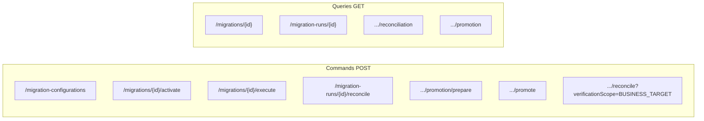

# ETP Migration — API guide

Base URL (local): `http://localhost:8082`  
API prefix: `/api/v1`  
OpenAPI: `/v3/api-docs` (enabled in the `dev` profile or with `ETP_MIGRATION_OPENAPI_ENABLED=true`)  
Error body: `ApiErrorResponse` — `timestamp`, `status`, `error`, `message`, `path`, optional `code`.

**POST** = command (may change state). **GET** = query (no create/prepare/promote).

Controllers: `CompositeMigrationConfigurationController`, `MigrationDefinitionController`, `MigrationSourceController`, `MigrationMappingController`, `MigrationExecutionController`, `MigrationRunController`, `PromotionController`.

Related: [USER_GUIDE.md](USER_GUIDE.md), [ARCHITECTURE.md](ARCHITECTURE.md), [migration-e2e-test-guide.md](migration-e2e-test-guide.md).

**Implementation status:** Only endpoints that exist on those controllers are listed. There is no `GET /api/v1/promotions/{promotionId}` and no `PUT`/`PATCH`/`DELETE` for definitions.

**Authentication:** Migration APIs require a Keycloak JWT unless Spring profile `dev` is active. See [Authentication and Swagger](#authentication-and-swagger).



---

## Conventions

| Item | Behavior |
|------|----------|
| UUIDs | Path variables, JSON string |
| Pagination | `page` default 0, `size` default 20, max 100 (`PagedResponse`) |
| 201 Location | Resource URL as documented per endpoint |
| JWT | Required on `/api/v1/**` except profile `dev`. Public: health; `/v3/api-docs/**` and Swagger UI only when OpenAPI is enabled (off by default outside `dev`). OpenAPI scheme **`bearer-jwt`**. No roles/scopes are enforced in this module. |

---

## A. Migration definition / configuration

### POST `/api/v1/migration-configurations`

**Purpose:** Create mapping + mapping rules + DRAFT definition + one source as **one logical configuration**. Does **not** activate, execute, reconcile, or promote.

**Transactional:** `CompositeMigrationConfigurationService.create` is `@Transactional`. Persist order:

1. mapping  
2. mapping rules  
3. definition (receives the new mapping id)  
4. source  

Promotion configuration remains inside **`definition.configuration.promotion`**. There is **no** separate promotion-create API.

**Body:** `definition`, `entityMappings` (JSON property `mapping`; alias `entityMappings`), `fieldMappings` (JSON property `rules`; alias `fieldMappings`), and `source`. The Java record names stay `mapping` and `rules`. Either name is accepted. Legacy clients that send `mapping` and `rules` remain valid.

`sourceType` does not choose single-entity versus entity-relationship. `MigrationModelRules.validate` reads the mapping configuration:

- No `modelType`: single-entity. `definition.targetEntity` is required. A blank value fails with `definition.targetEntity is required for a single-entity migration`.
- `modelType` `ENTITY_RELATIONSHIP`: `definition.targetEntity` may be omitted. `entityMappings.configuration.rootEntity` names the root. If `definition.targetEntity` is set, it may equal the root entity name, the root `targetEntity`, or a value that names neither another entity nor that entity's distinct `targetEntity` (a staging table name is an example of a non-contradicting value). A contradiction fails with `definition.targetEntity '<value>' contradicts root entity '<root>'`.

Entity objects accept `entity` or `name`. Both set to different values fails. `targetEntity` and `targetKey` are required. `sourceKey` may be JSON `null`, blank, or the literal string `null` (any case). Those are stored as no source key. They are not a column named `null`. `targetIdentity` is `PREFIX_SEQUENCE` (`prefix`, `sequenceLength`) or `PREFIX_SOURCE_VALUE` (`prefix` only).

Field mappings: `sequenceNo`, `entity`, `sourceField`, `targetField`, `transformationType`, optional `transformationExpression`, `defaultValue`, `mandatory`, `enabled`. An empty `configuration` object may be omitted. Rules for one entity run in `sequenceNo` order.

Relationships: `parent`, `child`, `cardinality` (`ONE_TO_ONE`, `ONE_TO_MANY`, `MANY_TO_ONE`; `MANY_TO_MANY` is rejected), optional `keys` (`parentField`, `childField`), and optional `targetForeignKey`. `targetForeignKey.column` is the child column. `targetForeignKey.referencesColumn` is the parent column that is copied. It is not assumed to be `id`. Identifiers match `[A-Za-z_][A-Za-z0-9_]*`. A relationship needs `keys` or `targetForeignKey`.

Canonical `definition.configuration` used by the UAM tests:

- `target.mode` `UAM`, `target.schema`, `target.stagingSchema`, `target.stagingTable`, `target.mergeStrategy` `NONE`
- `tables`: entity name → physical table
- `loadOrder`: optional. Omitted order is parent before child. A cycle is rejected. Independent names sort by name.
- `foreignKeys`: `{entity, parent, column}` writes the parent target identity. Add `referencesColumn` to copy that parent column instead.
- `loadTimestampColumns`: `{table, column}` fills a null or blank value during planning. A source timestamp already present is kept.
- `columnTypes`: still accepted. Planning converts only `numeric` and `timestamptz`. The live PostgreSQL load then converts from `information_schema`. See [ARCHITECTURE.md](ARCHITECTURE.md) §29.
- `promotion.enabled`

Filesystem source configuration: `provider` `FILE_SYSTEM`, `fileFormat` `CSV`, `objectKey`, `hasHeader`, `delimiter`. SFTP source configuration: `provider` `SFTP`, `fileFormat` `CSV`, `host`, `port`, `credentialRef`, `remotePath`, optional `hasHeader` and `delimiter`. Do not send `password`, `privateKey`, or `passphrase`.

The shape below is the fixture in `UamCanonicalLoadIntegrationTest`, shortened to one parent and one child. Names must be unique per call.

```json
{
  "definition": {
    "name": "uam-address",
    "version": "1",
    "sourceType": "FILE",
    "targetType": "POSTGRESQL",
    "targetEntity": "location",
    "batchSize": 1000,
    "loadMode": "BULK",
    "configuration": {
      "target": {
        "mode": "UAM",
        "schema": "uam",
        "stagingSchema": "migration_staging",
        "stagingTable": "uam_entity_stage",
        "mergeStrategy": "NONE"
      },
      "tables": {
        "AddressLocation": "location",
        "GeographicAddress": "geographic_address"
      },
      "foreignKeys": [
        {"entity": "GeographicAddress", "parent": "AddressLocation", "column": "location_id"}
      ],
      "loadTimestampColumns": [
        {"table": "location", "column": "created_at"}
      ],
      "columnTypes": [
        {"table": "location", "column": "created_at", "type": "timestamptz"}
      ],
      "promotion": {"enabled": true}
    }
  },
  "entityMappings": {
    "name": "uam-address-mapping",
    "version": "1",
    "sourceType": "FILE",
    "targetType": "UAM_POSTGRESQL",
    "configuration": {
      "modelType": "ENTITY_RELATIONSHIP",
      "rootEntity": "AddressLocation",
      "entities": [
        {
          "entity": "AddressLocation",
          "targetEntity": "location",
          "sourceKey": "address_id",
          "targetKey": "id",
          "targetIdentity": {"strategy": "PREFIX_SEQUENCE", "prefix": "LOC-", "sequenceLength": 9}
        },
        {
          "entity": "GeographicAddress",
          "targetEntity": "geographic_address",
          "sourceKey": "address_id",
          "targetKey": "id",
          "targetIdentity": {"strategy": "PREFIX_SEQUENCE", "prefix": "ADDR-", "sequenceLength": 10}
        }
      ],
      "relationships": [
        {
          "parent": "AddressLocation",
          "child": "GeographicAddress",
          "cardinality": "ONE_TO_ONE",
          "keys": [{"parentField": "address_id", "childField": "address_id"}],
          "targetForeignKey": {"column": "location_id", "referencesColumn": "id"}
        }
      ]
    }
  },
  "fieldMappings": [
    {"sequenceNo": 1, "entity": "AddressLocation", "targetField": "at_type", "transformationType": "DEFAULT", "defaultValue": "geographicAddress", "mandatory": true, "enabled": true},
    {"sequenceNo": 2, "entity": "GeographicAddress", "sourceField": "street_name", "targetField": "street_name", "transformationType": "DIRECT", "enabled": true}
  ],
  "source": {
    "name": "uam-address-source",
    "sourceType": "FILE",
    "enabled": true,
    "configuration": {
      "provider": "FILE_SYSTEM",
      "fileFormat": "CSV",
      "objectKey": "manual/addresses.csv",
      "hasHeader": true,
      "delimiter": ","
    }
  }
}
```

`definition.targetEntity` `location` matches the root entity's `targetEntity`, so it does not contradict `rootEntity` `AddressLocation`. The integration fixture's full entity list also includes `GeographicPointLocation`, `GeographicLocation`, `LocationGeometry`, and `GeographicSubAddress`. There is no `external_identifier` entity in that fixture.

**201:** `CompositeMigrationConfigurationResponse`  
**400:** validation / invalid promotion JSON  
**409:** unique name/version or rule sequence  

Location: `/api/v1/migrations/{definitionId}`

### POST `/api/v1/migrations`

**Purpose:** Create a **DRAFT definition only**. This remains the existing definition-only API. It does **not** create mapping, rules, or source.

**Body:** `CreateMigrationDefinitionRequest` — `name`, `version`, `sourceType`, `targetType` required; optional `description`, `targetEntity`, `mappingId`, `batchSize`, `loadMode`, `configuration`.

**201:** `MigrationDefinitionResponse`  
**400 / 409:** validation / duplicate / invalid mapping id  

Location: `/api/v1/migrations/{id}`

### GET `/api/v1/migrations`

**Query:** `page`, `size`  
**200:** `PagedResponse<MigrationDefinitionResponse>`

### GET `/api/v1/migrations/{id}`

**200:** `MigrationDefinitionResponse`  
**404:** unknown id  

Example:

```http
GET /api/v1/migrations/{migrationId}
```

Response fields: `id`, `name`, `version`, `description`, `sourceType`, `targetType`, `targetEntity`, `mappingId`, `batchSize`, `loadMode`, `status`, `configuration`, `createdAt`, `createdBy`, `updatedAt`, `updatedBy`.

### POST `/api/v1/migrations/{migrationId}/sources`

**Body:** `name`, `sourceType`, optional `configuration`, `enabled`.

**201:** `MigrationSourceResponse`  
**400 / 404**

`configuration` is stored and returned as submitted. For `provider=FILE_SYSTEM`, send `fileFormat=CSV` and `objectKey`. For `provider=SFTP`, send `fileFormat=CSV`, `host`, `port`, `credentialRef`, `remotePath`, and optional `hasHeader` and `delimiter`. Do not send `password`, `privateKey`, or `passphrase`. The API rejects those fields. The login is `etp.migration.source.sftp.credentials.<credentialRef>.username` and `.password` in application configuration. Source responses do not add a password. SFTP acquisition errors use `MIGRATION_SFTP_CONNECTION_FAILED`, `MIGRATION_SFTP_AUTHENTICATION_FAILED`, `MIGRATION_SFTP_FILE_NOT_FOUND`, `MIGRATION_SFTP_PERMISSION_DENIED`, `MIGRATION_SFTP_READ_FAILED`, `MIGRATION_SFTP_HOST_KEY_REJECTED`, `MIGRATION_SFTP_HOST_KEY_CONFIGURATION_INVALID`, and `MIGRATION_CSV_PARSE_FAILED`. The host key must be trusted through `etp.migration.source.sftp.known-hosts-file` or `etp.migration.source.sftp.credentials.<credentialRef>.host-key-fingerprints`; see the USER_GUIDE SFTP section. The message does not include a password, a private key, or a stack trace.

Location: `/api/v1/migrations/{migrationId}/sources/{sourceId}`

### GET `/api/v1/migrations/{migrationId}/sources`

**200:** paged sources **404:** definition missing

### GET `/api/v1/migrations/{migrationId}/sources/{sourceId}`

**200 / 404**

### POST `/api/v1/mappings`

**Body:** `CreateMigrationMappingRequest` — `name`, `version`, `sourceType`, `targetType` required; optional description/configuration.

**201:** `MigrationMappingResponse` (status DRAFT)  
Location: `/api/v1/mappings/{id}`

### GET `/api/v1/mappings` / GET `/api/v1/mappings/{id}`

List / get **without rules**. **404** on unknown id.

### POST `/api/v1/mappings/{mappingId}/rules`

**Body:** `sequenceNo`, `targetField`, `transformationType` required; optional `sourceField`, `transformationExpression`, `defaultValue`, `configuration`, `mandatory`, `enabled`.

**201:** `MigrationMappingRuleResponse`  
**409:** duplicate sequence  

Location: `/api/v1/mappings/{mappingId}/rules/{ruleId}`  
There is **no** GET-by-rule-id endpoint.

### GET `/api/v1/mappings/{mappingId}/rules`

Paged, ordered by `sequenceNo`. **404** if mapping missing.

---

## B. Activation

### POST `/api/v1/migrations/{migrationId}/activate`

**Purpose:** Lifecycle certification **DRAFT → ACTIVE**. Does **not** inspect the source file, create a run, or execute batches.

- DRAFT → ACTIVE after structural checks (mapping, ≥1 enabled rule, exactly one enabled source, connector `require()`, optional promotion JSON parse).
- ACTIVE → ACTIVE is **idempotent** (200, unchanged).
- **409** if status is neither DRAFT nor ACTIVE (e.g. INACTIVE).

Activation is **not** an environment security mechanism. Environment/release governance is outside this capability.

**200:** `MigrationDefinitionResponse`  
**400:** incomplete configuration  
**404:** missing definition  
**409:** not DRAFT/ACTIVE  

No request body.

---

## C. Execution

### POST `/api/v1/migrations/{migrationId}/execute`

**Purpose:** Synchronous execution facade. Does **not** activate, reconcile, or promote.

Orchestration in `MigrationExecutionService.execute` (same HTTP thread; **not** `@Async`, no scheduler, no Kafka):

1. create run (definition must be ACTIVE). Status is QUEUED.
2. source inspection / prepare (plan batches). A preparation failure records `migration_error` and sets that run FAILED.
3. mark the run RUNNING, then `processNextBatch` until no eligible batch remains
4. finalize the run when no batch is still in flight. An empty source completes as COMPLETED.
5. return the final `MigrationRunResponse`

`POST .../runs` does not do steps 2–4. That run remains QUEUED until prepare and process are called for it.

**Body:** optional `CreateMigrationRunRequest` (`idempotencyKey`, `sourceSnapshot`, `configurationSnapshot`). Empty/`{}` allowed.

**201:** final `MigrationRunResponse`  
Location: `/api/v1/migration-runs/{runId}`  
**404:** definition missing  
**409:** not ACTIVE (`DefinitionNotActiveException`)

### POST `/api/v1/migrations/{migrationId}/runs`

Create **QUEUED** run only (CREATED→QUEUED internally). Does not inspect or process.

**201 / 404 / 409** same as above. Idempotent on `idempotencyKey`.

### POST `/api/v1/migration-runs/{runId}/prepare`

Inspect source, persist metadata, create batches. Run must be QUEUED. A failure records an error and sets that unprepared run to FAILED.

**200:** `PrepareMigrationRunResponse` — `runId`, `status`, `sourceRecordCount`, `batchSize`, `batchCount`, `sourceChecksum`, `statusMessage`  
**404 / 409**

### POST `/api/v1/migration-runs/{runId}/process-next-batch`

Claim and process **one** batch. Not a scheduler.

**200:** `ProcessBatchResponse` — `runId`, `batchId`, `batchNumber`, `status`, `totalRecords`, `successRecords`, `failedRecords`, `rejectedRecords`  
**409:** no eligible batch  

### GET `/api/v1/migration-runs/{runId}/errors`

Paginated `migration_error` rows for the run, oldest first. `errorMessage` stays short. `errorDetails` is the stored JSON object (`errorCode`, `sqlState`, `exceptionType`, `message`, `rootCauseType`, `rootCauseMessage`, `phase`, `runId`, `batchId`, `targetEntity`, `retryable`, and PostgreSQL `relation` when the server reported one). Unknown fields are absent. Page defaults match the other list endpoints.

**200:** `content[]` of error rows, plus `page`, `size`, `totalElements`, `totalPages`  
**404:** run not found

### POST `/api/v1/migration-runs/{runId}/cancel`

Request cancellation; in-flight claimed batches are not deleted.

**200 / 409** (already terminal)

### POST `/api/v1/migration-runs/{runId}/retry`

Re-queue FAILED / COMPLETED_WITH_ERRORS batches.

**409** `MIGRATION_RETRY_BLOCKED_BY_PROMOTION` when a promotion for the run is `PROMOTING` or `PROMOTED`. Batches reprocessed after promotion would never be promoted. A `READY` (prepared, not executed) promotion does not block retry. Retry, promotion prepare and promote all lock the run row, so a retry racing a promote either waits and receives 409, or runs first; in that case the promote is rejected because the run is no longer complete.

**200 / 409**

---

## D. Run management (query + remaining commands)

### GET `/api/v1/migration-runs`

Paged runs across every definition. Query: `page` default 0, `size` default 20, maximum 100. A negative page is treated as 0. A size below 1 is treated as 20. A size above 100 is capped at 100. The same rules apply to `GET /api/v1/migrations`.

Order is `coalesce(startedAt, createdAt)` descending, then run id descending. A run that has not started is ordered by `createdAt`. Optional `migrationDefinitionId` limits the page to that definition and returns **404** when the definition does not exist. That filter keeps this order. `GET /api/v1/migrations/{migrationId}/runs` remains the definition-scoped list and still orders by `createdAt` descending. An empty history returns `content: []`, `totalElements: 0`, `totalPages: 0`.

**200:** `PagedResponse<MigrationRunResponse>`

### GET `/api/v1/migrations/{migrationId}/runs`

Paged runs for one definition, newest `createdAt` first. **404** if definition missing.

### GET `/api/v1/migration-runs/{runId}`

**200:** `MigrationRunResponse`  
**404:** unknown run  

Fields: `id`, `migrationDefinitionId`, `runNumber`, `idempotencyKey`, `status`, `startedAt`, `completedAt`, counters (`totalRecords`, `processedRecords`, `successRecords`, `duplicateRecords`, `validationFailures`, `enrichmentFailures`, `loadFailures`, `rejectedRecords`, `totalBatches`, `completedBatches`, `failedBatches`), `requestedBy`, `createdAt`, `updatedAt`.

### GET `/api/v1/migration-runs/{runId}/batches`

Paged `MigrationBatchResponse`.

---

## E. Reconciliation

### POST `/api/v1/migration-runs/{runId}/reconcile`

**Query:** `verificationScope` (optional).

| Scope | Request | Meaning |
|-------|---------|---------|
| **STAGING** (default) | Omit the query parameter | Compare source snapshot / run counters / staging table |
| **BUSINESS_TARGET** | `?verificationScope=BUSINESS_TARGET` | Compare **successfully promoted** batches to the promotion business table |

Does **not** change run or promotion status. Upserts COUNT, CHECKSUM, TARGET, FULL.

Staging checksum comparison to the staging table is **not** implemented (`comparisonPerformed: false`).

Business-target (PostgreSQL only): expected rows come from promotion batches in status `PROMOTED`; identity is `promotion.conflictKeys`; non-key `promotion.columns` are compared in SQL. Without `conflictKeys`, TARGET reports `MIGRATION_TARGET_IDENTITY_NOT_CONFIGURED`. Partial promotion reconciles only promoted batches.

**200:** `MigrationReconciliationResponse` — `runId`, overall `status`, `reconciliation` bundle (`count`, `checksum`, `target`, `full` as `ReconciliationItemResponse`)  
**404:** run missing  
**409:** active batches (`MIGRATION_RECONCILIATION_NOT_READY`)  
**400:** business-target on non-PostgreSQL (`MIGRATION_PROMOTION_UNSUPPORTED_TARGET`)  
**500:** unexpected / target infrastructure. A target-infrastructure 500 keeps its `code` (for example `MIGRATION_TARGET_DATABASE_CONNECTION_ERROR`), but its `message` is always `Target system operation failed (reference <uuid>)`. Operators can find the sanitized cause in the ERROR log line that carries the same `reference=`.  

### GET `/api/v1/migration-runs/{runId}/reconciliation`

**200** persisted bundle  
**404** run missing **or** no rows (`ReconciliationNotFoundException`: `Reconciliation not found for migration run {id}`)

---

## F. Promotion commands

### POST `/api/v1/migration-runs/{runId}/promotion/prepare`

**Body:** optional. `requestedBy` is accepted for compatibility but **ignored**; the stored `requestedBy` is the authenticated actor (token `sub`). A token that has no usable identity gets **403** `MIGRATION_AUDIT_IDENTITY_INVALID`.

**200:** `PreparePromotionResponse` — `promotionId`, `runId`, `status`, `totalBatches`, `eligibleBatches`, `skippedBatches`, `totalRecords`, `eligibleRecords`, `skippedRecords`, `batches[]` (`batchId`, `executionStatus`, `promotionStatus`, `eligibleRecordCount`, `skippedRecordCount`)

**400:** promotion missing/disabled/invalid, non-PostgreSQL  
**404:** run missing  
**409:** run not complete, active batches, no reconciliation, already PROMOTING  

Does not write business rows. Idempotent return of existing READY/PROMOTED.

Promotion statuses: `NOT_STARTED` (column default; prepare writes `READY`), `READY`, `PROMOTING`, `PROMOTED`, `PARTIALLY_PROMOTED`, `PROMOTION_FAILED`.

Promotion batch statuses: `NOT_ELIGIBLE`, `ELIGIBLE`, `PROMOTING`, `PROMOTED`, `FAILED`.

### POST `/api/v1/migration-runs/{runId}/promote`

No body. Requires READY (409 `MIGRATION_PROMOTION_NOT_READY` if none). Already **PROMOTED** returns the stored result without rewriting.

When definition `target.mode` is `UAM`, the call allocates mapping-level target identities and inserts the configured canonical tables in one transaction per eligible batch. A failure rolls that UAM transaction back. Stored identity allocations are reused on retry. `ON CONFLICT (id) DO NOTHING` leaves an existing primary key in place. Flat mode writes parameterized INSERT or UPSERT into `promotion.schema.table`. A failed flat batch does not roll back batches already committed (`PARTIALLY_PROMOTED` is possible). The completed local demonstration is [ARCHITECTURE.md](ARCHITECTURE.md) §28. It is not a production UAM deployment.

**200:** `ExecutePromotionResponse`  
**400 / 404 / 409** as annotated on `PromotionController`

---

## G. Promotion query

### GET `/api/v1/migration-runs/{runId}/promotion`

**Purpose:** Persisted promotion + batches. **Never** creates/prepares/promotes.

**200:** `ExecutePromotionResponse` — `promotionId`, `runId`, `status`, `totalBatches`, `eligibleBatches`, `promotedBatches`, `failedBatches`, `skippedBatches`, `totalRecords`, `promotedRecords`, `failedRecords`, `skippedRecords`, `batches[]` (`batchId`, `promotionStatus`, `eligibleRecordCount`, `promotedRecordCount`, `failedRecordCount`, `errorCode`, `errorMessage`)

**404:** `Migration run not found: {id}` or `Promotion not found for migration run {id}`

Latest promotion if multiple (`created_at` desc).

**Not implemented:** `GET /api/v1/promotions/{promotionId}`, `GET /api/v1/promotions/{id}/batches`.

---

## H. Health / OpenAPI

| Method | Path | Auth |
|--------|------|------|
| GET | `/actuator/health` | permitAll |
| GET | `/actuator/health/**` | permitAll (probes) |
| GET | `/v3/api-docs` and `/v3/api-docs/**` | permitAll when `ETP_MIGRATION_OPENAPI_ENABLED=true` (default in `dev`); otherwise JWT required and 404 |
| GET | `/swagger-ui/**`, `/swagger-ui.html` | Same as above |

Actuator exposure is **health only**. Migration APIs are **not** public.

---

## Authentication and Swagger

| Item | Behavior |
|------|----------|
| Identity provider | Keycloak / ETP IAM (`ETP_MIGRATION_KEYCLOAK_ISSUER_URI`). This capability does **not** issue tokens. |
| Spring Security | OAuth2 resource server JWT. Unauthenticated protected APIs return **401**. |
| Audience | Not checked unless `ETP_MIGRATION_JWT_AUDIENCES` is set (comma-separated). When set, a token without one of those values in `aud` returns **401** `invalid_token`. |
| OpenAPI scheme | `components.securitySchemes.bearer-jwt` — HTTP `bearer`, `bearerFormat=JWT`. |
| Operation security | Document-level and per-operation `security` include `bearer-jwt`, so Swagger Authorize attaches the header. |
| Swagger UI | Open `/swagger-ui/index.html` → Authorize → paste a Keycloak access token → Execute. |
| Expected request header | `Authorization: Bearer <JWT>` |
| Expected curl | `-H 'Authorization: Bearer <JWT>'` |
| Roles / scopes | **Not implemented** in this module. |

Profile `dev` permits `/api/v1/migrations/**`, `/migration-configurations/**`, `/mappings/**`, `/migration-runs/**` without JWT. That profile is local convenience, not production security.

---

## Example: execute

```http
POST /api/v1/migrations/{migrationId}/execute
Content-Type: application/json
Authorization: Bearer <JWT>

{}
```

**201** (field subset; counters depend on the source file):

```json
{
  "runNumber": 1,
  "status": "COMPLETED_WITH_ERRORS",
  "successRecords": 7,
  "validationFailures": 1,
  "totalBatches": 3,
  "completedBatches": 3,
  "failedBatches": 0
}
```

The local 8-row address demo uses `batchSize` 3 and expects this status. Identifiers (`id`, `migrationDefinitionId`) are created per instance — do not treat sample UUIDs as fixtures.

---

## Example: GET promotion

```http
GET /api/v1/migration-runs/{runId}/promotion
Authorization: Bearer <JWT>
```

See [USER_GUIDE.md](USER_GUIDE.md) for response field names on `ExecutePromotionResponse`.

---

## Status names (APIs)

Use these exact enums: definition `DRAFT`/`ACTIVE`/`INACTIVE`; run `QUEUED`/`RUNNING`/`COMPLETED`/`COMPLETED_WITH_ERRORS`/`FAILED`/…; promotion `NOT_STARTED`/`READY`/`PROMOTING`/`PROMOTED`/`PARTIALLY_PROMOTED`/`PROMOTION_FAILED`; promotion batch `NOT_ELIGIBLE`/`ELIGIBLE`/`PROMOTING`/`PROMOTED`/`FAILED`; reconciliation `PASSED`/`PASSED_WITH_WARNINGS`/`FAILED`.
