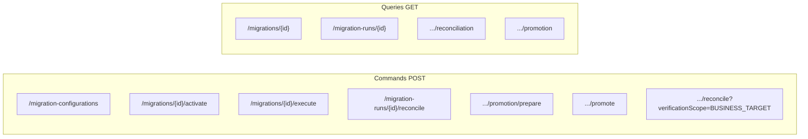

# ETP Migration — API guide

Base URL (local): `http://localhost:8082`  
API prefix: `/api/v1`  
OpenAPI: `/v3/api-docs`  
Error body: `ApiErrorResponse` — `timestamp`, `status`, `error`, `message`, `path`, optional `code`.

**POST** = command (may change state). **GET** = query (no create/prepare/promote).

Controllers: `CompositeMigrationConfigurationController`, `MigrationDefinitionController`, `MigrationSourceController`, `MigrationMappingController`, `MigrationExecutionController`, `MigrationRunController`, `PromotionController`.

Related: [USER_GUIDE.md](USER_GUIDE.md), [ARCHITECTURE.md](ARCHITECTURE.md).

**Implementation status:** Only endpoints that exist on those controllers are listed. There is no `GET /api/v1/promotions/{promotionId}` and no `PUT`/`PATCH`/`DELETE` for definitions.

**Authentication:** Migration APIs require a Keycloak JWT unless Spring profile `dev` is active. See [Authentication and Swagger](#authentication-and-swagger).



---

## Conventions

| Item | Behavior |
|------|----------|
| UUIDs | Path variables, JSON string |
| Pagination | `page` default 0, `size` default 20, max 100 (`PagedResponse`) |
| 201 Location | Resource URL as documented per endpoint |
| JWT | Required on `/api/v1/**` except profile `dev`. Public: health, `/v3/api-docs/**`, Swagger UI. OpenAPI scheme **`bearer-jwt`**. No roles/scopes are enforced in this module. |

---

## A. Migration definition / configuration

### POST `/api/v1/migration-configurations`

**Purpose:** Create mapping + mapping rules + DRAFT definition + one source as **one logical configuration**. Does **not** activate, execute, reconcile, or promote.

**Transactional:** `CompositeMigrationConfigurationService.create` is `@Transactional`. Persist order:

1. mapping  
2. mapping rules  
3. definition (receives the new mapping id)  
4. source  

Promotion configuration remains inside **`definition.configuration.promotion`**. There is **no** separate promotion-create API.

**Body:** `CompositeMigrationConfigurationRequest` — `definition` (`CompositeDefinitionRequest`), `mapping` (`CreateMigrationMappingRequest`), `rules` (non-empty `CreateMappingRuleRequest` list), `source` (`CreateMigrationSourceRequest`).

**201:** `CompositeMigrationConfigurationResponse`  
**400:** validation / invalid promotion JSON  
**409:** unique name/version or rule sequence  

Location: `/api/v1/migrations/{definitionId}`

### POST `/api/v1/migrations`

**Purpose:** Create a **DRAFT definition only**. This remains the existing definition-only API. It does **not** create mapping, rules, or source.

**Body:** `CreateMigrationDefinitionRequest` — `name`, `version`, `sourceType`, `targetType` required; optional `description`, `targetEntity`, `mappingId`, `batchSize`, `loadMode`, `configuration`.

**201:** `MigrationDefinitionResponse`  
**400 / 409:** validation / duplicate / invalid mapping id  

Location: `/api/v1/migrations/{id}`

### GET `/api/v1/migrations`

**Query:** `page`, `size`  
**200:** `PagedResponse<MigrationDefinitionResponse>`

### GET `/api/v1/migrations/{id}`

**200:** `MigrationDefinitionResponse`  
**404:** unknown id  

Example:

```http
GET /api/v1/migrations/{migrationId}
```

Response fields: `id`, `name`, `version`, `description`, `sourceType`, `targetType`, `targetEntity`, `mappingId`, `batchSize`, `loadMode`, `status`, `configuration`, `createdAt`, `createdBy`, `updatedAt`, `updatedBy`.

### POST `/api/v1/migrations/{migrationId}/sources`

**Body:** `name`, `sourceType`, optional `configuration`, `enabled`.

**201:** `MigrationSourceResponse`  
**400 / 404**

Location: `/api/v1/migrations/{migrationId}/sources/{sourceId}`

### GET `/api/v1/migrations/{migrationId}/sources`

**200:** paged sources **404:** definition missing

### GET `/api/v1/migrations/{migrationId}/sources/{sourceId}`

**200 / 404**

### POST `/api/v1/mappings`

**Body:** `CreateMigrationMappingRequest` — `name`, `version`, `sourceType`, `targetType` required; optional description/configuration.

**201:** `MigrationMappingResponse` (status DRAFT)  
Location: `/api/v1/mappings/{id}`

### GET `/api/v1/mappings` / GET `/api/v1/mappings/{id}`

List / get **without rules**. **404** on unknown id.

### POST `/api/v1/mappings/{mappingId}/rules`

**Body:** `sequenceNo`, `targetField`, `transformationType` required; optional `sourceField`, `transformationExpression`, `defaultValue`, `configuration`, `mandatory`, `enabled`.

**201:** `MigrationMappingRuleResponse`  
**409:** duplicate sequence  

Location: `/api/v1/mappings/{mappingId}/rules/{ruleId}`  
There is **no** GET-by-rule-id endpoint.

### GET `/api/v1/mappings/{mappingId}/rules`

Paged, ordered by `sequenceNo`. **404** if mapping missing.

---

## B. Activation

### POST `/api/v1/migrations/{migrationId}/activate`

**Purpose:** Lifecycle certification **DRAFT → ACTIVE**. Does **not** inspect the source file, create a run, or execute batches.

- DRAFT → ACTIVE after structural checks (mapping, ≥1 enabled rule, exactly one enabled source, connector `require()`, optional promotion JSON parse).
- ACTIVE → ACTIVE is **idempotent** (200, unchanged).
- **409** if status is neither DRAFT nor ACTIVE (e.g. INACTIVE).

Activation is **not** an environment security mechanism. Environment/release governance is outside this capability.

**200:** `MigrationDefinitionResponse`  
**400:** incomplete configuration  
**404:** missing definition  
**409:** not DRAFT/ACTIVE  

No request body.

---

## C. Execution

### POST `/api/v1/migrations/{migrationId}/execute`

**Purpose:** Synchronous execution facade. Does **not** activate, reconcile, or promote.

Orchestration in `MigrationExecutionService.execute` (same HTTP thread; **not** `@Async`, no scheduler, no Kafka):

1. create run (definition must be ACTIVE)  
2. source inspection / prepare (plan batches)  
3. `processNextBatch` until no eligible batch remains  
4. return the final `MigrationRunResponse`

**Body:** optional `CreateMigrationRunRequest` (`idempotencyKey`, `sourceSnapshot`, `configurationSnapshot`). Empty/`{}` allowed.

**201:** final `MigrationRunResponse`  
Location: `/api/v1/migration-runs/{runId}`  
**404:** definition missing  
**409:** not ACTIVE (`DefinitionNotActiveException`)

### POST `/api/v1/migrations/{migrationId}/runs`

Create **QUEUED** run only (CREATED→QUEUED internally). Does not inspect or process.

**201 / 404 / 409** same as above. Idempotent on `idempotencyKey`.

### POST `/api/v1/migration-runs/{runId}/prepare`

Inspect source, persist metadata, create batches. Run must be QUEUED.

**200:** `PrepareMigrationRunResponse` — `runId`, `status`, `sourceRecordCount`, `batchSize`, `batchCount`, `sourceChecksum`, `statusMessage`  
**404 / 409**

### POST `/api/v1/migration-runs/{runId}/process-next-batch`

Claim and process **one** batch. Not a scheduler.

**200:** `ProcessBatchResponse` — `runId`, `batchId`, `batchNumber`, `status`, `totalRecords`, `successRecords`, `failedRecords`, `rejectedRecords`  
**409:** no eligible batch  

### POST `/api/v1/migration-runs/{runId}/cancel`

Request cancellation; in-flight claimed batches are not deleted.

**200 / 409** (already terminal)

### POST `/api/v1/migration-runs/{runId}/retry`

Re-queue FAILED / COMPLETED_WITH_ERRORS batches.

**200 / 409**

---

## D. Run management (query + remaining commands)

### GET `/api/v1/migrations/{migrationId}/runs`

Paged runs, newest first. **404** if definition missing.

### GET `/api/v1/migration-runs/{runId}`

**200:** `MigrationRunResponse`  
**404:** unknown run  

Fields: `id`, `migrationDefinitionId`, `runNumber`, `idempotencyKey`, `status`, `startedAt`, `completedAt`, counters (`totalRecords`, `processedRecords`, `successRecords`, `duplicateRecords`, `validationFailures`, `enrichmentFailures`, `loadFailures`, `rejectedRecords`, `totalBatches`, `completedBatches`, `failedBatches`), `requestedBy`, `createdAt`, `updatedAt`.

### GET `/api/v1/migration-runs/{runId}/batches`

Paged `MigrationBatchResponse`.

---

## E. Reconciliation

### POST `/api/v1/migration-runs/{runId}/reconcile`

**Query:** `verificationScope` (optional).

| Scope | Request | Meaning |
|-------|---------|---------|
| **STAGING** (default) | Omit the query parameter | Compare source snapshot / run counters / staging table |
| **BUSINESS_TARGET** | `?verificationScope=BUSINESS_TARGET` | Compare **successfully promoted** batches to the promotion business table |

Does **not** change run or promotion status. Upserts COUNT, CHECKSUM, TARGET, FULL.

Staging checksum comparison to the staging table is **not** implemented (`comparisonPerformed: false`).

Business-target (PostgreSQL only): expected rows come from promotion batches in status `PROMOTED`; identity is `promotion.conflictKeys`; non-key `promotion.columns` are compared in SQL. Without `conflictKeys`, TARGET reports `MIGRATION_TARGET_IDENTITY_NOT_CONFIGURED`. Partial promotion reconciles only promoted batches.

**200:** `MigrationReconciliationResponse` — `runId`, overall `status`, `reconciliation` bundle (`count`, `checksum`, `target`, `full` as `ReconciliationItemResponse`)  
**404:** run missing  
**409:** active batches (`MIGRATION_RECONCILIATION_NOT_READY`)  
**400:** business-target on non-PostgreSQL (`MIGRATION_PROMOTION_UNSUPPORTED_TARGET`)  
**500:** unexpected / target infrastructure  

### GET `/api/v1/migration-runs/{runId}/reconciliation`

**200** persisted bundle  
**404** run missing **or** no rows (`ReconciliationNotFoundException`: `Reconciliation not found for migration run {id}`)

---

## F. Promotion commands

### POST `/api/v1/migration-runs/{runId}/promotion/prepare`

**Body:** optional `{ "requestedBy": "..." }`

**200:** `PreparePromotionResponse` — `promotionId`, `runId`, `status`, `totalBatches`, `eligibleBatches`, `skippedBatches`, `totalRecords`, `eligibleRecords`, `skippedRecords`, `batches[]` (`batchId`, `executionStatus`, `promotionStatus`, `eligibleRecordCount`, `skippedRecordCount`)

**400:** promotion missing/disabled/invalid, non-PostgreSQL  
**404:** run missing  
**409:** run not complete, active batches, no reconciliation, already PROMOTING  

Does not write business rows. Idempotent return of existing READY/PROMOTED.

Promotion statuses: `NOT_STARTED` (column default; prepare writes `READY`), `READY`, `PROMOTING`, `PROMOTED`, `PARTIALLY_PROMOTED`, `PROMOTION_FAILED`.

Promotion batch statuses: `NOT_ELIGIBLE`, `ELIGIBLE`, `PROMOTING`, `PROMOTED`, `FAILED`.

### POST `/api/v1/migration-runs/{runId}/promote`

No body. Requires READY (409 `MIGRATION_PROMOTION_NOT_READY` if none). Already **PROMOTED** returns the stored result without rewriting.

Writes parameterized INSERT or UPSERT into `promotion.schema.table`. Each ELIGIBLE batch is independently transactional; a failed batch does not roll back batches already committed (`PARTIALLY_PROMOTED` is possible). UPSERT is retry-safe when `conflictKeys` match target identity. INSERT is not inherently idempotent.

**200:** `ExecutePromotionResponse`  
**400 / 404 / 409** as annotated on `PromotionController`

---

## G. Promotion query

### GET `/api/v1/migration-runs/{runId}/promotion`

**Purpose:** Persisted promotion + batches. **Never** creates/prepares/promotes.

**200:** `ExecutePromotionResponse` — `promotionId`, `runId`, `status`, `totalBatches`, `eligibleBatches`, `promotedBatches`, `failedBatches`, `skippedBatches`, `totalRecords`, `promotedRecords`, `failedRecords`, `skippedRecords`, `batches[]` (`batchId`, `promotionStatus`, `eligibleRecordCount`, `promotedRecordCount`, `failedRecordCount`, `errorCode`, `errorMessage`)

**404:** `Migration run not found: {id}` or `Promotion not found for migration run {id}`

Latest promotion if multiple (`created_at` desc).

**Not implemented:** `GET /api/v1/promotions/{promotionId}`, `GET /api/v1/promotions/{id}/batches`.

---

## H. Health / OpenAPI

| Method | Path | Auth |
|--------|------|------|
| GET | `/actuator/health` | permitAll |
| GET | `/actuator/health/**` | permitAll (probes) |
| GET | `/v3/api-docs` and `/v3/api-docs/**` | permitAll |
| GET | `/swagger-ui/**`, `/swagger-ui.html` | permitAll |

Actuator exposure is **health only**. Migration APIs are **not** public.

---

## Authentication and Swagger

| Item | Behavior |
|------|----------|
| Identity provider | Keycloak / ETP IAM (`ETP_MIGRATION_KEYCLOAK_ISSUER_URI`). This capability does **not** issue tokens. |
| Spring Security | OAuth2 resource server JWT. Unauthenticated protected APIs return **401**. |
| OpenAPI scheme | `components.securitySchemes.bearer-jwt` — HTTP `bearer`, `bearerFormat=JWT`. |
| Operation security | Document-level and per-operation `security` include `bearer-jwt`, so Swagger Authorize attaches the header. |
| Swagger UI | Open `/swagger-ui/index.html` → Authorize → paste a Keycloak access token → Execute. |
| Expected request header | `Authorization: Bearer <JWT>` |
| Expected curl | `-H 'Authorization: Bearer <JWT>'` |
| Roles / scopes | **Not implemented** in this module. |

Profile `dev` permits `/api/v1/migrations/**`, `/migration-configurations/**`, `/mappings/**`, `/migration-runs/**` without JWT. That profile is local convenience, not production security.

---

## Example: execute

```http
POST /api/v1/migrations/{migrationId}/execute
Content-Type: application/json
Authorization: Bearer <JWT>

{}
```

**201** (field subset; counters depend on the source file):

```json
{
  "runNumber": 1,
  "status": "COMPLETED_WITH_ERRORS",
  "successRecords": 7,
  "validationFailures": 1,
  "totalBatches": 3,
  "completedBatches": 3,
  "failedBatches": 0
}
```

The local 8-row address demo uses `batchSize` 3 and expects this status. Identifiers (`id`, `migrationDefinitionId`) are created per instance — do not treat sample UUIDs as fixtures.

---

## Example: GET promotion

```http
GET /api/v1/migration-runs/{runId}/promotion
Authorization: Bearer <JWT>
```

See [USER_GUIDE.md](USER_GUIDE.md) for response field names on `ExecutePromotionResponse`.

---

## Status names (APIs)

Use these exact enums: definition `DRAFT`/`ACTIVE`/`INACTIVE`; run `QUEUED`/`RUNNING`/`COMPLETED`/`COMPLETED_WITH_ERRORS`/`FAILED`/…; promotion `NOT_STARTED`/`READY`/`PROMOTING`/`PROMOTED`/`PARTIALLY_PROMOTED`/`PROMOTION_FAILED`; promotion batch `NOT_ELIGIBLE`/`ELIGIBLE`/`PROMOTING`/`PROMOTED`/`FAILED`; reconciliation `PASSED`/`PASSED_WITH_WARNINGS`/`FAILED`.
