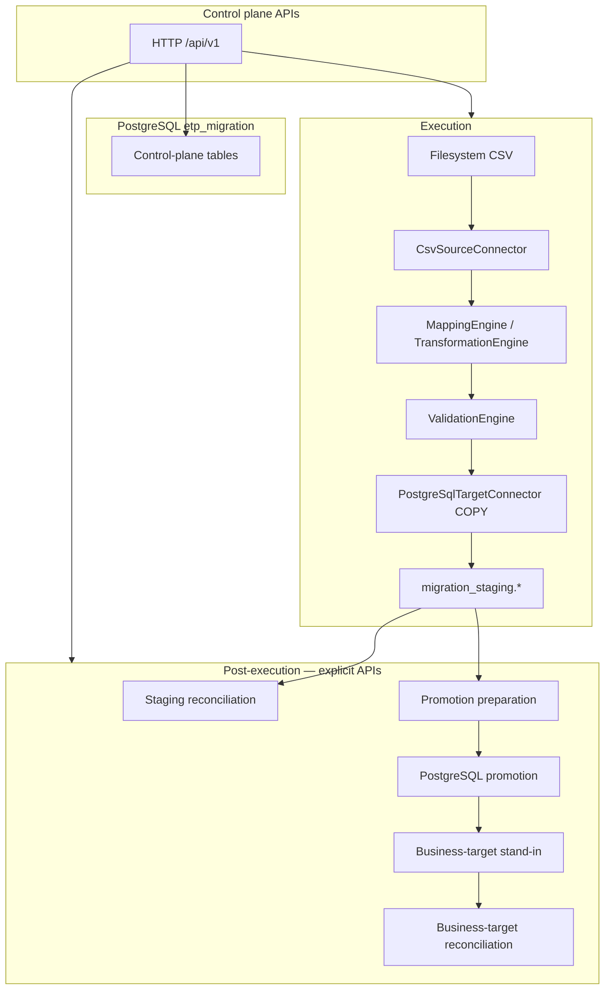
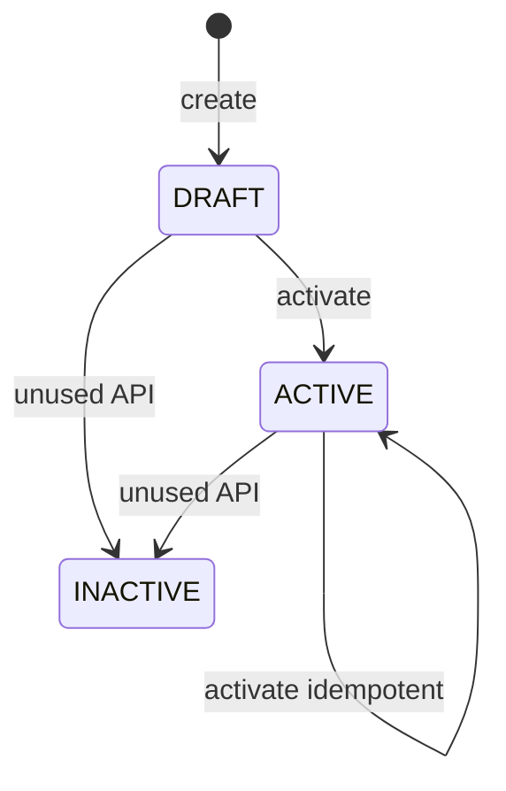
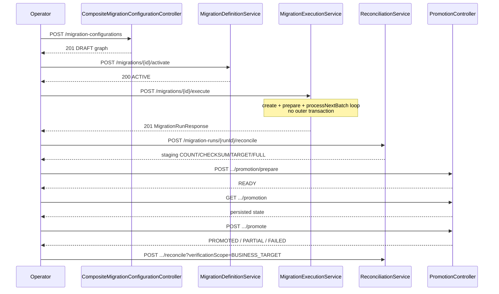

# ETP Migration Capability — Architecture

**Module:** `capabilities/etp-migration` (`com.etp:etp-migration:0.0.1-SNAPSHOT`)  
**Implementation status:** Current as of Flyway **V2**, Spring Boot **4.1.0**, Java **21**, Phase 12–14C plus OpenAPI JWT attachment and Testcontainers integration-test isolation.  
**Related docs:** [DATABASE_MODEL.md](DATABASE_MODEL.md), [USER_GUIDE.md](USER_GUIDE.md), [API_GUIDE.md](API_GUIDE.md), [BENCHMARK_TESTING.md](BENCHMARK_TESTING.md), [CLAUDE_CONTEXT.md](CLAUDE_CONTEXT.md)

This document describes the **implemented** architecture. Items that exist only as schema placeholders, unused enums, or extension points are labeled **not implemented**.

---

## 1. Overview

ETP Migration is a reusable Spring Boot capability that moves records from a configured source into a **PostgreSQL staging table**, then (when configured and invoked) **promotes** staged rows into a separate PostgreSQL business table. Operators drive the work through HTTP APIs. There is no GUI, Kafka consumer, or background scheduler in this module.

**Problem it solves (current scope):** repeatable, metadata-driven file-to-PostgreSQL migrations with batch restart, record-level validation errors, explicit reconciliation, and explicit promotion.

**Architectural goals that the code actually follows:**

- Configuration persisted on definitions/sources/mappings (JSONB), not hard-coded per customer application.
- Cloud-agnostic *design*: storage and target types are selected from configuration. **Implemented storage is local filesystem only.** Object stores listed in the schema (`MINIO`, `S3`, `AZURE_BLOB`, `GCS`) throw `UnsupportedStorageProviderException` if selected.
- Generic engine: no UAM domain services in the promotion/staging path. A placeholder REST connector exists for `targetType=UAM` (SINGLE HTTP POST). The local demo business table (`uam_migration_test.address`) is a **simulated** PostgreSQL table, not the UAM product.
- Staging load is not the same as writing the application table. `COMPLETED` / `COMPLETED_WITH_ERRORS` mean **staging** finished.
- Reconciliation and promotion are **user-invoked**, not automatic after execute.

---

## 2. Purpose and scope

### What the capability does

- Persist mapping rules, sources, and a migration definition (DRAFT, then optionally ACTIVE).
- Create a run against an **ACTIVE** definition, inspect a filesystem CSV, plan batches, claim one batch at a time, transform/validate, COPY into staging.
- Reconcile source vs processing vs staging (default) or vs promoted business rows (`verificationScope=BUSINESS_TARGET`).
- Prepare and execute PostgreSQL INSERT/UPSERT promotion from staging, then query promotion state.

### What it does not do

- Enrichment pipeline (counters exist; no enrichment engine).
- Deduplication engine (`DEDUPLICATE` is a `MigrationStage` check constraint value only).
- Record-level lineage for every success (`migration_record` table exists; workers do not populate it).
- Kafka, Spark, Airflow, Redis, Kubernetes operators, or a scheduler.
- GUI.
- Automatic promotion or automatic reconciliation after execute.
- Production UAM application integration (no UAM OpenAPI in this repo; REST adapter is a placeholder).
- Proven 10M/30M production capacity (see [BENCHMARK_TESTING.md](BENCHMARK_TESTING.md)).

### Current implementation boundaries

| Area | Implemented | Not implemented / unused |
|------|-------------|---------------------------|
| Source | Filesystem CSV via `CsvSourceConnector` (`provider=FILE_SYSTEM`, `fileFormat=CSV`) | SFTP, S3, other formats/providers |
| Staging target | PostgreSQL `COPY` (`PostgreSqlTargetConnector`, `LoadMode.BULK`) | PostgreSQL SINGLE/BATCH load modes |
| REST target | `UamTargetConnector`, `LoadMode.SINGLE` only (HTTP placeholder) | Production UAM-specific connector; BATCH/BULK UAM APIs |
| Promotion | Configuration-driven PostgreSQL INSERT/UPSERT (`PostgreSqlPromotionWriter`) | Promotion for UAM REST |
| Activation | DRAFT → ACTIVE; ACTIVE → ACTIVE idempotent | INACTIVE transition API; environment/PROD checks in this capability |
| Execute facade | **Synchronous** create → inspect/prepare → loop `processNextBatch` | Scheduler, Kafka trigger, `@Async` / background worker |
| Composite config | `POST /migration-configurations` (`@Transactional`) | Separate promotion-create API |
| Security | JWT resource server; OpenAPI `bearer-jwt` scheme **and** operation `SecurityRequirement` | Role/scope/`@PreAuthorize` model |
| Integration tests | Shared PostgreSQL 17 Testcontainer `etp_migration_test` | Writing to the developer demo database |

---

## 3. Key architectural concepts

| Concept | Persistence | Role |
|---------|-------------|------|
| **Migration definition** | `migration_definition` | Named/versioned recipe: `sourceType`, `targetType`, `mapping_id`, `batch_size`, `load_mode`, JSON `configuration`, status DRAFT/ACTIVE/INACTIVE. |
| **Migration mapping** | `migration_mapping` | Reusable source-to-target mapping metadata (also DRAFT/ACTIVE/INACTIVE). Execution loads **enabled rules** by mapping id; mapping status need not be ACTIVE. |
| **Mapping rules** | `migration_mapping_rule` | Ordered (`sequence_no`) field transforms. |
| **Migration source** | `migration_source` | Per-definition source JSON (`provider`, `fileFormat`, `objectKey`, …). `sourceType` is a **free-form string**, not a Java enum. |
| **Migration run** | `migration_run` | One execution. Snapshots, counters, status. Completing a run does **not** promote. |
| **Migration batch** | `migration_batch` | Restartable slice with `source_locator` JSON (CSV row range). Claimed with `FOR UPDATE SKIP LOCKED`. |
| **Migration artifact** | `migration_artifact` | Metadata for stored files. Prepare can persist source artifact metadata. Large payloads are **not** in PostgreSQL. |
| **Migration error** | `migration_error` | Record/batch errors flushed by the worker. |
| **Reconciliation** | `migration_reconciliation` | One row per `(run_id, reconciliation_type)`: COUNT, CHECKSUM, TARGET, FULL. |
| **Promotion** | `migration_promotion` | Separate lifecycle from the run. |
| **Promotion batch** | `migration_promotion_batch` | Eligibility and promote outcome per execution batch. |
| **Source connector** | Java SPI-style beans | `MigrationSourceConnector.supports(MigrationSource)` then inspect/read. |
| **Target connector** | Registry by `targetType` string | Staging load (PostgreSQL COPY or UAM REST). |
| **Transformation** | `TransformationEngine` | Applied in `sequence_no` order. |
| **Validation** | `ValidationEngine` | Mandatory target fields non-blank after transform. |
| **Staging** | Operator-created table, not Flyway | JSONB `target_payload` plus run/batch/record keys. |
| **Business-target promotion** | Config `configuration.promotion` | Writes configured schema.table via `PostgreSqlPromotionWriter`. |

---

## 4. High-level architecture



**Three planes (implemented):**

| Plane | What lives there | Examples |
|-------|------------------|----------|
| **Control plane** | Capability PostgreSQL `etp_migration` + HTTP APIs | Definition, mapping, rules, source, run, batch, artifact metadata, error, reconciliation, promotion, promotion batch |
| **Migration execution / data plane** | Source I/O, transform/validate, staging COPY | Filesystem CSV → `migration_staging.address_load` |
| **Business target** | Application table named in `configuration.promotion` | Local demo stand-in `uam_migration_test.address` — **not** production UAM |

Control-plane data lives in the capability database. Staging and business tables are **not** created by Flyway; they are named in definition JSON and must exist on the PostgreSQL target datasource (`etp.migration.target.postgresql.*`).

### Staging-first model

```text
Source (CSV)
  → migration_staging.<stagingTable>     (execute / COPY)
  → staging reconciliation               (explicit POST)
  → optional promotion prepare/execute   (explicit POSTs)
  → business target table                (INSERT/UPSERT)
  → business-target reconciliation       (explicit POST, optional)
```

`COMPLETED` / `COMPLETED_WITH_ERRORS` mean **staging** finished. They do **not** mean the business table was written.

### End-to-end execution flow (implemented)

```text
Migration configuration
  → Source inspection
  → Batch planning
  → Batch claim (SKIP LOCKED)
  → Source read
  → Mapping / transformation
  → Validation
  → Target staging (PostgreSQL COPY)
  → Reconciliation (default STAGING)
  → Promotion preparation
  → Business-target promotion
  → Business-target reconciliation (verificationScope=BUSINESS_TARGET)
```

Reconciliation and promotion are **not** started by execute. There is no scheduler, Kafka consumer, or `@Async` worker looping batches in the background.

---

## 5. Component architecture

Package roots under `com.etp.migration`:

| Package | Responsibility |
|---------|----------------|
| `migration` | Definitions, sources, composite configuration (`CompositeMigrationConfigurationService`), activation. |
| `transformation` | Mapping CRUD, `MappingEngine`, `TransformationEngine`. |
| `validation` | Mandatory-field checks. |
| `run` | Run CRUD, cancel/retry, `MigrationExecutionService` facade. |
| `processing` | `SourceInspectionService`, `MigrationBatchWorker`, `MigrationRecordProcessor`. |
| `batch` | `RecordCountBatchPlanner`, `MigrationBatchQueueService` (SKIP LOCKED claim), transitions. |
| `connector.source` | Registry + CSV filesystem connector. |
| `connector.storage` | `FileSystemArtifactStorage` / `DefaultArtifactStorage`. |
| `connector.target` | PostgreSQL staging, promotion writer, business verifier; UAM REST placeholder. |
| `reconciliation` | Engine + service; staging vs business scope. |
| `promotion` | Prepare, execute, read-only query. |
| `repository` | Spring Data JPA. |
| `entity` | JPA model aligned with Flyway. |
| `config` | Security, JWT, worker identity, exception handler. |
| `openapi` | Springdoc info + `bearer-jwt` scheme and operation `SecurityRequirement`. |
| `performance` | Offline CSV generator and benchmark helpers (not started with the app). |

`enrichment/` contains only a placeholder (`.gitkeep`). No enrichment service.

---

## 6. Execution architecture

### Lifecycle (implemented)

1. **Configuration** — composite `POST /api/v1/migration-configurations` (`@Transactional`: mapping → mapping rules → definition → source) or stepwise mapping/definition/source APIs. Status **DRAFT**. Promotion stays in `definition.configuration.promotion` (no separate promotion-create API).
2. **Activation** — `POST /api/v1/migrations/{id}/activate`. Validates mapping rules, one enabled source, connector `require()`, optional promotion JSON via `PromotionTargetConfiguration.parse`. **Does not inspect the file or run I/O beyond registry validation.** Idempotent if already ACTIVE. INACTIVE cannot be activated (409).
3. **Execute** — `POST /api/v1/migrations/{id}/execute` (`MigrationExecutionService`):
   - `MigrationRunService.create` (definition must be ACTIVE → 409 `DefinitionNotActiveException` otherwise). Run goes CREATED → **QUEUED** in the same create method.
   - `SourceInspectionService.prepare` (inspect CSV, persist checksum/count, plan batches).
   - Loop `MigrationBatchWorker.processNextBatch(runId)` until none remain.
   - Return `GET`-equivalent `MigrationRunResponse`.
4. **Not** wrapped in one `@Transactional`. Each claim/complete uses short transactions; COPY uses its own JDBC transaction on the **target** datasource.

### Per-batch processing (`MigrationBatchWorker`)

1. Claim (`FOR UPDATE OF b SKIP LOCKED`) for `PENDING` / `RETRY_PENDING` or expired `CLAIMED`/`PROCESSING` lease.
2. Mark PROCESSING; increment attempt.
3. Resolve source via `MigrationSourceConnectorRegistry.require` (`supports()` on configuration, not a `sourceType` enum).
4. Hash **entire source file** (`ArtifactChecksumCalculator`) per batch; fail if changed (`SOURCE_CHANGED`).
5. `CsvSourceConnector.readBatch` for locator row range.
6. Load enabled mapping rules ordered by `sequence_no`.
7. `MigrationRecordProcessor`: transform then validate.
8. Target `load()` for successful records only (PostgreSQL COPY after DELETE of that run+batch).
9. Flush errors; complete batch; roll run counters; evaluate run COMPLETED / COMPLETED_WITH_ERRORS / FAILED.

### Transaction boundaries

- Control-plane claim/complete: Spring `TransactionTemplate` / `@Transactional` on queue service.
- Staging COPY: JDBC `setAutoCommit(false)` on target pool; DELETE + COPY + commit; rollback on failure.
- Execute facade: **no** outer transaction (source I/O and COPY must not hold a control-plane TX for the whole file).
- Promotion: begin TX (READY → PROMOTING), each batch write on target, then complete TX aggregating statuses.

### Failure handling

- Validation failures: record errors, batch `COMPLETED_WITH_ERRORS` if some rows succeeded.
- Transformation exceptions: record REJECTED / transform stage.
- Target COPY failure: batch FAILED, COPY TX rolled back (that batch’s staging rows not committed).
- Concurrent workers: SKIP LOCKED. **Known limitation:** concurrent `completeBatch` updates of the same `migration_run` row can lose counter increments (measured in Phase 12 with 4 in-process workers). Not fixed.

### Retry / idempotency

- `POST .../retry` re-queues FAILED / COMPLETED_WITH_ERRORS batches; successful batches are not duplicated.
- Staging retry: DELETE existing rows for that run+batch then COPY.
- Run create: optional `idempotencyKey` unique per definition.
- Promote of already **PROMOTED** promotion returns the existing result without rewriting.
- Prepare of existing READY / PROMOTING / PROMOTED returns stored promotion (PROMOTING is 409 on prepare).

### Why the whole migration is not one transaction

A full-file transaction would hold locks across inspect, transform, and COPY of every batch; PostgreSQL COPY is a separate datasource. The engine is designed for restartable batches and leases, which is incompatible with a single atomic run transaction.

---

## 7. Configuration-driven design

Behavior is taken from persisted JSON and string types, not from environment names (no PROD/DEV branches in migration logic).

**Current CSV source configuration (canonical local demo):**

```json
{
  "name": "csv-source",
  "sourceType": "FILE_SYSTEM",
  "configuration": {
    "provider": "FILE_SYSTEM",
    "fileFormat": "CSV",
    "objectKey": "demo/addresses.csv",
    "hasHeader": true
  }
}
```

Runtime file path with default `etp.migration.storage.root=./data/migration`:

`data/migration/demo/addresses.csv`

**Resolution model (implemented):**

| Field | Where | How used |
|-------|--------|----------|
| `sourceType` | `migration_source.source_type` VARCHAR | Required non-blank for `MigrationSourceConnectorRegistry.require()`. **Not** a Java enum. `CsvSourceConnector.supports()` does **not** switch on this string; it parses `configuration`. `FILE_SYSTEM` is the documented demo value; a non-blank value such as `FILE` also works if configuration is valid. |
| `configuration.provider` | JSON | Must be `FILE_SYSTEM` (`StorageProvider`). Other providers throw `UnsupportedStorageProviderException`. |
| `configuration.fileFormat` | JSON | Must be `CSV`. |
| `configuration.objectKey` | JSON | Path relative to `etp.migration.storage.root`. |
| `configuration.hasHeader` | JSON | Default `true`. |

Connector selection is therefore **configuration-driven** (`CsvFileSourceConfiguration.from`), consistent with the implemented CSV filesystem connector.

Definition `configuration` typically includes:

- `target.schema`, `target.stagingTable`, `target.mergeStrategy` (`NONE` only for PostgreSQL staging).
- Optional `promotion.enabled`, `schema`, `table`, `strategy` (`INSERT`/`UPSERT`), `columns`, `conflictKeys`.

Default batch size property: `etp.migration.batch-size` (default 10000); definition `batch_size` is what prepare uses.

---

## 8. Source connector architecture

`MigrationSourceConnectorRegistry.require` picks the first bean where `supports(source)` is true. The only implementation is `CsvSourceConnector`: `supports` is true iff `CsvFileSourceConfiguration.from(configuration)` succeeds.

If none match, the registry still calls `CsvFileSourceConfiguration.from` so invalid CSV/filesystem config surfaces as 400 (`InvalidSourceConfigurationException` / unsupported format/provider), else `UnsupportedSourceTypeException` (“No source connector is available for the configured source”).

`CsvFileSourceConfiguration` fields: provider, optional bucket (stored, unused by filesystem), objectKey, fileFormat, delimiter (default `,`), hasHeader (default true), encoding (default UTF-8), quoteCharacter.

Inspect counts all data rows, SHA-256 of the file stream, header columns. `RecordCountBatchPlanner` splits `0 .. recordCount-1` into locators. `CsvRowRangeLocator` reads that range.

---

## 9. Target connector architecture

`MigrationTargetConnectorRegistry` keys connectors by `targetType()` uppercased.

### PostgreSQL staging — **implemented**

- `PostgreSqlTargetConnector` (`POSTGRESQL`), **BULK only**.
- Requires `etp.migration.target.postgresql.url` (non-blank) to create the target `DataSource`.
- Staging table columns expected: `migration_run_id`, `migration_batch_id`, `source_record_number`, `target_payload` JSONB, `idempotency_key`, `loaded_at`.
- `COPY ... FROM STDIN` CSV; payload is JSON of mapped fields.
- Per batch: DELETE those run+batch rows, then COPY, one JDBC transaction.

### UAM REST — **HTTP placeholder only (not production UAM)**

- `UamTargetConnector` (`UAM`), **SINGLE** only: `POST {baseUrl}/api/v1/{entity}` with mapped JSON. Default path from `etp.migration.target.uam.*`. Optional client-credentials token.
- There is **no** UAM-specific production Java implementation for staging or promotion. Promotion SQL is generic (`PostgreSqlPromotionSql` + validated identifiers).
- The local demonstration business table **`uam_migration_test.address`** is a **PostgreSQL stand-in**, not the UAM product and not a real UAM integration.
- Promotion does **not** use `UamTargetConnector`.

### Other connectors

None. No S3/MinIO source. No Kafka source.

---

## 10. Mapping and transformation architecture

Rules run in `sequence_no` order (`MappingEngine`). Disabled rules are skipped.

| `TransformationType` | Runtime |
|----------------------|---------|
| DIRECT, TRIM, UPPERCASE, LOWERCASE, DEFAULT, CONCAT, SPLIT, REGEX, CONDITIONAL, DATE_FORMAT | Implemented in `TransformationEngine` |
| LOOKUP, CUSTOM | Allowed in DB check constraint; **throw** `UNSUPPORTED_TRANSFORMATION` at process time |

CONCAT uses `configuration.sourceFields` + `separator`. SPLIT uses `delimiter` + `targetFields`. REGEX uses `pattern` / `replacement`. CONDITIONAL uses `condition.operator` / `sourceField` / `value` and `thenValue`/`elseValue`. DATE_FORMAT uses configured pattern keys in the rule `configuration` map.

**Validation:** for each enabled **mandatory** rule, target field must be non-null and non-blank. Empty `DEMO-004` address after TRIM fails validation; the row is not COPY’d.

`transformation_expression` is stored; the engine does not evaluate arbitrary expressions.

---

## 11. Reconciliation architecture

`POST /api/v1/migration-runs/{runId}/reconcile` requires no active batches (PENDING/CLAIMED/PROCESSING/RETRY_PENDING). Does **not** change run or promotion status. Upserts four types (unique per run+type).

| Type | Behavior |
|------|----------|
| COUNT | Internal consistency of run counters vs source snapshot count; staging COUNT vs success when scope is staging. |
| CHECKSUM | Records source checksum; **`comparisonPerformed=false`** — source vs staging checksum is **not** compared (warning). |
| TARGET | Staging `COUNT(*)` or business-target verifier. |
| FULL | Combines the three. |

| Scope | How to invoke | What is compared |
|-------|----------------|------------------|
| **STAGING** (default) | Omit `verificationScope`, or any value other than `BUSINESS_TARGET` | Source snapshot / run counters vs `migration_staging` (`PostgreSqlTargetReconciliationProvider`) |
| **BUSINESS_TARGET** | `?verificationScope=BUSINESS_TARGET` | Successfully **promoted** batches vs the promotion table (`PostgreSqlBusinessTargetVerifier`) |

Business-target verification (PostgreSQL only):

- Expected population is staging rows for batches whose promotion status is **PROMOTED** (partial promotion does not expect unpromoted batches).
- `promotion.conflictKeys` establish target identity; non-key `promotion.columns` are compared in SQL.
- Duplicate identities fail (`MIGRATION_TARGET_IDENTITY_AMBIGUOUS`).
- INSERT (or any strategy) **without** `conflictKeys` cannot establish identity → `MIGRATION_TARGET_IDENTITY_NOT_CONFIGURED`; comparison is not performed.
- Does **not** modify run or promotion status.

GET returns 404 if the run has no reconciliation rows.

---

## 12. Promotion architecture

Requires `targetType` POSTGRESQL, `promotion.enabled=true`, run COMPLETED or COMPLETED_WITH_ERRORS, no active execution batches, **some** reconciliation rows present (status of those rows is not re-checked beyond existence).

**Prepare:** counts staging rows per batch. COMPLETED / COMPLETED_WITH_ERRORS with staged rows → ELIGIBLE. Zero staged or failed execution batch → NOT_ELIGIBLE. Status **READY**. Does not write the business table.

**Execute:** requires READY. Sets PROMOTING. Each ELIGIBLE batch: target TX INSERT or UPSERT (`PostgreSqlPromotionSql`). Failed batch does not roll back previously successful batches → PARTIALLY_PROMOTED. All fail → PROMOTION_FAILED. All succeed → PROMOTED. INSERT vs UPSERT and `conflictKeys` from JSON.

**GET** `/promotion`: read-only latest promotion by `created_at` desc + batches; 404 if none. Does not prepare.

There is **no** `GET /api/v1/promotions/{promotionId}`.

### PostgreSQL promotion behavior (implemented)

| Topic | Behavior |
|-------|----------|
| Prepare | Counts staging rows per execution batch. Does **not** write the business table. |
| Execute | Processes **ELIGIBLE** batches only. Each batch is its own JDBC transaction on the target datasource. |
| Isolation | A failed batch does **not** roll back batches already committed as PROMOTED. Overall status can be `PARTIALLY_PROMOTED`. |
| INSERT | Parameterized `INSERT INTO "schema"."table" (...) VALUES (?)`. **Not** inherently idempotent. Retry can duplicate rows if the business table has no uniqueness constraint matching the payload. |
| UPSERT | Same INSERT plus `ON CONFLICT ("conflictKeys") DO UPDATE` (or `DO NOTHING` if only key columns). Retry-safe when `conflictKeys` correctly represent target identity. `conflictKeys` are **required** at parse time for UPSERT. |
| SQL safety | Values bound with `PreparedStatement`. Schema/table/column names must match `[A-Za-z_][A-Za-z0-9_]*` and are double-quoted (`PostgreSqlIdentifiers`). |
| INSERT without `conflictKeys` | Allowed at configuration parse. Business-target reconciliation **cannot** establish identity and returns `MIGRATION_TARGET_IDENTITY_NOT_CONFIGURED` (comparison not performed). |

---

## 13. Lifecycle / state model

### Migration definition (`MigrationConfigStatus`)



INACTIVE exists in DB/enum. **No HTTP API** sets INACTIVE.

**ACTIVE is not an environment firewall.** It is a migration-definition lifecycle / certification flag required before `POST .../runs` and `POST .../execute`. Deployment/release governance (who may activate in which environment) is **outside** this capability. There are no PROD/DEV branches in migration business logic.

### Migration run (`MigrationRunStatus`)

Create immediately transitions CREATED → QUEUED. Processing → RUNNING. Terminal: COMPLETED, COMPLETED_WITH_ERRORS, FAILED, CANCELLED. PAUSED has no transitions implemented. CANCEL_REQUESTED cancels PENDING/RETRY_PENDING batches.

**COMPLETED means staging complete, not promoted.**

### Migration batch (`MigrationBatchStatus`)

PENDING → CLAIMED → PROCESSING → COMPLETED | COMPLETED_WITH_ERRORS | FAILED. Retry → RETRY_PENDING. Lease expiry allows reclaim of CLAIMED/PROCESSING. CANCELLED from pending/retry.

### Promotion (`PromotionStatus`)

NOT_STARTED (default column; prepare writes READY). READY → PROMOTING → PROMOTED | PARTIALLY_PROMOTED | PROMOTION_FAILED.

### Promotion batch (`PromotionBatchStatus`)

NOT_ELIGIBLE | ELIGIBLE | PROMOTING | PROMOTED | FAILED.

### Reconciliation (`ReconciliationStatus`)

PENDING / RUNNING exist in the check constraint; the service writes PASSED, PASSED_WITH_WARNINGS, or FAILED when persist completes.

---

## 14. End-to-end sequence (product facades)



Stepwise APIs (`POST /mappings`, `/migrations`, `/sources`, `/runs`, `/prepare`, `/process-next-batch`) remain implemented.

---

## 15. Security (implemented)

- Spring Security OAuth2 resource server JWT (`ETP_MIGRATION_KEYCLOAK_ISSUER_URI`, default Keycloak `http://localhost:8180/realms/etp`).
- Identity provider is **Keycloak / ETP IAM**. This module does **not** own login, users, or token issuance.
- OpenAPI scheme name: **`bearer-jwt`** (HTTP bearer, JWT). Global `SecurityRequirement` plus `OpenApiCustomizer` copies the requirement onto documented operations so Swagger UI sends `Authorization: Bearer <JWT>` after Authorize.
- PermitAll (public): `/actuator/health`, `/actuator/health/**`, `/v3/api-docs/**`, `/swagger-ui/**`, `/swagger-ui.html`.
- All other routes **authenticated**, including migration APIs.
- Spring profile **`dev` only:** `DevMigrationApiSecurityConfig` permitAll on `/api/v1/migrations/**`, `/migration-configurations/**`, `/mappings/**`, `/migration-runs/**`. JWT validation remains configured on the default chain for other paths/profiles.
- CSRF disabled; stateless sessions.
- No method-level `@PreAuthorize`, roles, or OAuth scopes are implemented in this module.

This is **not** a production IAM hardening guide.

---

## 16. Deployment / runtime (local)

| Item | Current local default |
|------|------------------------|
| Process | `mvn spring-boot:run` (optional `-Dspring-boot.run.profiles=dev`) |
| HTTP | `ETP_MIGRATION_SERVER_PORT` default **8082** |
| Control DB | PostgreSQL database `etp_migration`, JDBC `localhost:55433` (`ETP_MIGRATION_DB_URL`) |
| Target DB | Typically the same instance (`ETP_MIGRATION_TARGET_POSTGRESQL_URL`) |
| Postgres container | **etp-migration** Compose: `capabilities/etp-migration/docker-compose.yml`, service `etp-migration-postgres`, image `postgres:17`, host port **55433** |
| Storage | `etp.migration.storage.root` default `./data/migration` |
| JWT issuer | Keycloak **8180** (required when the `dev` profile is not used) |

IAM Compose still publishes Postgres on **55432** (`etp_iam`). That instance is **not** the etp-migration demo datasource. There is no production deployment descriptor in this module. Do not treat workstation Phase 12 numbers as cloud capacity.

---

## 17. Design principles (as implemented)

- Cloud-agnostic **configuration** (providers enumerated; filesystem implemented).
- Generic engine; promotion SQL is identifier-validated, not UAM-specific Java.
- Staging separated from business-target writes.
- Explicit promotion and reconciliation.
- Batch-oriented processing with leases.
- ACTIVE is a **certification/lifecycle** flag for starting runs, not an environment firewall. DRAFT cannot start runs (`DefinitionNotActiveException`). There is no code path that allows DRAFT execute.

---

## 18. Current limitations / non-goals

- Enrichment: **not implemented** (counter columns only).
- Deduplication: **not implemented**.
- Scheduler / Kafka / `@Async` workers: **not implemented**. `process-next-batch` is an explicit HTTP call; execute loops it in-process.
- GUI: **not implemented**.
- Scale: **30M is not claimed.** Local 1M measured; 10M/30M **not executed** (see [BENCHMARK_TESTING.md](BENCHMARK_TESTING.md)).
- Multi-worker run counters can under-count.
- Per-batch full-file SHA-256 cost grows with file size × batch count.
- `migration_record` unused by the worker.
- Mapping LOOKUP/CUSTOM not executable.
- Object storage providers in the schema are not implemented.
- Flyway V1 header comment mentions “30M+”; that is **schema intent text, not a measured capability**.
- No deactivate API; PAUSED runs unused.

---

## 19. Future extension points (**not implemented**)

Labeled future only: additional `MigrationSourceConnector` beans; `ArtifactStorage` for S3/MinIO; atomic run-counter SQL; checksum-once-per-run; scheduler claiming `claimNextBatch()` without runId; `GET /api/v1/promotions/{id}`; enrichment/dedup engines; INACTIVE workflow. Implement only when required.

---

## 20. Integration-test database isolation

`mvn test` must **not** write control-plane rows into the developer demo database (`localhost:55433/etp_migration` or any leftover `localhost:55432/etp_migration`).

| Kind of test | Database |
|--------------|----------|
| `@SpringBootTest`, `@DataJpaTest` | Shared Testcontainers PostgreSQL **17** (`postgres:17`), database **`etp_migration_test`**, ephemeral mapped port |
| `@WebMvcTest`, plain unit tests | No container; no JDBC |

Spring obtains the test DataSource via a test `ContextCustomizerFactory` (`PostgreSqlTestcontainersContextCustomizerFactory`) that starts one JVM-scoped container and sets `spring.datasource.*` and `etp.migration.target.postgresql.*`. Those inlined properties override `.env` / `ETP_MIGRATION_DB_URL`. Flyway V1+V2 run against the **empty** test database. Isolation is the container, **not** TRUNCATE/DELETE cleanup.

Testcontainers Java **1.21.4**. Docker Engine 29 compatibility uses test `docker-java.properties` (`api.version=1.44`).

---

## 21. Local demonstration (semantics, not instance IDs)

| Item | Value |
|------|--------|
| Sample CSV in git | Repository `demo/data/addresses.csv` (copy into storage) |
| Runtime object | `{storage.root}/demo/addresses.csv` → default `data/migration/demo/addresses.csv` |
| Source | `sourceType=FILE_SYSTEM`, `provider=FILE_SYSTEM`, `fileFormat=CSV`, `hasHeader=true` |
| Staging | `migration_staging.address_load` |
| Business-target stand-in | `uam_migration_test.address` (**not** production UAM) |
| Source rows | **8** |
| Valid / staged | **7** (DEMO-004 empty `address_line_1` fails mandatory TRIM) |
| Validation failures | **1** |
| `batchSize` | **3** |
| Batches | **3** |
| Expected execute status | **`COMPLETED_WITH_ERRORS`** |

Product HTTP sequence (no hard-coded UUIDs — identifiers are created per demonstration instance):

```text
POST /api/v1/migration-configurations
POST /api/v1/migrations/{id}/activate
POST /api/v1/migrations/{id}/execute
POST /api/v1/migration-runs/{runId}/reconcile
POST /api/v1/migration-runs/{runId}/promotion/prepare
GET  /api/v1/migration-runs/{runId}/promotion
POST /api/v1/migration-runs/{runId}/promote
POST /api/v1/migration-runs/{runId}/reconcile?verificationScope=BUSINESS_TARGET
```

---

## 22. Capability matrix (current codebase)

**Implemented**

- Configuration-driven migration definitions, mappings, mapping rules, sources
- Transformation (`TransformationEngine` types listed in §10) and mandatory-field validation
- CSV filesystem source; PostgreSQL staging; PostgreSQL bulk COPY
- Batching, SKIP LOCKED claim, retry/recovery (`POST .../retry`, staging DELETE+COPY)
- Staging reconciliation and business-target reconciliation
- Configuration-driven PostgreSQL promotion (INSERT/UPSERT)
- Composite configuration facade; execution facade; definition activation
- JWT authentication; Swagger/OpenAPI `bearer-jwt` security requirement
- Isolated integration-test PostgreSQL Testcontainer

**Not implemented**

- Enrichment engine; deduplication engine
- GUI; scheduler; Kafka-triggered execution
- SFTP source; S3 source
- Production UAM-specific connector
- Automatic environment promotion / deployment governance
- Proven 10M/30M production capacity (`30M` is **not** a supported-capacity claim)
