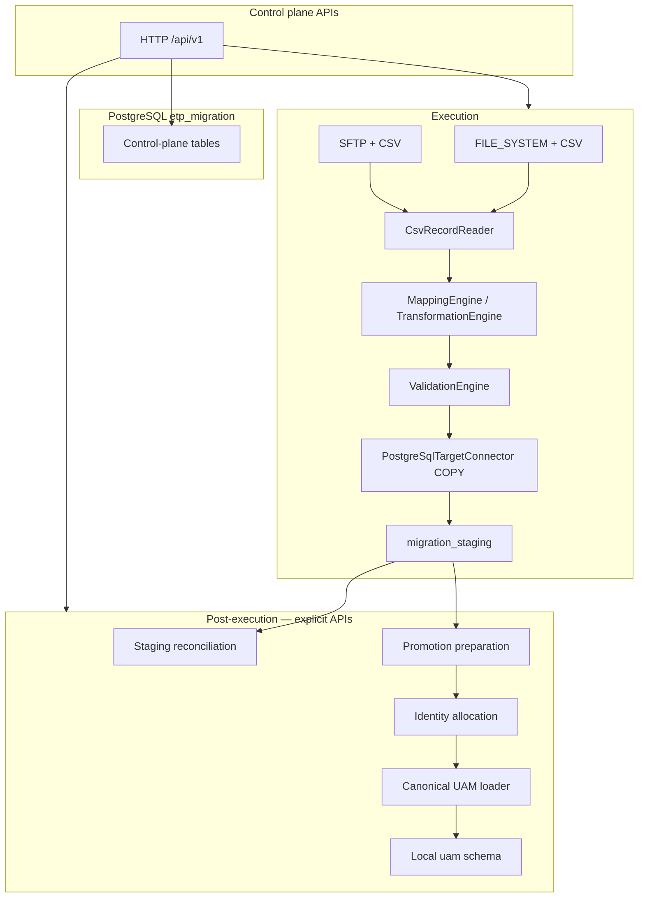
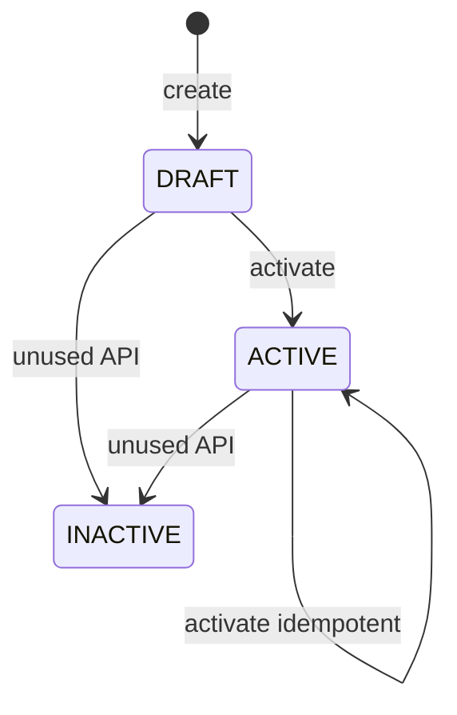
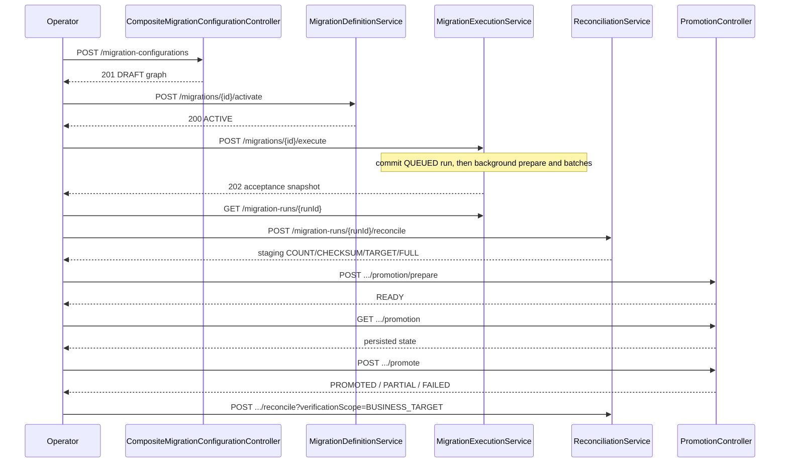

# ETP Migration Capability — Architecture

**Module:** `capabilities/etp-migration` (`com.etp:etp-migration:0.0.1-SNAPSHOT`)
**Implementation status:** Phases **0–10** are complete. Canonical target loading adds Flyway **V4** (per-run identity assignment) and **V5** (numeric range allocator). The repository continues through **V11**. Startup applies pending versions. Container `etp-migration-postgres` on host port 55446 has V1–V9 recorded as successful and does not yet have V10 or V11. Port 55433 was not inspected. Spring Boot **4.1.0**, Java **21**. The earlier full-suite figure of 542 tests is not restated here. The catalog-load tests re-run for this documentation pass are recorded in [migration-e2e-test-guide.md](migration-e2e-test-guide.md). See [DATABASE_MODEL.md](DATABASE_MODEL.md).
**Related docs:** [DATABASE_MODEL.md](DATABASE_MODEL.md), [USER_GUIDE.md](USER_GUIDE.md), [API_GUIDE.md](API_GUIDE.md), [migration-e2e-test-guide.md](migration-e2e-test-guide.md), [BENCHMARK_TESTING.md](BENCHMARK_TESTING.md), [CLAUDE_CONTEXT.md](CLAUDE_CONTEXT.md)

This document describes the **implemented** architecture. Items that exist only as schema placeholders, unused enums, or extension points are labeled **not implemented**.

---

## 1. Overview

ETP Migration is a reusable Spring Boot capability that moves records from a configured source into a **PostgreSQL staging table**, reconciles that staging result, then (when configured and invoked) **promotes** staged rows into a business target. The demonstrated business target is a local canonical UAM schema loaded from staging. Operators drive the work through HTTP APIs. Execute, reconciliation, promotion preparation, and promotion each return HTTP 202 and continue on a background worker. There is no GUI or Kafka consumer. Completing one phase does not start the next.

The authoritative flow is source → staging → promotion → business target. It is not source → UAM direct loading. For the local UAM demonstration that flow is source → staging → promotion → UAM. See §28.

**Problem it solves (current scope):** repeatable, metadata-driven file-to-PostgreSQL migrations with batch restart, record-level validation errors, explicit reconciliation, and explicit promotion.

**Architectural goals that the code actually follows:**

- Configuration persisted on definitions/sources/mappings (JSONB), not hard-coded per customer application. New business entities are configuration-driven. The demonstrated multi-entity model did not require an entity-specific production Java branch.
- Cloud-agnostic *design*: storage and target types are selected from configuration. **Implemented storage is local filesystem only.** Object stores listed in the schema (`MINIO`, `S3`, `AZURE_BLOB`, `GCS`) throw `UnsupportedStorageProviderException` if selected.
- Generic engine: staging and the canonical loader are driven by mapping and definition JSON. A separate REST connector exists for `targetType=UAM` (SINGLE HTTP POST). That REST adapter is a placeholder. It is not the loader used by the local canonical demonstration. The older flat stand-in `uam_migration_test.address` is also not that demonstration.
- Staging load is not the same as writing the application tables. `COMPLETED` / `COMPLETED_WITH_ERRORS` mean **staging** finished.
- Reconciliation and promotion are **user-invoked**, not automatic after execute. Staging reconciliation does not verify the final UAM tables.

---

## 2. Purpose and scope

### What the capability does

- Persist mapping rules, sources, and a migration definition (DRAFT, then optionally ACTIVE).
- Create a run against an **ACTIVE** definition, inspect a filesystem CSV, extract configured entities, resolve relationships, plan batches, transform/validate, and COPY into staging.
- Reconcile logical entity counts and relationships against staging (default) or, for the flat promotion contract, compare promoted rows (`verificationScope=BUSINESS_TARGET`).
- Prepare promotion, allocate mapping-level target identities, and load the canonical UAM tables. The flat INSERT/UPSERT writer remains for definitions that are not in canonical mode.

### What it does not do

- Enrichment pipeline (counters exist; no enrichment engine).
- Deduplication engine (`DEDUPLICATE` is a `MigrationStage` check constraint value only).
- Record-level lineage for every success (`migration_record` table exists; workers do not populate it).
- Kafka, Spark, Airflow, Redis, Kubernetes operators, or a scheduler.
- GUI.
- Automatic promotion or automatic reconciliation after execute.
- A production UAM deployment. The local canonical load in §28 used a PostgreSQL schema named `uam` on a workstation database. It is not a production UAM environment and not a UAM OpenAPI integration. The REST adapter remains a placeholder.
- A production-capacity claim for 10M, 30M, or 50M records. The 515-record local demonstration is not that claim. Phase 10 measured a local prepare baseline of about 1.01 million generated entities. That is not a capacity claim. See [BENCHMARK_TESTING.md](BENCHMARK_TESTING.md).

### Current implementation boundaries

| Area | Implemented | Not implemented / unused |
|------|-------------|---------------------------|
| Source | CSV from the filesystem (`CsvSourceConnector`, `provider=FILE_SYSTEM`) or from SFTP (`SftpCsvSourceConnector`, `provider=SFTP`). Both use `CsvRecordReader` | S3 and other object stores, formats other than CSV, multi-file SFTP |
| Staging target | PostgreSQL `COPY` (`PostgreSqlTargetConnector`, `LoadMode.BULK`) | PostgreSQL SINGLE/BATCH load modes |
| REST target | `UamTargetConnector`, `LoadMode.SINGLE` only (HTTP placeholder) | Production UAM HTTP API; BATCH/BULK UAM REST |
| Canonical promotion | Local PostgreSQL load of configured UAM tables from staging (`target.mode=UAM`), with promotion-time identity allocation | Production UAM deployment |
| Flat promotion | Configuration-driven PostgreSQL INSERT/UPSERT (`PostgreSqlPromotionWriter`) when canonical mode is not selected | |
| Activation | DRAFT → ACTIVE; ACTIVE → ACTIVE idempotent | INACTIVE transition API; environment/PROD checks in this capability |
| Execute facade | **Synchronous** create → inspect/prepare → loop `processNextBatch` | Scheduler, Kafka trigger, `@Async` / background worker |
| Composite config | `POST /migration-configurations` (`@Transactional`) | Separate promotion-create API |
| Security | JWT resource server; OpenAPI `bearer-jwt` scheme **and** operation `SecurityRequirement` | Role/scope/`@PreAuthorize` model |
| Integration tests | Shared PostgreSQL 17 Testcontainer `etp_migration_test` | Writing to the developer demo database |

### Phase status

| Phase | Subject | Status |
|-------|---------|--------|
| 0 | Domain neutrality | Complete |
| 1 | Entity/relationship configuration | Complete |
| 2 | Entity-scoped mapping rules | Complete |
| 3 | CSV single-file, multiple entities | Complete |
| 4 | CSV multi-file relationships | Complete |
| 5 | Logical migration scope | Complete |
| 6 | Streaming execution planner | Complete |
| 7 | Identity resolution | Complete |
| 8 | Entity-aware CSV execution | Complete |
| 9 | Entity-aware reconciliation | Complete |
| 10 | CSV performance, scalability, and hardening | Complete |
| 11 | XLSX single sheet | Future |
| 12 | XLSX multiple sheets | Future |

XLSX is not implemented. The historical performance note named “Phase 12” in [BENCHMARK_TESTING.md](BENCHMARK_TESTING.md) is an older flat-pipeline measurement from 2026-09-20. It is not this roadmap’s Phase 12, and its ~9,650 records/sec figure is not the Phase 10 result.

---

## 3. Key architectural concepts

| Concept | Persistence | Role |
|---------|-------------|------|
| **Migration definition** | `migration_definition` | Named/versioned recipe: `sourceType`, `targetType`, `mapping_id`, `batch_size`, `load_mode`, JSON `configuration`, status DRAFT/ACTIVE/INACTIVE. |
| **Migration mapping** | `migration_mapping` | Reusable source-to-target mapping metadata (also DRAFT/ACTIVE/INACTIVE). Execution loads **enabled rules** by mapping id; mapping status need not be ACTIVE. |
| **Mapping rules** | `migration_mapping_rule` | Ordered (`sequence_no`) field transforms. |
| **Migration source** | `migration_source` | Per-definition source JSON (`provider`, `fileFormat`, `objectKey`, …). `sourceType` is a **free-form string**, not a Java enum. |
| **Migration run** | `migration_run` | One execution. Snapshots, counters, status. Completing a run does **not** promote. |
| **Migration batch** | `migration_batch` | Restartable slice with `source_locator` JSON (CSV row range). Claimed with `FOR UPDATE SKIP LOCKED`. |
| **Migration artifact** | `migration_artifact` | Metadata for stored files. Prepare can persist source artifact metadata. Large payloads are **not** in PostgreSQL. |
| **Migration error** | `migration_error` | Record, execution-batch, promotion-batch, and phase-job errors. Promotion uses stage `PROMOTE`. |
| **Reconciliation** | `migration_reconciliation` | One row per `(run_id, reconciliation_type)`: COUNT, CHECKSUM, TARGET, FULL. |
| **Promotion** | `migration_promotion` | Separate lifecycle from the run. |
| **Promotion batch** | `migration_promotion_batch` | Eligibility and promote outcome per execution batch. |
| **Source connector** | Java SPI-style beans | `MigrationSourceConnector.supports(MigrationSource)` then inspect/read. |
| **Target connector** | Registry by `targetType` string | Staging load is PostgreSQL COPY. Canonical promotion uses the UAM table loader. The UAM REST bean is a separate placeholder. |
| **Transformation** | `TransformationEngine` | Applied in `sequence_no` order. |
| **Validation** | `ValidationEngine` | Mandatory target fields non-blank after transform. |
| **Staging** | Operator-created table, not Flyway | JSONB `target_payload` plus run/batch/record keys. |
| **Business-target promotion** | `configuration.target` and `configuration.promotion` when `target.mode` is `UAM` or `POSTGRESQL` | Canonical loader writes each entity's `targetEntity` on `target.connectionRef`, or the default PostgreSQL datasource when that reference is omitted. Foreign keys and load order come from the mapping relationships. A live load reads `information_schema` and converts values from that catalog. Flat mode writes one schema.table via `PostgreSqlPromotionWriter`. |

---

## 4. High-level architecture



**Three planes (implemented):**

| Plane | What lives there | Examples |
|-------|------------------|----------|
| **Control plane** | Capability PostgreSQL `etp_migration` + HTTP APIs | Definition, mapping, rules, source, run, batch, artifact metadata, error, reconciliation, promotion, promotion batch |
| **Migration execution / data plane** | Source I/O, entity extraction, transform/validate, staging COPY | Filesystem or SFTP CSV → `migration_staging`. The local demonstration used `uam_entity_stage`. |
| **Business target** | Canonical tables named by each entity `targetEntity`, or one flat table named in `configuration.promotion` | Local demonstration schema `uam` on the target PostgreSQL instance. That schema is a local stand-in, not a production UAM deployment. The older flat stand-in `uam_migration_test.address` is a separate historical illustration. |

Control-plane data lives in the capability database. Staging and business tables are **not** created by Flyway; they are named in definition JSON and must exist on the PostgreSQL target datasource (`etp.migration.target.postgresql.*`).

### Staging-first model

```text
CSV
  → Source connector
  → Entity extraction
  → Relationship resolution
  → Logical scoping
  → Batch planning
  → Transformation / mapping
  → Validation
  → PostgreSQL staging
  → Reconciliation
  → Promotion preparation
  → Identity resolution / allocation
  → UAM canonical target loader
  → UAM
```

Mappings without `modelType` stay on the flat CSV path: source read, mapping, validation, staging COPY, then optional flat INSERT/UPSERT promotion. That path does not extract entities.

`COMPLETED` / `COMPLETED_WITH_ERRORS` mean **staging** finished. They do **not** mean the business tables were written. Target identities are not allocated during staging. Canonical inserts are a later promotion step. That step reads the target catalog, converts values, and inserts in its own transaction. See §29.

### End-to-end execution flow (implemented)

```text
Migration configuration
  → Source inspection
  → Entity extraction and relationship resolution
  → Logical scoping and batch planning
  → Batch claim (SKIP LOCKED)
  → Transformation / mapping
  → Validation
  → PostgreSQL staging (COPY)
  → Staging reconciliation
  → Promotion preparation
  → Identity allocation from mapping targetIdentity
  → Canonical UAM load
```

Flat definitions skip entity extraction. Their promotion step is INSERT/UPSERT into one configured table. `verificationScope=BUSINESS_TARGET` applies to that flat contract. The local canonical demonstration verified staging reconciliation and the UAM row counts after promotion. It did not use business-target reconciliation as the proof of the UAM load.

Reconciliation and promotion are **not** started by execute. There is no scheduler, Kafka consumer, or `@Async` worker looping batches in the background.

---

## 5. Component architecture

Package roots under `com.etp.migration`:

| Package | Responsibility |
|---------|----------------|
| `migration` | Definitions, sources, composite configuration (`CompositeMigrationConfigurationService`), activation. |
| `transformation` | Mapping CRUD, `MappingEngine`, `TransformationEngine`. |
| `validation` | Mandatory-field checks. |
| `run` | Run CRUD, cancel/retry, `MigrationExecutionService` facade. |
| `processing` | `SourceInspectionService`, `MigrationBatchWorker`, `MigrationRecordProcessor`. |
| `batch` | `RecordCountBatchPlanner`, `MigrationBatchQueueService` (SKIP LOCKED claim), transitions. |
| `connector.source` | Registry + CSV filesystem connector. |
| `connector.storage` | `FileSystemArtifactStorage` / `DefaultArtifactStorage`. |
| `connector.target` | PostgreSQL staging, promotion writer, business verifier; UAM REST placeholder. |
| `reconciliation` | Engine + service; staging vs business scope. |
| `promotion` | Prepare, execute, read-only query. |
| `repository` | Spring Data JPA. |
| `entity` | JPA model aligned with Flyway. |
| `config` | Security, JWT, worker identity, exception handler. |
| `openapi` | Springdoc info + `bearer-jwt` scheme and operation `SecurityRequirement`. |
| `performance` | Offline CSV generator and benchmark helpers (not started with the app). |

`enrichment/` contains only a placeholder (`.gitkeep`). No enrichment service.

---

## 6. Execution architecture

### Lifecycle (implemented)

1. **Configuration** — composite `POST /api/v1/migration-configurations` (`@Transactional`: mapping → mapping rules → definition → source) or stepwise mapping/definition/source APIs. Status **DRAFT**. Promotion stays in `definition.configuration.promotion` (no separate promotion-create API).
2. **Activation** — `POST /api/v1/migrations/{id}/activate`. Validates mapping rules, one enabled source, connector `require()`, optional promotion JSON via `PromotionTargetConfiguration.parse`. **Does not inspect the file or run I/O beyond registry validation.** Idempotent if already ACTIVE. INACTIVE cannot be activated (409).
3. **Execute** — `POST /api/v1/migrations/{id}/execute` (`MigrationExecutionService`):
   - `MigrationRunService.create` commits CREATED → **QUEUED** (definition must be ACTIVE → 409 otherwise). The HTTP thread then sets `background_execution` and returns **202** with that QUEUED snapshot. It does not inspect, prepare, or process batches.
   - `MigrationExecutionCoordinator` submits the run to a bounded pool (`etp.migration.execution.max-concurrent-runs`, default 1; queue capacity default 32). A rejected submission leaves the row QUEUED with `background_execution` true. Recovery retries it. The pool does not run the rejected task on the HTTP thread.
   - `MigrationRunDriver` claims the row (`execution_worker_id`, `execution_lease_until`) and the same update sets **RUNNING** and `started_at`. A second claim of the same run fails while the lease is current. Those two lease columns are not updated by Hibernate, so a batch flush cannot clear them. `POST .../runs` leaves `background_execution` false, so recovery does not start that stepwise run.
   - A renewal that matches this worker on an already terminal run is completion, not a lost lease. The batch worker marks the run terminal when the last batch finishes, before the driver asks for another batch.
   - `RunExecutionLifecycle.beginExecution` runs as soon as the claim succeeds. Preparation accepts QUEUED (a stepwise prepare) or RUNNING (a claimed background run).
   - `SourceInspectionService.prepare` reads and plans the entity source before it locks the run. The lock is held only while batches are inserted, so two drivers cannot both insert batches. The local CSV index is read through a buffer. Source transfer and index logs report bytes read, and the index log also reports rows, every 8 MiB. The index scan fails if it is still running 30 minutes after it starts. Stage logs report source count, entity planning, and persist durations. The lease is renewed only after one of those reports, or after a completed batch. A live thread is not a report. A worker that stops reporting for `etp.migration.execution.progress-interval` (default 30 seconds) can be claimed again. SFTP connect, auth, and a silent remote read are bounded by `etp.migration.source.sftp.connect-timeout` and `etp.migration.source.sftp.idle-timeout`. A failure on an unprepared QUEUED or RUNNING run writes `migration_error` and sets the run FAILED. A run that already has in-flight batches is not failed by that recorder.
   - Loop `MigrationBatchWorker.processNextBatch(runId)` until none remain, the lease is lost, or the process is shutting down. Each terminal batch recalculates the parent run. An expired CLAIMED or PROCESSING batch lease can be claimed again.
   - `RunExecutionLifecycle.finalizeIfIdle` sets COMPLETED, COMPLETED_WITH_ERRORS, or FAILED when nothing is still in flight. Zero batches becomes COMPLETED. That status means staging finished. Reconciliation and promotion stay separate requests.
   - Poll `GET /api/v1/migration-runs/{runId}` for counters. That GET does not start work.
4. **Not** wrapped in one `@Transactional`. Run creation commits before scheduling. Each claim, renew, and batch uses a short transaction. COPY uses its own JDBC transaction on the **target** datasource.

### Per-batch processing (`MigrationBatchWorker`)

1. Claim (`FOR UPDATE OF b SKIP LOCKED`) for `PENDING` / `RETRY_PENDING` or expired `CLAIMED`/`PROCESSING` lease.
2. Mark PROCESSING; increment attempt.
3. Resolve source via `MigrationSourceConnectorRegistry.require` (`supports()` on configuration, not a `sourceType` enum).
4. Hash **entire source file** (`ArtifactChecksumCalculator`) per batch; fail if changed (`SOURCE_CHANGED`).
5. `CsvSourceConnector.readBatch` for locator row range.
6. Load enabled mapping rules ordered by `sequence_no`.
7. `MigrationRecordProcessor`: transform then validate.
8. Target `load()` for successful records only (PostgreSQL COPY after DELETE of that run+batch).
9. Flush errors; complete batch; roll run counters; evaluate run COMPLETED / COMPLETED_WITH_ERRORS / FAILED.

### Transaction boundaries

- Control-plane claim/complete: Spring `TransactionTemplate` / `@Transactional` on queue service.
- Staging COPY: JDBC `setAutoCommit(false)` on target pool; DELETE + COPY + commit; rollback on failure.
- Execute facade: **no** outer transaction (source I/O and COPY must not hold a control-plane TX for the whole file).
- Promotion: begin TX (READY → PROMOTING), each batch write on target, then complete TX aggregating statuses.

### Failure handling

- Validation failures: record errors, batch `COMPLETED_WITH_ERRORS` if some rows succeeded.
- Transformation exceptions: record REJECTED / transform stage.
- Target COPY failure: batch FAILED, COPY TX rolled back (that batch’s staging rows not committed).
- Concurrent workers: SKIP LOCKED. **Known limitation:** concurrent `completeBatch` updates of the same `migration_run` row can lose counter increments (measured in Phase 12 with 4 in-process workers). Not fixed.

### Retry / idempotency

- `POST .../retry` re-queues FAILED / COMPLETED_WITH_ERRORS batches; successful batches are not duplicated. It returns 409 `MIGRATION_RETRY_BLOCKED_BY_PROMOTION` once a promotion is `PROMOTING` or `PROMOTED`. The check runs after `SELECT ... FOR UPDATE` on the run row, which promotion prepare and begin also take, so it cannot interleave with a promotion start. A `READY` promotion does not block retry. Its batch eligibility was computed before the retry, and `prepare` returns that existing `READY` promotion. This is a known limitation, not changed here.
- Flat staging retry: DELETE existing rows for that run and batch, then COPY.
- Entity staging retry uses the same batch lifecycle. The connector deletes the current batch’s rows, then deletes earlier rows in the same run whose `entity-v1:` keys are being loaded, then COPY. See §27. The retry mechanism itself was not redesigned.
- Run create: optional `idempotencyKey` unique per definition.
- Promote of already **PROMOTED** promotion returns the existing result without rewriting.
- Prepare of existing READY / PROMOTING / PROMOTED returns stored promotion (PROMOTING is 409 on prepare).

### Shutdown and interrupted work

- `server.shutdown=graceful`. On SIGTERM the web server stops accepting new requests, and requests already running get up to `spring.lifecycle.timeout-per-shutdown-phase` (`ETP_MIGRATION_SHUTDOWN_GRACE_PERIOD`, default `30s`) to finish.
- `ShutdownSignal` is set when the application context starts closing. The background driver checks it before claiming each new batch. It finishes the batch it is processing, claims no more, releases its run lease, and leaves the run RUNNING with remaining batches `PENDING`. It does not mark the run FAILED. The executor shuts down and waits; it is not interrupted mid-batch.
- After restart, a scheduler (`etp.migration.execution.recovery-interval-ms`, default 15000) selects rows with `background_execution` true, status QUEUED or RUNNING, and a null or expired `execution_lease_until`. The driver claims one of those rows and continues. A manual `POST .../runs` row is not selected. Continue a stepwise run with `POST /api/v1/migration-runs/{runId}/process-next-batch`.
- `process-next-batch` handles one batch per request, so it only needs that batch to finish within the grace period.
- If a batch does not finish within the grace period, shutdown continues and the batch stays `CLAIMED` or `PROCESSING` with its lease. After `lease_until` (5 minutes after the last claim or renewal) `process-next-batch` can claim it again with a higher attempt number. The fencing check rejects any late write from the interrupted attempt. Staging writes for a batch delete that batch's rows and copy them again in one target transaction, so a reclaimed batch does not duplicate staging rows. The forced-termination path itself is not covered by an automated test. Lease expiry and stale-claim fencing are covered by `MigrationBatchConcurrencyIntegrationTest`.

### Why the whole migration is not one transaction

A full-file transaction would hold locks across inspect, transform, and COPY of every batch; PostgreSQL COPY is a separate datasource. The engine is designed for restartable batches and leases, which is incompatible with a single atomic run transaction.

---

## 7. Configuration-driven design

Behavior is taken from persisted JSON and string types, not from environment names (no PROD/DEV branches in migration logic).

**Current CSV source configuration (canonical local demo):**

```json
{
  "name": "csv-source",
  "sourceType": "FILE_SYSTEM",
  "configuration": {
    "provider": "FILE_SYSTEM",
    "fileFormat": "CSV",
    "objectKey": "demo/addresses.csv",
    "hasHeader": true
  }
}
```

Runtime file path with default `etp.migration.storage.root=./data/migration`:

`data/migration/demo/addresses.csv`

**Resolution model (implemented):**

| Field | Where | How used |
|-------|--------|----------|
| `sourceType` | `migration_source.source_type` VARCHAR | Required non-blank for `MigrationSourceConnectorRegistry.require()`. **Not** a Java enum. `CsvSourceConnector.supports()` does **not** switch on this string; it parses `configuration`. `FILE_SYSTEM` is the documented demo value; a non-blank value such as `FILE` also works if configuration is valid. |
| `configuration.provider` | JSON | `FILE_SYSTEM` selects `CsvSourceConnector`. `SFTP` selects `SftpCsvSourceConnector`. Other known providers still throw `UnsupportedStorageProviderException`. |
| `configuration.fileFormat` | JSON | Must be `CSV` for both providers. |
| `configuration.objectKey` | JSON | Filesystem path relative to `etp.migration.storage.root`. Not used by SFTP. |
| `configuration.remotePath` | JSON | SFTP remote CSV path. Required when `provider` is `SFTP`. |
| `configuration.host`, `port`, `credentialRef` | JSON | SFTP connection. The password is not part of this JSON. |
| `configuration.hasHeader` | JSON | Default `true` for both providers. |
| `configuration.delimiter` | JSON | Default `,` for both providers. |

`FILE_SYSTEM` and `SFTP` are transports. CSV parsing is shared. Connector selection is configuration-driven: the registry uses the first `supports()` match. A non-blank `sourceType` label such as `FILE` still works when the JSON is valid.

**SFTP source configuration:**

```json
{
  "name": "sftp-source",
  "sourceType": "FILE",
  "configuration": {
    "provider": "SFTP",
    "fileFormat": "CSV",
    "host": "sftp.example",
    "port": 22,
    "credentialRef": "local-sftp",
    "remotePath": "/inbound/rows.csv",
    "hasHeader": true,
    "delimiter": ","
  }
}
```

The password is resolved from `etp.migration.source.sftp.credentials.<credentialRef>.username` and `.password`. Do not put `password`, `privateKey`, or `passphrase` in the migration definition. Responses and error messages do not include those values. Host keys are verified by `SftpHostKeyVerifier` on every connection. Fingerprints in `etp.migration.source.sftp.credentials.<credentialRef>.host-key-fingerprints` decide when present. Otherwise `etp.migration.source.sftp.known-hosts-file` is checked through SSHD's `KnownHostsServerKeyVerifier`, which is read only. With neither configured the connection is refused before it opens. `etp.migration.source.sftp.accept-unknown-host-keys` defaults to false; when true it admits only hosts with no trusted entry and logs a warning. A changed key is always rejected. SFTP reads one remote CSV. `layoutType=MULTI_FILE` stays on the filesystem connector.

Definition `configuration` typically includes:

- `target.schema`, `target.stagingTable`, `target.mergeStrategy` (`NONE` only for PostgreSQL staging).
- Optional `promotion.enabled`, `schema`, `table`, `strategy` (`INSERT`/`UPSERT`), `columns`, `conflictKeys`.

Default batch size property: `etp.migration.batch-size` (default 10000); definition `batch_size` is what prepare uses.

---

## 8. Connector Architecture

Connectors isolate source, staging, target, and external-system integration concerns. The migration engine itself remains responsible for migration processing, including extraction, entity/relationship resolution, planning, mapping, validation, reconciliation, identity resolution, and promotion orchestration.

UAM is the first demonstrated business target implementation, not the definition of the migration engine.

The tree below is a responsibility map. It is not a claim that every class is a separate external-system connector.

```text
ETP Migration Engine
│
├── Source Connectors
│   ├── CsvSourceConnector
│   ├── SftpCsvSourceConnector
│   ├── CsvRecordReader
│   └── MultiFileEntitySource
│
├── Staging / PostgreSQL Target
│   ├── PostgreSqlStagingTarget
│   ├── PostgreSqlTargetConnector
│   └── PostgreSqlStagedEntityReader
│
├── Business Target / Promotion
│   ├── UamStagingPromotion
│   ├── UamPostgreSqlTargetConnector
│   └── UamTargetConnector
│
└── Reconciliation
    ├── MigrationTargetReconciliationProvider
    └── PostgreSqlTargetReconciliationProvider
```

`MigrationSourceConnectorRegistry` selects the first source bean whose `supports` method accepts the source. `provider=FILE_SYSTEM` and `fileFormat=CSV` select `CsvSourceConnector`. `provider=SFTP` and `fileFormat=CSV` select `SftpCsvSourceConnector`. `MigrationTargetConnectorRegistry` selects a target bean by `targetType()`. Implemented target types are `POSTGRESQL` (staging COPY) and `UAM` (REST). The demonstrated promotion path keeps definition `targetType` as `POSTGRESQL` and selects the canonical loader with `target.mode=UAM`.

There is no Kafka connector, no S3 or other object-storage source, no database source connector, and no REST connector other than `UamTargetConnector`.

```text
FILE_SYSTEM + CSV
        \
         \
          → Generic migration pipeline
         /
SFTP + CSV
        /
```

SFTP changes only how the CSV bytes are acquired. Extraction, relationship resolution, planning, identity resolution, mapping, validation, staging, reconciliation, and promotion are unchanged.

### Source connectors

#### CsvSourceConnector

`CsvSourceConnector` reads CSV from the configured filesystem source and supplies `SourceRecord` values to inspection and to the generic extraction pipeline.

- It accepts a source when `CsvFileSourceConfiguration` can parse the source JSON. It does not switch on the free-form `sourceType` label. `FILE_SYSTEM` is the documented value. A non-blank label such as `FILE` also works when the JSON is valid.
- Source configuration includes `provider`, `fileFormat`, `objectKey`, `hasHeader`, and `delimiter`. Encoding defaults to UTF-8. `objectKey` is relative to `etp.migration.storage.root`.
- Inspect counts data rows, records a SHA-256 of the file stream, and reads header columns. Flat batch planning then splits that count into row ranges.
- `CsvRecordReader` drops a leading byte-order mark (U+FEFF) after decoding, so it never becomes part of the first header or the first value. The SHA-256 is taken from the raw bytes and still includes the mark. Header names are compared exactly: case-sensitive and without trimming, the same way mapping rules look up fields. A repeated name is rejected with `CsvHeaderException`, an `InvalidSourceConfigurationException` (HTTP 400), because the earlier column would otherwise be unreachable. `id` and `ID`, or `id` and ` id`, are different columns and are both kept. The same rules apply to the SFTP connector.
- It does not contain business-target logic, does not allocate target identities, and does not write business tables.

#### SftpCsvSourceConnector

`SftpCsvSourceConnector` reads one remote CSV over SFTP and passes the open stream to `CsvRecordReader`. Header handling, delimiter handling, and record conversion match the filesystem CSV source.

- Configuration is `host`, `port`, `credentialRef`, `remotePath`, `fileFormat=CSV`, `hasHeader`, and `delimiter`. The password is resolved from application properties by `credentialRef`. It is not stored on the migration definition.
- The remote file is read as an `InputStream`. The file is not loaded into a `List`. The SFTP session and stream close when parsing finishes or fails.
- Entity-relationship preparation and batch reads do not download that file once per entity or once per batch. `SftpSourceCache` copies it once under `{etp.migration.storage.root}/etp-source-cache/sftp/` and builds an on-disk index of each data row's byte offset (`8` bytes per source row, not the row payload). A later batch in the same process seeks to the `sourceRecordNumber` values already stored on its work items. The copy is published only after the downloaded byte count matches the remote size. A later process reuses it when the remote size and modification time match the stored stamp and the local SHA-256 still matches. A same-size file with a different modification time is downloaded again. A same-size replacement that also keeps the modification time is not detected. Host-key verification still runs on the connection that checks or downloads. Flat CSV batches still stream the remote file for each row range. The cache directory is safe to delete only when no migration process is running.
- `etp.migration.source.sftp.idle-timeout` (default `PT10M`, must be positive) is applied as SSHD's `IDLE_TIMEOUT` on the client. It bounds two things: the wait for each SFTP response (stat, open and every read chunk), measured from when the reader starts waiting for that response; and how long the SSH session may carry no traffic in either direction before SSHD closes it. SSHD checks session idleness on a timer, so the close can come up to about a second after the limit. It is not a limit on total transfer time: a slow transfer that keeps delivering data within the limit runs to completion. A consumer that stops reading for longer than the limit loses the session, and the next read fails with `MIGRATION_SFTP_READ_FAILED`. `connect-timeout` separately bounds TCP connect and authentication.
- Connection, authentication, missing file, permission, read, and CSV parse failures use `MIGRATION_SFTP_CONNECTION_FAILED`, `MIGRATION_SFTP_AUTHENTICATION_FAILED`, `MIGRATION_SFTP_FILE_NOT_FOUND`, `MIGRATION_SFTP_PERMISSION_DENIED`, `MIGRATION_SFTP_READ_FAILED`, and `MIGRATION_CSV_PARSE_FAILED`. Untrusted or changed host keys use `MIGRATION_SFTP_HOST_KEY_REJECTED`; missing or invalid trust configuration uses `MIGRATION_SFTP_HOST_KEY_CONFIGURATION_INVALID`. Messages do not include passwords, private keys, or stack traces.
- It does not map entities, resolve relationships, allocate identities, validate rules, write staging, or promote.

#### MultiFileEntitySource

`MultiFileEntitySource` is the multi-file source capability. A migration does not have to be one physical CSV.

`SourceLayoutConfiguration` reads optional `layoutType` from the source configuration. When `layoutType` is omitted, the source stays on the single-object CSV path. `SourceLayoutType` is `SINGLE_FILE` or `MULTI_FILE`. `SourceLayout` names the CSV bound to each configured entity. `MultiFileEntitySource` opens one of those filesystem files through `CsvSourceConnector` and extracts only the entity that file is mapped to. Relationship resolution stays outside this class. SFTP does not use the multi-file layout.

No file format other than CSV is implemented.

### Staging / PostgreSQL target

#### PostgreSqlStagingTarget

`PostgreSqlStagingTarget` resolves the staging relation from configuration. It prefers `target.stagingSchema`, then `target.schema`, then the target datasource schema property, then `migration_staging`. The table name is `target.stagingTable`. Callers that read or write staging use that resolved name.

The demonstrated local table is `migration_staging.uam_entity_stage`. The schema and table are configuration. They are not inherently UAM tables.

Promotion reads one batch with `migration_run_id` and `migration_batch_id`. The identity unique index does not serve that lookup. `V9__StagingBatchLookupIndex` creates `idx_uam_entity_stage_run_batch` on `(migration_run_id, migration_batch_id)` only when `migration_staging.uam_entity_stage` is in the database Flyway migrates, and it runs outside a transaction because `CREATE INDEX CONCURRENTLY` cannot. On this workstation staging is a different PostgreSQL server, so V9 records success and does not build the index there. `local/migration-staging.sql` creates the same index for a new staging database. The application does not create it on first read. A missing or invalid index is logged once per process. An invalid index has to be dropped with `DROP INDEX CONCURRENTLY` and created again while staging writers are idle.

`POST /migration-runs/{runId}/control` and `POST /migration-runs/{runId}/promotion/control` persist `control_state` separately from lifecycle status. `PAUSE` becomes `PAUSED` only after the worker finishes the current batch. Recovery and startup do not claim `PAUSE_REQUESTED` or `PAUSED` work. `RESUME` continues the existing job.

The repository geographic-address mapping sets `GeographicSubAddress.address_id` to `referencesColumn` `id`, which matches `geographic_sub_address.address_id → geographic_address(id)`. A definition that stored `referencesColumn` `location_id` does not match that foreign key. Do not rewrite staged payloads while a promotion is running. After the promotion is paused and staging writers are idle, a reviewed repair is to set that relationship's `referencesColumn` from `location_id` to `id` in `migration_staging.uam_entity_stage.target_payload` for `GeographicSubAddress` rows only, then confirm a sample `address_id` equals the parent `geographic_address.id` before resuming. That repair was not applied to the current run.

One staging row is one logical entity payload. The entity JSON includes `entity`, `targetEntity`, `sourceIdentity`, `targetIdentity`, `sourceKey`, `targetKey`, `sourceRecordNumber`, `attributes`, and `relationships`. At staging time `targetIdentity` is null. Parent target identities in `relationships` are null until promotion.

Staging is not the canonical UAM database. A row is not inserted into UAM because it was staged.

#### PostgreSqlTargetConnector

`PostgreSqlTargetConnector` is the PostgreSQL loading capability used by migration execution. Its target type is `POSTGRESQL` and it supports `LoadMode.BULK` only. It requires `etp.migration.target.postgresql.url`.

For the demonstrated bulk flow it `COPY`-loads the generated payload into the staging table resolved by `PostgreSqlStagingTarget`. The staging columns are `migration_run_id`, `migration_batch_id`, `source_record_number`, `target_payload`, `idempotency_key`, and `loaded_at`. Flat loads delete that run and batch, then copy. Entity loads also delete earlier rows in the same run that share the entity idempotency key. See §27.

```text
PostgreSqlTargetConnector
    ↓
PostgreSQL staging
```

It is not the canonical UAM loader.

```text
PostgreSqlTargetConnector
    ↓
UAM canonical tables
```

That path does not exist.

#### PostgreSqlStagedEntityReader

Promotion does not reread the original CSV. `PostgreSqlStagedEntityReader` reads one staged batch from the resolved staging table and rebuilds the payload list. Null target identities stay null. The reader does not allocate identities and does not write business tables.

```text
Staging
   ↓
PostgreSqlStagedEntityReader
   ↓
Promotion
```

`StagedEntityView` and `StagedRelationshipView` are the reconciliation projection of the same staged payload: entity name, source identity, target identity, and parent links. `PostgreSqlTargetReconciliationProvider` builds those views. They are not a second stored copy of the migration, and they are not the type the reader returns to promotion.

### Business target connectors

Generic processing ends at staging. Loading a business application is a later, explicit promotion step.

```text
Source
  ↓
Staging
  ↓
Promotion
  ↓
Business Target
```

UAM is the reference business-target implementation for that last step.

#### UamStagingPromotion

`UamStagingPromotion` is the bridge from staged results to the UAM PostgreSQL loader. It is not part of entity extraction or mapping.

When `target.mode` is `UAM`, it reads the staged batch, allocates target identities from `mapping.entities[].targetIdentity`, fills parent target identities, and calls `UamPostgreSqlTargetConnector`. Definition `targetType` remains `POSTGRESQL`. Staging rows are not updated.

#### UamPostgreSqlTargetConnector

`UamPostgreSqlTargetConnector` is the canonical UAM business-target implementation used by the demonstrated promotion path. Its connector type is `UAM_POSTGRESQL`. It is not selected as the execution staging target.

It receives prepared canonical rows and inserts each entity's `targetEntity` in one database transaction per promotion batch. Load order is parent before child from the relationship graph. `targetForeignKey` assigns the named parent column to the child column. The live load reads `information_schema.columns` and converts from the catalog. A required timestamp column with no default and no mapped value receives one UTC instant for that load. See §29.

A failure during the insert transaction rolls that target transaction back. The statement is `ON CONFLICT (<first column>) DO NOTHING`. The first column is the payload `targetKey`. The UAM fixtures use `id`. If that column would be omitted, the load fails before the statement is sent. A retry that reuses `migration_identity_allocation` therefore does not insert a second row for an existing key. An already `PROMOTED` promotion returns the stored result.

The local demonstration loaded:

| Table | Role |
|-------|------|
| `uam.location` | Business table |
| `uam.geographic_address` | Business table |
| `uam.geographic_location` | Business table |
| `uam.location_geometry` | Business table |
| `uam.geographic_sub_address` | Business table |

The UAM schema is business-application-owned reference-target schema. The migration engine provides the migration capability and the target integration. Those tables are not part of the generic engine.

This path was demonstrated locally. It is not a production UAM deployment and it does not call a UAM HTTP API. See §28.

#### UamTargetConnector

`UamTargetConnector` is the REST UAM integration retained in the codebase. Target type `UAM`, `LoadMode.SINGLE` only: `POST {baseUrl}/api/v1/{entity}` with the mapped JSON body. The base URL comes from `etp.migration.target.uam.*`. An optional client-credentials token may be sent. BATCH and BULK REST endpoints are not implemented.

```text
UamTargetConnector
    → REST/HTTP UAM integration

UamPostgreSqlTargetConnector
    → canonical PostgreSQL UAM loading used by the demonstrated promotion path
```

Promotion does not use `UamTargetConnector`. Neither connector replaces the other.

### Target reconciliation providers

Reconciliation is separate from loading.

```text
MigrationTargetReconciliationProvider
    ↓
PostgreSqlTargetReconciliationProvider
```

`MigrationTargetReconciliationProvider` is the verification interface. `PostgreSqlTargetReconciliationProvider` counts and projects staged PostgreSQL rows for the run. The demonstrated end-to-end reconciliation verifies that staging result. It does not perform a canonical UAM checksum comparison.

`PASSED_WITH_WARNINGS` remains the status when that checksum comparison is unavailable, including when entity and relationship staging checks passed. That warning is not a failed migration. See §11 and §26.

`UamTargetReconciliationProvider` is the provider for REST target type `UAM`. It reports target-count verification as unavailable. It is not the provider used by the demonstrated PostgreSQL staging reconciliation.

### Connector extensibility

```text
Generic Migration Engine
        │
        ├── Source connector
        │
        ├── PostgreSQL staging capability
        │
        ├── Promotion
        │
        └── Business target connector
                    │
                    ├── UAM
                    └── Other business application
```

A new business application should normally be a target-integration and configuration concern. It should not require entity-specific changes to `EntityExtractor`, relationship resolution, `LogicalMigrationScopeBuilder`, `ExecutionPlanner`, `MappingEngine`, validation, or generic reconciliation.

A genuinely new technology, protocol, or target behavior that the current connectors do not support can require a new connector. Configuration alone does not cover every future target. No such additional connector is implemented today.

## 9. Target connector architecture

Target-connector responsibilities are part of §8 Connector Architecture. Staging COPY stays on `PostgreSqlTargetConnector`. Canonical UAM loading stays on `UamPostgreSqlTargetConnector`. REST UAM stays on `UamTargetConnector`.

---

## 10. Mapping and transformation architecture

Rules run in `sequence_no` order (`MappingEngine`). Disabled rules are skipped.

| `TransformationType` | Runtime |
|----------------------|---------|
| DIRECT, TRIM, UPPERCASE, LOWERCASE, DEFAULT, CONCAT, SPLIT, REGEX, CONDITIONAL, DATE_FORMAT | Implemented in `TransformationEngine` |
| LOOKUP, CUSTOM | Allowed in DB check constraint; **throw** `UNSUPPORTED_TRANSFORMATION` at process time |

CONCAT uses `configuration.sourceFields` + `separator`. SPLIT uses `delimiter` + `targetFields`. REGEX uses `pattern` / `replacement`. CONDITIONAL uses `condition.operator` / `sourceField` / `value` and `thenValue`/`elseValue`. DATE_FORMAT uses configured pattern keys in the rule `configuration` map.

**Validation:** for each enabled **mandatory** rule, target field must be non-null and non-blank. Empty `DEMO-004` address after TRIM fails validation; the row is not COPY’d.

`transformation_expression` is stored; the engine does not evaluate arbitrary expressions.

---

## 11. Reconciliation architecture

`POST /api/v1/migration-runs/{runId}/reconcile` requires no active batches (PENDING/CLAIMED/PROCESSING/RETRY_PENDING). Does **not** change run or promotion status. Upserts four types (unique per run+type).

| Type | Behavior |
|------|----------|
| COUNT | Internal consistency of run counters vs source snapshot count; staging COUNT vs success when scope is staging. |
| CHECKSUM | Records source checksum; **`comparisonPerformed=false`** — source vs staging checksum is **not** compared (warning). |
| TARGET | Staging `COUNT(*)` or business-target verifier. |
| FULL | Combines the three. |

| Scope | How to invoke | What is compared |
|-------|----------------|------------------|
| **STAGING** (default) | Omit `verificationScope`, or any value other than `BUSINESS_TARGET` | Source snapshot / run counters vs `migration_staging` (`PostgreSqlTargetReconciliationProvider`) |
| **BUSINESS_TARGET** | `?verificationScope=BUSINESS_TARGET` | Successfully **promoted** batches vs the promotion table (`PostgreSqlBusinessTargetVerifier`) |

Business-target verification (PostgreSQL only):

- Expected population is staging rows for batches whose promotion status is **PROMOTED** (partial promotion does not expect unpromoted batches).
- `promotion.conflictKeys` establish target identity; non-key `promotion.columns` are compared in SQL.
- Duplicate identities fail (`MIGRATION_TARGET_IDENTITY_AMBIGUOUS`).
- INSERT (or any strategy) **without** `conflictKeys` cannot establish identity → `MIGRATION_TARGET_IDENTITY_NOT_CONFIGURED`; comparison is not performed.
- Does **not** modify run or promotion status.

GET returns 404 if the run has no reconciliation rows.

---

## 12. Promotion architecture

Requires `targetType` POSTGRESQL, `promotion.enabled=true`, run COMPLETED or COMPLETED_WITH_ERRORS, no active execution batches, **some** reconciliation rows present (status of those rows is not re-checked beyond existence).

**Prepare:** counts staging rows per batch. COMPLETED / COMPLETED_WITH_ERRORS with staged rows → ELIGIBLE. Zero staged or failed execution batch → NOT_ELIGIBLE. Status **READY**. Does not write the business table.

**Execute:** requires READY. Sets PROMOTING and clears any previous promotion error summary. Canonical mode (`target.mode=UAM`) loads configured UAM tables in one transaction per eligible batch. A failure rolls that UAM transaction back and marks the batch failed. Identity allocations are stored before that transaction and are reused on retry. Flat mode uses INSERT or UPSERT (`PostgreSqlPromotionSql`). A failed flat batch does not roll back previously successful batches → `PARTIALLY_PROMOTED` with `error_code` `MIGRATION_PROMOTION_PARTIAL_FAILURE`. All fail → `PROMOTION_FAILED` with `MIGRATION_PROMOTION_BATCH_FAILED`. All succeed → `PROMOTED`, and the promotion error summary is cleared. The phase job can still be `COMPLETED` for every one of those outcomes. An already PROMOTED promotion returns the stored result. Batch failures remain the `migration_error` rows. The promotion row does not add another error per batch.

**GET** `/promotion`: read-only latest promotion by `created_at` desc. Status counts come from `GROUP BY status`. The batch list is empty. Batch pages are `GET /promotion/batches`. 404 if none. Does not prepare.

`migration_promotion_batch.started_at` is set when processing of that attempt begins, not when the batch is queued. `completed_at` stays null while the attempt is running and is set when the attempt finishes, including a failure. A retry overwrites both timestamps. `durationMillis` is computed from those two values for the latest attempt. It is not a stored column and it is not the sum of earlier attempts.

There is **no** `GET /api/v1/promotions/{promotionId}`.

### Canonical UAM promotion (implemented, demonstrated locally)

| Topic | Behavior |
|-------|----------|
| Selection | `target.mode=UAM` and `promotion.enabled=true`. Flat schema/table/columns/conflictKeys are not the canonical contract. |
| Staging | Read as stored. `targetIdentity` and `parentTargetIdentity` are null at staging time. |
| Identity | `mapping.entities[].targetIdentity` is the authoritative format. `PREFIX_SEQUENCE` reserves a number and formats `prefix` plus `sequenceLength` digits. The assignment is stored on `migration_identity_allocation`. `definition.configuration.identity` is not read. |
| Parents | Parent target identities are filled from those allocations before the insert. |
| Transaction | One eligible batch, one target transaction around the inserts. Catalog conversion errors are raised before that transaction starts. An insert failure rolls the UAM inserts back. The allocation rows remain. Staging rows are not deleted by that rollback. |
| Retry | The same run reuses the stored target identities. `ON CONFLICT (<targetKey>) DO NOTHING` skips a row whose conflict key is already present. The UAM fixtures use `targetKey` `id`. |
| Idempotent completion | A promotion that is already `PROMOTED` is returned without another load. |

### Flat PostgreSQL promotion behavior (implemented)

| Topic | Behavior |
|-------|----------|
| Prepare | Counts staging rows per execution batch. Does **not** write the business table. |
| Execute | Processes **ELIGIBLE** batches only. Each batch is its own JDBC transaction on the target datasource. |
| Isolation | A failed batch does **not** roll back batches already committed as PROMOTED. Overall status can be `PARTIALLY_PROMOTED`. |
| INSERT | Parameterized `INSERT INTO "schema"."table" (...) VALUES (?)`. **Not** inherently idempotent. Retry can duplicate rows if the business table has no uniqueness constraint matching the payload. |
| UPSERT | Same INSERT plus `ON CONFLICT ("conflictKeys") DO UPDATE` (or `DO NOTHING` if only key columns). Retry-safe when `conflictKeys` correctly represent target identity. `conflictKeys` are **required** at parse time for UPSERT. |
| SQL safety | Values bound with `PreparedStatement`. Schema/table/column names must match `[A-Za-z_][A-Za-z0-9_]*` and are double-quoted (`PostgreSqlIdentifiers`). |
| INSERT without `conflictKeys` | Allowed at configuration parse. Business-target reconciliation **cannot** establish identity and returns `MIGRATION_TARGET_IDENTITY_NOT_CONFIGURED` (comparison not performed). |

---

## 13. Lifecycle / state model

### Migration definition (`MigrationConfigStatus`)



INACTIVE exists in DB/enum. **No HTTP API** sets INACTIVE.

**ACTIVE is not an environment firewall.** It is a migration-definition lifecycle / certification flag required before `POST .../runs` and `POST .../execute`. Deployment/release governance (who may activate in which environment) is **outside** this capability. There are no PROD/DEV branches in migration business logic.

### Migration run (`MigrationRunStatus`)

Create immediately transitions CREATED → QUEUED. That QUEUED run stays QUEUED until its own execution starts. A background claim sets RUNNING before preparation. A stepwise run stays QUEUED through prepare and moves to RUNNING when its execution starts. RUNNING then becomes COMPLETED, COMPLETED_WITH_ERRORS, or FAILED once no batch is PENDING, RETRY_PENDING, CLAIMED, or PROCESSING. FAILED and COMPLETED_WITH_ERRORS can return to QUEUED on retry. PAUSED has no transitions implemented. CANCEL_REQUESTED cancels PENDING/RETRY_PENDING batches, then CANCELLED when nothing is claimed or processing. Batch transitions: PENDING or RETRY_PENDING → CLAIMED → PROCESSING → COMPLETED, COMPLETED_WITH_ERRORS, or FAILED. FAILED and COMPLETED_WITH_ERRORS → RETRY_PENDING. An expired lease returns CLAIMED or PROCESSING to a new claim. CANCELLED is terminal.

**COMPLETED means staging complete, not promoted.**

### Migration batch (`MigrationBatchStatus`)

PENDING → CLAIMED → PROCESSING → COMPLETED | COMPLETED_WITH_ERRORS | FAILED. Retry → RETRY_PENDING. Lease expiry allows reclaim of CLAIMED/PROCESSING. CANCELLED from pending/retry.

### Promotion (`PromotionStatus`)

NOT_STARTED is inserted when preparation is accepted. The worker then writes READY. READY → PROMOTING → PROMOTED | PARTIALLY_PROMOTED | PROMOTION_FAILED. One run has at most one NOT_STARTED, READY, or PROMOTING row.

### Promotion batch (`PromotionBatchStatus`)

NOT_ELIGIBLE | ELIGIBLE | PROMOTING | PROMOTED | FAILED.

### Reconciliation (`ReconciliationStatus`)

PENDING / RUNNING exist in the check constraint; the service writes PASSED, PASSED_WITH_WARNINGS, or FAILED when persist completes.

---

## 14. End-to-end sequence (product facades)



Stepwise APIs (`POST /mappings`, `/migrations`, `/sources`, `/runs`, `/prepare`, `/process-next-batch`) remain implemented.

---

## 15. Security (implemented)

- Spring Security OAuth2 resource server JWT (`ETP_MIGRATION_KEYCLOAK_ISSUER_URI`, default Keycloak `http://localhost:8180/realms/etp`).
- Identity provider is **Keycloak / ETP IAM**. This module does **not** own login, users, or token issuance.
- Token validation: signature (JWKS from the issuer's discovery document), expiry, and `iss`. Audience is validated only when `ETP_MIGRATION_JWT_AUDIENCES` (`spring.security.oauth2.resourceserver.jwt.audiences`, comma-separated) is set. In that case the token's `aud` must contain at least one listed value, or the request gets 401 `invalid_token`. Unset keeps issuer-only validation. Keycloak puts a client in `aud` only when the client has an Audience mapper.
- OpenAPI scheme name: **`bearer-jwt`** (HTTP bearer, JWT). Global `SecurityRequirement` plus `OpenApiCustomizer` copies the requirement onto documented operations so Swagger UI sends `Authorization: Bearer <JWT>` after Authorize.
- PermitAll (public): `/actuator/health`, `/actuator/health/**`. `/v3/api-docs`, `/v3/api-docs.yaml`, `/v3/api-docs/**`, `/swagger-ui`, `/swagger-ui/**` and `/swagger-ui.html` are public only when `etp.migration.openapi.enabled=true` (`ETP_MIGRATION_OPENAPI_ENABLED`). That defaults to false and to true in the `dev` profile. `mvn spring-boot:run` sets the property for the local process; a packaged run does not. The same flag sets `springdoc.api-docs.enabled` and `springdoc.swagger-ui.enabled`. When it is false those paths require authentication and return 404.
- All other routes **authenticated**, including migration APIs.
- Spring profile **`dev` only:** `DevMigrationApiSecurityConfig` permitAll on `/api/v1/migrations/**`, `/migration-configurations/**`, `/mappings/**`, `/migration-runs/**`. JWT validation remains configured on the default chain for other paths/profiles.
- CSRF disabled; stateless sessions.
- No method-level `@PreAuthorize`, roles, or OAuth scopes are implemented in this module.
- **Audit identity** (`AuditActor`). `created_by`, `updated_by` and `requested_by` always come from the authenticated principal, never from request bodies. `PreparePromotionRequest.requestedBy` is accepted but ignored.
  - JWT with `sub`, user or service account: the `sub` value. Keycloak service accounts have a stable `sub` of their own, so they are recorded the same way as users.
  - JWT without `sub`: `client:<azp>`, or `client:<client_id>` when `azp` is absent.
  - Rejected with 403 `MIGRATION_AUDIT_IDENTITY_INVALID` before anything is written: a token with neither `sub` nor a client identifier; an identity longer than the 100-character columns (it is not truncated, because truncation could merge identities); control characters; or a `sub` of `system` or `anonymous`, or starting with `client:`.
  - No authentication (internal calls): `system`. Anonymous access under the `dev` profile: `anonymous`.
- **Target failure disclosure.** `TargetInfrastructureException` returns HTTP 500 with its `code` and the generic message `Target system operation failed (reference <uuid>)`. `GlobalExceptionHandler` logs that reference at ERROR with the code, method, path, exception message and `TargetFailureDiagnostics` summary. No stack trace is logged, because cause messages from the driver can contain row values. Database-derived text in exception messages, stored batch and promotion-batch errors, and worker or promotion failure logs (`cause=`) is limited to the sanitized summary described in §29.

This is **not** a production IAM hardening guide.

---

## 16. Deployment / runtime (local)

| Item | Current local default |
|------|------------------------|
| Process | `mvn spring-boot:run` (optional `-Dspring-boot.run.profiles=dev`) |
| HTTP | `ETP_MIGRATION_SERVER_PORT` default **8082** |
| Control DB | PostgreSQL database `etp_migration`, JDBC `localhost:55433` (`ETP_MIGRATION_DB_URL`), container `etp-migration-postgres` |
| Target DB | Local demonstration: PostgreSQL database `etp_migration` on `localhost:55432` (`ETP_MIGRATION_TARGET_POSTGRESQL_URL`). Staging schema `migration_staging`, staging table `uam_entity_stage`, canonical schema `uam`. |
| Postgres containers | Control plane: `capabilities/etp-migration/docker-compose.yml`, host port **55433**. The local UAM schema was placed on the existing PostgreSQL instance at **55432** because a separate UAM project container was not available. That split is a local demonstration arrangement, not the production deployment architecture. |
| Storage | `etp.migration.storage.root` default `./data/migration` |
| JWT issuer | Keycloak **8180** (required when the `dev` profile is not used) |

There is no production deployment descriptor in this module. Do not treat the local 515-record demonstration, or the historical flat throughput figure, as cloud capacity.

### Health probes

Only the `health` endpoint is exposed, with `show-details=never`. The probes are public and return only `{"status":...}`.

| Endpoint | Contributors | Down means |
|----------|--------------|------------|
| `/actuator/health/liveness` | `livenessState` | The process is broken and should be restarted. A database outage does not change it. |
| `/actuator/health/readiness` | `readinessState`, `controlPlaneDb` | Do not route traffic. `controlPlaneDb` runs a validation query on the control-plane pool only. |
| `/actuator/health` | All contributors, including `db` for both pools | Overall status. Not intended as a probe. |

While the control-plane database is unreachable, a readiness call can take up to the pool's connection timeout (10 s) before it answers `DOWN`. Set the probe timeout above that, or accept that a probe timeout also counts as not ready.

The target PostgreSQL pool is left out of readiness on purpose. The control-plane API works without it, and target failures are recorded on the batch and can be retried. Stopping traffic to every instance because the target is down would also block run inspection and retry.

### Connection pools

Both datasources use HikariCP 7.0.2. `HikariPoolSettings` checks each pool at startup and stops startup if a setting would make Hikari silently replace it or wait without a bound:

- `connection-timeout` must be between 250 ms and 5 minutes. Hikari treats `0` as about 24.8 days.
- `validation-timeout` must be at least 250 ms and shorter than `connection-timeout`.
- `max-lifetime` must be `0` or at least 30 s.
- `keepalive-time` must be `0` or at least 30 s, and shorter than `max-lifetime`.
- `idle-timeout` must be `0` or at least 10 s, and at least 1 s shorter than `max-lifetime`.

| Setting | Control plane (`spring.datasource.hikari.*`, milliseconds) | Target (`etp.migration.target.postgresql.*`, durations) |
|---------|-----------------------------------------------------------|---------------------------------------------------------|
| Pool name | `etp-migration-control-plane` | `etp-migration-postgresql-target` |
| Maximum size | `10` (`ETP_MIGRATION_DB_POOL_MAX_SIZE`) | `4` (`max-pool-size`) |
| Minimum idle | equal to maximum (fixed pool) | Hikari default (equal to maximum) |
| Connection acquisition timeout | `10000` | `pool.connection-timeout=10s` |
| Validation timeout | `5000` | `pool.validation-timeout=5s` |
| Idle timeout | `600000` (only applies when minimum idle is below maximum) | `pool.idle-timeout=10m` |
| Maximum lifetime | `1800000` | `pool.max-lifetime=30m` |
| Keepalive | `120000` | `pool.keepalive-time=2m` |

The acquisition timeout was lowered from Hikari's 30 s default to 10 s so that a request waiting for an exhausted or unreachable pool fails well inside a typical proxy timeout. The other values are Hikari's defaults, now set explicitly. Set `max-lifetime` a few seconds or minutes shorter than any database or network idle limit. The control-plane values bind only to the `@Primary` datasource in `ControlPlaneDataSourceConfig`. The target values bind only to `PostgreSqlTargetClientConfig`.

### Log correlation

`MigrationLogContext` puts `migrationRunId` and `migrationBatchId` into the SLF4J MDC. The scope restores the previous values on close, including when an exception is thrown, so request threads reused by Tomcat do not keep identifiers from an earlier request.

- `MigrationBatchWorker` uses a run-and-batch scope for each claimed batch: started (INFO), finished (INFO with status and counts), failed (WARN with `errorCode` and exception type) and claim lost (WARN).
- `MigrationExecutionService.execute` uses a run scope, so inspection and the shutdown WARN carry the run ID.
- `MigrationRunService.retry` logs each batch it resets to `RETRY_PENDING` (run and batch) and the run summary (run only).

The formatted failure line does not include the exception message, because messages can quote source values. When that message is null or blank, the original throwable is logged so the stack is kept. A message that quotes a secret or a row value is not attached as a throwable. The stored batch text is a safe diagnostic, and the same text is written to `migration_error`. `logging.pattern.correlation` adds `run=<id> batch=<id>` to Boot's default console and file patterns when those keys are set, and nothing otherwise.

---

## 17. Design principles (as implemented)

- Cloud-agnostic **configuration** (providers enumerated; filesystem implemented).
- Generic engine; promotion SQL is identifier-validated, not UAM-specific Java.
- Staging separated from business-target writes.
- Explicit promotion and reconciliation.
- Batch-oriented processing with leases.
- ACTIVE is a **certification/lifecycle** flag for starting runs, not an environment firewall. DRAFT cannot start runs (`DefinitionNotActiveException`). There is no code path that allows DRAFT execute.

---

## 18. Current limitations / non-goals

- Enrichment: **not implemented** (counter columns only).
- Deduplication: **not implemented**.
- Scheduler / Kafka / `@Async` workers: **not implemented**. `process-next-batch` is an explicit HTTP call; execute loops it in-process.
- GUI: **not implemented**.
- Scale: 10M, 30M, and 50M are not demonstrated. Phase 10 established a local prepare baseline at about 1.01 million generated entities. The historical flat end-to-end run (~9,650 records/sec) is a different pipeline. See §27.
- Multi-worker run counters can under-count.
- Per-batch full-file SHA-256 cost grows with file size × batch count.
- `migration_record` unused by the worker.
- Mapping LOOKUP/CUSTOM not executable.
- Object storage providers in the schema are not implemented.
- Flyway V1 header comment mentions “30M+”; that is **schema intent text, not a measured capability**.
- No deactivate API; PAUSED runs unused.

---

## 19. Future extension points (**not implemented**)

Labeled future only: XLSX single sheet (Phase 11) and XLSX multiple sheets (Phase 12); additional `MigrationSourceConnector` beans; `ArtifactStorage` for S3/MinIO; atomic run-counter SQL; checksum-once-per-run; scheduler claiming `claimNextBatch()` without runId; `GET /api/v1/promotions/{id}`; enrichment/dedup engines; INACTIVE workflow. Implement only when required. XLSX is not implemented.

---

## 20. Integration-test database isolation

`mvn test` must **not** write control-plane rows into the developer demo database (`localhost:55433/etp_migration` or any leftover `localhost:55432/etp_migration`).

| Kind of test | Database |
|--------------|----------|
| `@SpringBootTest`, `@DataJpaTest` | Shared Testcontainers PostgreSQL **17** (`postgres:17`), database **`etp_migration_test`**, ephemeral mapped port |
| `@WebMvcTest`, plain unit tests | No container; no JDBC |

Spring obtains the test DataSource via a test `ContextCustomizerFactory` (`PostgreSqlTestcontainersContextCustomizerFactory`) that starts one JVM-scoped container and sets `spring.datasource.*` and `etp.migration.target.postgresql.*`. Those inlined properties override `.env` / `ETP_MIGRATION_DB_URL`. Flyway applies every version on the classpath, currently V1–V11, to the **empty** test database. Isolation is the container, **not** TRUNCATE/DELETE cleanup.

Testcontainers Java **1.21.4**. Docker Engine 29 compatibility uses test `docker-java.properties` (`api.version=1.44`).

---

## 21. Historical flat CSV illustration

This is an earlier flat-pipeline illustration. It is not the current end-to-end demonstration. The current demonstration is §28.

| Item | Value |
|------|--------|
| Sample CSV in git | Repository `demo/data/addresses.csv` (copy into storage) |
| Runtime object | `{storage.root}/demo/addresses.csv` → default `data/migration/demo/addresses.csv` |
| Source | `sourceType=FILE_SYSTEM`, `provider=FILE_SYSTEM`, `fileFormat=CSV`, `hasHeader=true` |
| Staging | `migration_staging.address_load` |
| Business-target stand-in | `uam_migration_test.address` (**not** production UAM) |
| Source rows | **8** |
| Valid / staged | **7** (DEMO-004 empty `address_line_1` fails mandatory TRIM) |
| Validation failures | **1** |
| `batchSize` | **3** |
| Batches | **3** |
| Expected execute status | **`COMPLETED_WITH_ERRORS`** |

Product HTTP sequence (no hard-coded UUIDs — identifiers are created per demonstration instance):

```text
POST /api/v1/migration-configurations
POST /api/v1/migrations/{id}/activate
POST /api/v1/migrations/{id}/execute
GET  /api/v1/migration-runs/{runId}
POST /api/v1/migration-runs/{runId}/reconcile
POST /api/v1/migration-runs/{runId}/promotion/prepare
GET  /api/v1/migration-runs/{runId}/promotion
POST /api/v1/migration-runs/{runId}/promote
POST /api/v1/migration-runs/{runId}/reconcile?verificationScope=BUSINESS_TARGET
```

---

## 22. Capability matrix (current codebase)

**Implemented**

- Configuration-driven migration definitions, mappings, mapping rules, sources
- Transformation (`TransformationEngine` types listed in §10) and mandatory-field validation
- CSV filesystem source and SFTP CSV source (`SftpCsvSourceConnector`); `ENTITY_RELATIONSHIP` extraction, relationships, logical scoping, and batch planning
- PostgreSQL staging; PostgreSQL bulk COPY
- Batching, SKIP LOCKED claim, retry/recovery (`POST .../retry`, staging DELETE+COPY)
- Staging reconciliation, including logical entity and relationship checks
- Mapping-level target identity allocation during promotion, with retry reuse
- Canonical UAM promotion from staging, including catalog-driven value conversion for the verified column types, batch rollback, and idempotent completion. See §29.
- Flat PostgreSQL promotion (INSERT/UPSERT) when canonical mode is not selected
- Composite configuration facade; execution facade; definition activation
- JWT authentication; Swagger/OpenAPI `bearer-jwt` security requirement
- Isolated integration-test PostgreSQL Testcontainer
- Historical local demonstration (§28): 110 physical CSV rows expanded to 515 logical entity records. Those counts were not re-measured for this documentation pass.

**Not claimed**

- 30M, 10M, or 50M production-scale support. The 515-record demonstration does not establish that claim.
- Production UAM deployment or production operational readiness
- All source and target technologies
- Enrichment engine; deduplication engine
- GUI; scheduler; Kafka-triggered execution
- S3 and other object-storage sources. SFTP is implemented for one remote CSV. Multi-file SFTP is not implemented.
- Complete PostgreSQL type conversion. Arrays, enums, domains, `bytea`, `money`, `interval`, `xml`, `inet`, and other unrecognized `udt_name` values are left unchanged. They are outside the verified UAM table set (`varchar`, `text`, `timestamptz`, `numeric`, `jsonb`). See §29.
- Production UAM HTTP API (`UamTargetConnector` remains a SINGLE placeholder)
- Automatic environment promotion / deployment governance
- XLSX

---

## 23. Logical migration scope

Entity-relationship migrations distinguish these units. They are not interchangeable.

| Unit | What it is |
|------|------------|
| **Physical source record** | One row from a source. It is not an entity. |
| **Entity record** | One extracted entity instance: entity name, source identity, source record number, and that entity's source fields. |
| **Resolved relationship** | A source-side link between two entity identities. It does not carry full source payloads or target ids. |
| **Logical migration scope** | The relationship scope rooted at one source identity of the configured `rootEntity`. Members are identities plus provenance. Relationships stay as parent/child references. |
| **Execution batch** | A persisted `migration_batch`: a restartable slice of physical source throughput. Logical-scope planning does not change this table. |
| **Execution batch plan** | A bounded in-memory list of work items from `ExecutionPlanner`. It is not a `migration_batch` row. One logical scope can produce many plans. |

**Logical Migration Scope is the business/entity relationship unit; Execution Batch is the throughput unit.**

A scope is built by `LogicalMigrationScopeBuilder` from an `EntityRelationshipMapping`, entity records, and resolved relationships. One scope is emitted per distinct root source identity. Reachable identities are members. The same `(entityName, sourceIdentity)` is stored once even when several paths reach it. Entities with no relationship path to that root are left out. Source field maps are not copied into the scope.

The builder is not called by flat CSV execution, the physical batch planner, target loading, promotion, or reconciliation. Nothing in the scope model is written to the control-plane database. The in-memory scope identity index is retained until the scope stream closes. Phase 10 kept that index after measurement. See §27.

`ExecutionPlanner` reads that scope stream and emits `ExecutionBatchPlan` values. Batch size is the maximum number of work items. One logical scope can produce many plans. One plan can contain work items from more than one scope. Every work item keeps its root identity and its direct parent identities, so a batch boundary does not drop scope or dependency information. A child is not ordered before its parent. Flat CSV execution does not use these plans. An `ENTITY_RELATIONSHIP` run stores each plan's work-item identities in `migration_batch.source_locator` and processes one stored batch at a time.

## 24. Identity resolution

Identity resolution answers one question: given a source entity identity, which target identity represents it. It does not create or update the target entity. Target loading is a separate step.

```text
source identity
    -> IdentityResolutionService
    -> TargetIdentityLookup
         -> existing lookup, when a target id is already known
         -> generated id, when the entity configures targetIdentity
    -> ResolvedIdentity
```

An identity is scoped by entity. The key is `(entityName, sourceIdentity)`. The same source text on two entity types is two identities. A source identity and its target identity are different values. The configured `sourceKey` and `targetKey` may also differ. `targetEntity` is the configured target identifier, not a physical table name.

`IdentityResolutionService` reads one `ExecutionBatchPlan` and does not modify it. It groups source identities by entity, including direct parent identities, and asks a `TargetIdentityLookup` for each entity. Lookups follow entity dependency order so a parent entity is looked up before a child entity. Each call sends a bounded list of source identities. The caller supplies the chunk size. There is no application-wide identity map and no use of `migration_record` as an identity index.

A hit becomes a `ResolvedIdentity` that keeps the source identity, the target identity, and lightweight parent identity references. A miss is an `UnresolvedIdentity` with `TARGET_IDENTITY_NOT_FOUND`. A provider error is `LOOKUP_FAILED` for that chunk. Neither case invents a target id or copies the source id into the target id. A child can still carry an unresolved parent reference. Multiple parents stay on the one child identity.

The identity service does not insert or update target rows. Flat process-batch does not call it. Staging calls a lookup and, when no id is already known, stores the entity with a null target identity. It does not allocate. Canonical promotion is the step that generates ids from `mapping.entities[].targetIdentity`. A definition-level `configuration.identity` object is not an identity source.

### Target identity format and allocation

These are different responsibilities.

The mapping answers what the id looks like. Each entity carries `targetIdentity`. That mapping field is the authoritative identity configuration. There is no `start` value. A stored definition object named `identity` with strategy `SEQUENCE` is not read.

```json
"targetIdentity": { "strategy": "PREFIX_SEQUENCE", "prefix": "LOC-", "sequenceLength": 9 }
```

`PREFIX_SOURCE_VALUE` uses the same prefix field and appends the source identity. It does not reserve a number.

`prefix` and `sequenceLength` are configuration. The next number is runtime state on `target_identity_allocator`, keyed by the prefix. Two prefixes do not share a counter, even when both entities write the same physical table. `PostgresTargetIdentityAllocator.reserve` locks that row and returns a contiguous range. Two concurrent runs cannot receive the same range.

The first reservation for a prefix may read the highest existing target id that matches that prefix and digit length. That read happens once (`floor_established`). Later reservations advance `current_value` and do not scan the target table. `PostgreSqlTargetIdentityFloorProbe` runs that read only when `target.schema` is set, using the entity `targetEntity` and `targetKey` as the table and column. It is not UAM-specific SQL.

A reserved number is formatted by `PrefixSequenceFormatter` (`LOC-` + 9 digits → `LOC-000001251`). The formatted value is stored on `migration_identity_allocation` for `(migration run, entity name, source identity)`. A retry of that run reads the stored value and does not reserve another number. The assignment row and the range reservation commit together, before the target insert. A failed target batch rolls back its own rows and still resolves the same ids on retry.

## 25. Entity-relationship execution

Mappings without `modelType` stay on the flat path:

```text
CSV -> SourceRecord -> MappingEngine -> Validation -> Target -> batch completion
```

`modelType = ENTITY_RELATIONSHIP` uses one entity pipeline for a single CSV and for `MULTI_FILE`:

```text
Source
  -> entity extraction
  -> relationship resolution
  -> logical scope
  -> execution planning
  -> entity mapping
  -> validation
  -> PostgreSQL staging
  -> staging reconciliation
  -> promotion preparation
  -> identity allocation
  -> canonical UAM load
```

Prepare streams execution batches and writes one `migration_batch` per batch. `batchSize` on an entity run is the maximum number of work items. `migration_run.total_records`, `source.recordCount`, and `source.workItemCount` are that work-item workload. `source.sourceRowCount` is the physical CSV data-row count when the source is one positioned file. A `recordCount` on the source configuration, when present, is a declared physical row count and preparation rejects it when it disagrees with the file. Flat `source.recordCount` remains the physical row count from the CSV scan. The locator stores identities, not payloads. Process-next-batch loads source fields only for that batch, resolves identities in chunked groups, maps with the existing `MappingEngine`, validates, and loads through `MigrationTargetConnector`. The batch plan is not modified. Payloads are discarded when the batch returns.

The staged payload is generic: entity name, configured `targetEntity`, source identity, mapped attributes, and parent source identities. Target identities are left null. Source identities are not written as target ids or foreign keys. Multiple parents stay on the one child.

PostgreSQL staging is the entity-aware execution target. The connector writes the payload JSON. Canonical UAM tables are loaded later, during promotion, after identities are allocated. A missing target identity or a missing parent target identity fails that canonical load. Checksum re-verification on process stays on the flat path. Entity extraction and relationship failures are stored as `migration_error` rows with `entityName` and `sourceIdentity` in `error_details`. A physical source row that does not instantiate an entity is not an extraction failure. Flat counter meaning is unchanged. For an entity batch, processed count is the number of execution work items.

Flat staging uniqueness stays `(migration_run_id, migration_batch_id, source_record_number)`. Entity staging uses the idempotency key in section 27. One physical source row may produce several entities, so those entities do not share that flat key.

## 26. Entity-aware reconciliation

Reconciliation observes a finished run. It does not retry work, repair rows, insert or update target data, resolve identities, or change mapping configuration, batch status, or source data. Migration run status stays whatever execution already set.

```text
Source entity counts
    -> execution results
    -> identity resolution results
    -> relationship results
    -> entity-level reconciliation
    -> overall reconciliation
```

Mappings without `modelType` keep COUNT, CHECKSUM, TARGET, and FULL exactly as before. `POST /api/v1/migration-runs/{runId}/reconcile` is still the only reconciliation entry point. Re-running it updates the existing row for each type.

`ENTITY_RELATIONSHIP` uses those same four types. The database check constraint does not allow additional type values, so entity count, entity result, relationship, and overall views are sections of `migration_reconciliation.details`. The nested object is `entityReconciliation`. Counts are entity instances `(entityName, sourceIdentity)`. One physical CSV row that yields three entities counts as three. Multi-file and single-file runs use the same fold. Address `A001` and Site `A001` stay separate.

The fold reads stored batch locators, `migration_error`, and a staged-entity projection from the target provider. It does not open the source files again and it does not run a second relationship resolver. Cardinality violations are the ones relationship resolution already recorded. Per-entity target totals come only from that projection. If a connector cannot supply them, the metric is `unavailable`. A missing total is not stored as zero.

`details` holds aggregate counters, relationship totals, and at most 100 discrepancy examples. It does not hold every successful identity, payload, or relationship. The GET response redacts a secret-bearing `sourceIdentity` to `redacted` and a secret-bearing `reason` to `Error details were redacted`. Counts, status, and entity names stay. The stored document is not changed by that read. `migration_error` remains the detailed error store. Checksum comparison is still not performed. When the canonical checksum cannot be compared with the source representation, CHECKSUM is `PASSED_WITH_WARNINGS` and the overall status is `PASSED_WITH_WARNINGS` even though the entity and relationship checks passed. That warning is not a migration failure. This reconciliation verifies staging. It does not verify the final UAM tables. An entity run can finish `COMPLETED_WITH_ERRORS` while reconciliation is `FAILED`, or the other way around. Those statuses are independent. A completed reconciliation whose outcome is `FAILED` stays on `migration_reconciliation.details`. It does not insert `migration_error`, because that outcome is a business result and the phase job still completes. A thrown reconciliation exception is a phase failure: `migration_error` is written only after this worker's failure update succeeds. Pause, a lost lease, and a failed claim do not write that row.

Extracted-entity totals are not retained after prepare, so `extractedEntityCount` is `unavailable`. Planned and processed totals come from stored work items. Success and resolved relationship targets come from the staged projection when the connector provides it.

## 27. CSV performance and entity idempotency

Phase 10 measured the current CSV pipeline and hardened entity staging identity. It did not add workers or a control-plane table. Phase 10 left Flyway at V3. Target identity assignment and range allocation were added later as V4 and V5.

### Instrumentation

`PipelineTiming` records ten stage totals and a small set of counters for one pass. It does not store a timing event per row. Stage times are inclusive and overlap: relationship resolution includes source reading and extraction, and planning includes walking scopes. Do not add the stage times together and call the sum elapsed time. A batch log line `Pipeline timing` can also include `batchRecords`, `sourceRowsParsed`, `sourceBytesRead`, `positionedSourceReads`, `sftpDownloads`, `sftpTransferMs`, `sftpCacheHits`, `stagingRowsRead`, `identityLookupCalls`, `identityInserts`, `identityInsertBatches`, `targetInsertRows`, and `targetInsertBatches`. `Batch processing finished` includes `durationMs`. Those lines carry the run and batch identifiers from the MDC and do not include source payloads.

### What was measured

The numbers below are a **local benchmark measurement** on this workstation (Windows, JDK 21, Maven Surefire). They are not production capacity. The older flat end-to-end figure of about 9,650 records/sec is a different pipeline and is not the entity result. 30 million and 50 million records were not run.

Prepare time is planning only: read, extract, resolve relationships, build scopes, and plan batches. It does not include PostgreSQL staging. Process time in this Phase 10 run re-read the source once per batch and loaded a recording target in memory. The benchmark harness does not install `SftpSourceCache` or the filesystem row index, so those numbers are not the current entity batch read. Reconciliation time is an in-memory fold of the planned work items, reported separately. Staging copy time is a separate PostgreSQL measurement.

Observed heap is one `MemoryMXBean` sample of used heap, not a guaranteed peak and not process RSS. The 1.7–1.9 GB samples on the 1,011,000-entity prepare runs are total used JVM heap during that run. They are not the scope index. The scope-index estimate at that size is about 198 MB. Scope bytes, relationship-parent-index bytes, the resolved relationship list, and observed heap are four different figures.

| Scenario | Leaves | Entities | Prepare | Leaves/sec | Entities/sec | Reconcile fold | Observed heap | Source opens |
|----------|--------|----------|---------|------------|--------------|----------------|---------------|--------------|
| Flat CSV source read | 10,000 rows | — | 246 ms | 40,650 | — | — | 59 MB | — |
| Flat CSV source read | 100,000 rows | — | 266 ms | 375,940 | — | — | 107 MB | — |
| Single-file entity prepare | 10,000 | 10,110 | 4,009 ms | 2,494 | 2,522 | 77 ms | 113 MB | 5 |
| Multi-file entity prepare | 10,000 | 10,110 | 796 ms | 12,563 | 12,701 | 183 ms | 152 MB | 7 |
| Single-file entity prepare | 100,000 | 101,100 | 6,290 ms | 15,898 | 16,073 | 99 ms | 340 MB | 5 |
| Multi-file entity prepare | 100,000 | 101,100 | 1,852 ms | 53,996 | 54,590 | 58 ms | 505 MB | 7 |
| Single-file entity prepare | 1,000,000 | 1,011,000 | 47,468 ms | 21,067 | 21,299 | 277 ms | 1,904 MB | 5 |
| Multi-file entity prepare | 1,000,000 | 1,011,000 | 20,590 ms | 48,567 | 49,102 | 300 ms | 1,739 MB | 7 |

Batch size was 10,000 work items. One worker. Generated entity names were EntityA, EntityB, and EntityC, with counts leaves/1000, leaves/100, and leaves (at least one root). These are not production datasets. Generated files were not committed.

1,011,000 entities were successfully measured locally during the prepare benchmark. Phase 10 established a local benchmark baseline at approximately 1.01 million generated entities for the prepare path. The figure is that local prepare measurement. It is not a production capacity figure, and it is not a linear extrapolation.

Process-batch, recording target, source re-read once per batch, not included in the prepare column:

| Layout | Leaves | Batches | Process | Entities/sec | Identity lookup calls |
|--------|--------|---------|---------|--------------|------------------------|
| Single-file | 10,000 | 2 | 1,070 ms | 9,449 | 104 |
| Multi-file | 10,000 | 2 | 2,021 ms | 5,002 | 104 |
| Single-file | 100,000 | 11 | 11,855 ms | 8,528 | 1,032 |
| Multi-file | 100,000 | 11 | 6,406 ms | 15,782 | 1,032 |

1,000,000-leaf process-batch was not run. One hundred and two full source re-reads were not measured.

PostgreSQL staging copy, 10,000 rows, reconciliation not included:

| Target | Table | Copy | Rows/sec | Retry copy | Rows after retry |
|--------|-------|------|----------|------------|------------------|
| Flat | `migration_staging.flat_benchmark` | 773 ms | 12,937 | — | 10,000 |
| Entity | `migration_staging.entity_identity_benchmark` | 841 ms | 11,891 | 469 ms | 10,000 |

The entity retry loaded the same identities under another batch id. The row count stayed 10,000.

### Scope index

The scope index stores, per distinct `(entityName, sourceIdentity)`, the source record number and links to both children and parents. Membership follows those links from the root in either direction. It does not store source field maps. It lives until the scope stream is closed.

Measured estimate, about 196 bytes per identity:

| Identities | Estimated index | Largest scope in that run |
|------------|-----------------|---------------------------|
| 10,110 | 1.9 MB | 1,011 members |
| 101,100 | 19.6 MB | 1,011 members |
| 1,011,000 | 198 MB | 1,011 members |

The benchmark splits leaves across parents, so one scope stayed about 1,011 members. A separate unit test materialized one scope of 1,000, 10,000, and 100,000 members. Estimated bytes grew about tenfold at each step. 100,000 members is the largest single scope that test built. A 1,000,000-member scope was not built.

### Relationship index

The parent index is keyed by relationship-key values and stores parent name, source identity, and source record number. At 1,000,000 leaves the index held 11,000 parents (the roots and middle entities) and about 1.9 MB. It did not grow with the leaf count. A unit test indexed 1,000, 10,000, and 100,000 distinct parents; estimated bytes grew about tenfold at each step. The index is discarded when resolution returns.

The resolved relationship list is a different object. It has one entry per child link and stays reachable until prepare finishes consuming it. At 1,000,000 leaves that list has 1,010,000 relationships. That list, not the parent index, is the large relationship-shaped cost.

### Scalability decision

Phase 10 kept the current in-memory indexes:

- the scope identity index
- the relationship parent index

No persisted identity index was added. This is a measured decision for the sizes that were run. It is not a claim of unlimited scale. Memory still grows with entity count and with the resolved relationship list. Identity lookup stays batch-local and chunked at 100. Source matching keeps only the identities in the current batch, and the processor clears that map before it returns. That Phase 10 harness opened each single file 5 times and each three-file layout 7 times. It does not install the source cache. Current single-file prepare reads the local copy twice for relationship roles and once while building scopes.

### Entity idempotency

Flat key, unchanged: `runId:batchId:sourceRecordNumber`.

Entity key: `entity-v1:` plus the hex SHA-256 of `runId`, entity name, and source identity, separated by a unit separator. Batch id is not part of the key. The same `(run, entity, source identity)` in a later batch is the same logical entity. The latest load is the one staging row. A second copy of that entity inside one batch is counted as a duplicate and is not loaded twice.

The connector still deletes the current batch's rows, then deletes any earlier rows in the same run whose idempotency key is one of the entity keys being loaded, then COPY. Flat keys do not use the `entity-v1:` prefix, so that second delete does not apply to them.

Staging tables are operator DDL, outside Flyway. A JSONB configuration cannot enforce uniqueness across staging rows. The entity table should use `UNIQUE (migration_run_id, idempotency_key)`. The flat table keeps `UNIQUE (migration_run_id, migration_batch_id, source_record_number)`. Flyway V4 and V5 create the control-plane identity tables. They do not create the staging table.

Retry uses the existing batch lifecycle. A successful entity is not inserted a second time. An entity that never loaded can be inserted on retry. Source identity and the hashed key stay the same across the retry.

### Known limitations

1. The Phase 10 process measurement reread the whole source once per batch. Current entity batches read only the source rows named by the stored work items. Single-file relationship resolution reads the local copy twice, once to index parents and once to resolve children, and scope building reads it once more. Multi-file layouts still open each entity file on its own. The resolved relationship list is still held until prepare finishes.
2. The scope index and the resolved relationship list are retained through prepare.
3. The Phase 10 benchmark supplied a lookup that prefixes the source identity. The later control-plane allocator (V4 and V5) is what canonical promotion uses. The benchmark result is not that allocator's measurement.
4. Phase 10 benchmarks use a recording target or PostgreSQL staging. They did not load canonical UAM tables. The local canonical load is §28, at 515 records, and is not a scale result.
5. A 1,000,000-leaf process-batch was not measured.
6. A 1,000,000-row staging copy was not measured.
7. A full 1,000,000-entity migration through staging and HTTP reconciliation was not measured.
8. A single scope of 1,000,000 members was not measured. The unit test stopped at 100,000 members.
9. 10M, 30M, and 50M datasets were not demonstrated.
10. Observed heap is a sample, not an exact peak-memory measurement.
11. Pipeline stage timings overlap. Do not add them into an elapsed time.

### Measured and not demonstrated

**Measured locally**

- Flat CSV source read at 10,000 and 100,000 rows
- Entity single-file prepare at 10,000, 100,000, and 1,000,000 leaves (10,110, 101,100, and 1,011,000 entities)
- Entity multi-file prepare at the same three sizes
- Entity process-batch at 10,000 and 100,000 leaves
- PostgreSQL staging copy at 10,000 flat rows and 10,000 entity rows
- Entity staging retry at 10,000 rows, with the row count left at 10,000
- Scope footprint through 100,000 members in one scope
- About 1,011,000 identities across many scopes
- Relationship parent-index behavior through the 100,000-parent unit test, and the 11,000-parent index inside the 1,000,000-leaf prepare

**Not demonstrated**

- 1,000,000-leaf process-batch
- 1,000,000-row staging copy
- 1,000,000-entity migration through staging and HTTP reconciliation
- One logical scope of 1,000,000 members
- 10M, 30M, and 50M

The local canonical demonstration in §28 is a functional proof at 515 logical records. It is not one of the measurements above and it does not change them.

---

## 28. Local End-to-End Migration Demonstration

**Status:** historical workstation record. The counts below were recorded for definition `59fc4cc1-85cf-44bd-870b-dd56ae3ca1ae` and run `f9e9fd4f-cc61-4d0f-8e71-e3333f09b431`. They were not re-measured while updating this document.

`private_street_name` and `private_street_number` are nullable in `local/uam-target.sql` and in the integration-test table. A blank mapped value is stored as SQL `NULL`. Flyway does not create this table. See §29 and [migration-e2e-test-guide.md](migration-e2e-test-guide.md).

The migration engine has been demonstrated locally on the configuration-driven path CSV → staging → promotion → UAM. This is a workstation demonstration. It is not a production UAM deployment and it is not evidence of 30M production support.

### Local topology

| Item | Value |
|------|--------|
| Application | `http://localhost:8082` |
| Control-plane PostgreSQL | `localhost:55433`, database `etp_migration` |
| Target PostgreSQL | `localhost:55432`, database `etp_migration` |
| Staging | schema `migration_staging`, table `uam_entity_stage` |
| Canonical schema | `uam` |

The local `uam` schema was hosted on the existing PostgreSQL instance at port 55432 because a separate UAM project container was not available. That arrangement is local infrastructure. It is not the production UAM deployment architecture.

### Definition and run

| Item | Value |
|------|--------|
| Definition ID | `59fc4cc1-85cf-44bd-870b-dd56ae3ca1ae` |
| Name | `migrate_geographicAddress_test01` |
| Version | 1.2 |
| Definition status | ACTIVE |
| Run ID | `f9e9fd4f-cc61-4d0f-8e71-e3333f09b431` |
| Run number | 2 |
| Promotion ID | `2994bce6-6033-4b9a-94ba-f5b2c3e1a561` |

### Dataset

The CSV contains 110 physical rows: 100 SFU address rows, one MDU address represented by 10 sub-address rows, and latitude/longitude. Six entities and eight relationships are configured. The engine expands the physical rows into logical entity records.

```text
110 physical CSV rows
        ↓
515 logical entity records
        ↓
515 staged records
        ↓
515 reconciled records
        ↓
515 promoted records
```

### Entities and relationships

| Entity | Staged and promoted |
|--------|---------------------|
| AddressLocation | 101 |
| GeographicPointLocation | 101 |
| GeographicAddress | 101 |
| GeographicLocation | 101 |
| LocationGeometry | 101 |
| GeographicSubAddress | 10 |

| Relationship | Cardinality |
|--------------|-------------|
| AddressLocation → GeographicAddress | ONE_TO_ONE |
| AddressLocation → GeographicPointLocation | ONE_TO_ONE |
| GeographicPointLocation → GeographicLocation | ONE_TO_ONE |
| GeographicPointLocation → LocationGeometry | ONE_TO_ONE |
| GeographicLocation → GeographicAddress | ONE_TO_ONE |
| GeographicLocation → LocationGeometry | ONE_TO_ONE |
| GeographicAddress → GeographicSubAddress | ONE_TO_MANY |
| GeographicLocation → GeographicSubAddress | ONE_TO_MANY |

The ONE_TO_MANY case was part of the successful promotion. Ten sub-address records share one geographic address and one geographic location.

### Execution

| Counter | Result |
|---------|--------|
| status | COMPLETED |
| totalRecords | 515 |
| processedRecords | 515 |
| successRecords | 515 |
| duplicateRecords | 0 |
| validationFailures | 0 |
| enrichmentFailures | 0 |
| loadFailures | 0 |
| rejectedRecords | 0 |
| totalBatches | 1 |
| completedBatches | 1 |
| failedBatches | 0 |

### Staging reconciliation

Overall status **PASSED_WITH_WARNINGS**. Source count, planned entity count, processed entity count, and successful entity count are each 515. Failed entities, unresolved identities, load failures, relationship failures, and the difference are 0.

| Entity | Result |
|--------|--------|
| AddressLocation | 101 / 101 successful |
| GeographicAddress | 101 / 101 successful |
| GeographicLocation | 101 / 101 successful |
| GeographicPointLocation | 101 / 101 successful |
| GeographicSubAddress | 10 / 10 successful |
| LocationGeometry | 101 / 101 successful |

All eight configured relationships have expected equal to resolved, unresolved 0, and status PASSED.

The warning exists because canonical checksum comparison is not available between the source representation and the canonical staging representation. It is not a migration failure. This reconciliation verifies staging. It does not verify the final UAM tables. The 100 SFU rows that do not instantiate `GeographicSubAddress` are not extraction failures. The entity source count is the planned logical records (515), not the 110 physical CSV rows.

### Promotion

| Counter | Result |
|---------|--------|
| status | PROMOTED |
| totalRecords | 515 |
| promotedRecords | 515 |
| failedRecords | 0 |
| skippedRecords | 0 |
| totalBatches | 1 |
| promotedBatches | 1 |
| failedBatches | 0 |

### UAM rows

| Table | Rows |
|-------|------|
| `uam.location` | 202 |
| `uam.geographic_address` | 101 |
| `uam.geographic_location` | 101 |
| `uam.location_geometry` | 101 |
| `uam.geographic_sub_address` | 10 |
| Total | 515 |

`uam.location` holds 202 rows because both `AddressLocation` (101) and `GeographicPointLocation` (101) load that table.

### Repeated parent

The ten sub-address target identities are `SUB-000000011` through `SUB-000000020`. All ten reference the same geographic address `ADDR-0000000202` and the same geographic location `GEO-000000202`.

```text
MDU
 ├── one GeographicAddress
 │    ├── SubAddress 101
 │    ├── SubAddress 102
 │    ├── ...
 │    └── SubAddress 110
 │
 └── one GeographicLocation
      └── LocationGeometry
```

That result is the demonstrated repeated-parent and ONE_TO_MANY behavior during promotion.

### Identity configuration

Target identities are not allocated during staging. Staging keeps source identities and relationship links. Allocation runs during promotion from `mapping.entities[].targetIdentity`:

| Entity | Strategy | Prefix | sequenceLength |
|--------|----------|--------|----------------|
| AddressLocation | PREFIX_SEQUENCE | `LOC-` | 9 |
| GeographicPointLocation | PREFIX_SEQUENCE | `GEO-LOC-` | 9 |
| GeographicAddress | PREFIX_SEQUENCE | `ADDR-` | 10 |
| GeographicSubAddress | PREFIX_SEQUENCE | `SUB-` | 9 |
| GeographicLocation | PREFIX_SEQUENCE | `GEO-` | 9 |
| LocationGeometry | PREFIX_SEQUENCE | `GEOM-` | 9 |

That mapping field is the authoritative identity configuration. A definition-level `identity` object is not used.

### Earlier failure and retry

An earlier local promotion, not run `f9e9fd4f-cc61-4d0f-8e71-e3333f09b431`, failed while loading the canonical tables. The UAM transaction rolled back. The identity allocations for that run remained. A later promotion could reuse those allocations, and a successful load then committed. A promotion that is already `PROMOTED` is returned without writing the batch again. `ON CONFLICT (<targetKey>) DO NOTHING` leaves an existing key in place. The demonstration used `id`. Run 2 above is the clean completed demonstration. It is not that failed attempt. Schema-driven conversion, per-row defaults, and the probe-table types are covered by the tests in §29, not by this 515-record run.

### What this demonstration shows

The local run shows that the engine can:

- ingest file-based source data
- expand physical rows into logical entity records
- process multiple configured entities
- resolve configured entity relationships
- support ONE_TO_ONE and ONE_TO_MANY relationships
- transform and validate data
- stage records with PostgreSQL bulk loading
- reconcile logical entity counts and relationships
- allocate target identities during promotion
- resolve repeated parent identities
- promote staged records into the local UAM canonical model
- roll back a failed canonical batch and retry with the same identities
- treat an already promoted batch as complete

New business entities should normally be configuration-driven. The demonstrated `GeographicSubAddress` case did not require an entity-specific production Java branch.

### What is not claimed

- 30M production-scale support
- a production UAM deployment
- production operational readiness
- every source or target technology
- enrichment and deduplication

Phase 10 and the historical flat measurement remain the performance records. They are unchanged by this 515-record demonstration. See [BENCHMARK_TESTING.md](BENCHMARK_TESTING.md).

---

## 29. Schema-driven canonical PostgreSQL loading

Canonical loading stays after staging. `PostgreSqlTargetConnector` COPY-loads JSON payloads into the staging table. `UamPostgreSqlTargetConnector.load` is a separate operation. Promotion calls it when `target.mode` is `UAM`. It does not replace the staging path.

```text
Source connector
  → PostgreSQL staging (COPY)
  → validation / transformation already applied before COPY
  → reconciliation (staging; user-invoked)
  → promotion preparation
  → identity allocation
  → UamCanonicalRows.planDetailed
  → UamForeignKeySchema.verify when referencesColumn is set
  → UamTargetColumns.load / bind
  → one insert transaction
```

Validation and transformation run in the batch worker before staging. Reconciliation does not rewrite rows and does not verify the final UAM tables. Enrichment and deduplication are not implemented. Checksum comparison remains `comparisonPerformed=false`.

### Planning and catalog conversion

`UamCanonicalRows.planDetailed` builds insert groups from the staged entity payload:

- The physical table is the payload `targetEntity`. The first column is the payload `targetKey`. UAM fixtures use `id`.
- Attributes become the remaining columns.
- Foreign keys are the staged relationship `targetForeignKey`. `referencesColumn` is copied from the parent row in the same batch. When that parent row was already emitted in an earlier batch and `referencesColumn` is the parent identity column (`targetKey`), the resolved parent target identity is copied instead. A referenced column that is not the identity column still requires the parent row. Definition configuration does not supply a second foreign-key list.
- `EntityLoadOrder.parentsFirst` orders parents before children. Independent entities are ordered by name. A cycle fails with `Entity relationship graph contains a cycle: ...`.
- Column types are not converted during planning. `UamTargetColumns` converts them from the catalog when a connection is open.

`UamPostgreSqlTargetConnector.bind` then loads `information_schema.columns` once per schema and table for that `load()` call. The cache is not static. A later `load()` reads the catalog again. `UamTargetColumns.bind` converts each value from `udt_name` and may split one planned group into several insert groups when rows keep different columns.

`information_schema` returns the type alias, not the SQL declaration name. Examples verified against PostgreSQL 17: `character varying` is `varchar`, `character` is `bpchar`, `integer` is `int4`, `bigint` is `int8`, `double precision` is `float8`, `boolean` is `bool`, `timestamp without time zone` is `timestamp`, `timestamp with time zone` is `timestamptz`.

| `udt_name` | Java value written to JDBC |
|---|---|
| `numeric`, `decimal` | `BigDecimal` |
| `int2`, `int4` | `Integer` |
| `int8` | `Long` |
| `float4`, `float8` | `Double` |
| `bool` | `Boolean`. Accepted text is `true`/`t`/`1`/`yes` and `false`/`f`/`0`/`no`. |
| `date` | `LocalDate` |
| `timestamp` | `LocalDateTime` |
| `timestamptz` | `OffsetDateTime`. An existing `OffsetDateTime` is kept. An `Instant` or a zoned ISO-8601 string keeps its instant. A `LocalDateTime` or a local datetime string is attached to UTC. |
| `time` | `LocalTime` |
| `timetz` | `OffsetTime` |
| `uuid` | `UUID` |
| `json`, `jsonb` | `org.postgresql.util.PGobject`. A `Map` or `List` is serialized with Jackson. A string is sent as its text. |
| `varchar`, `text`, `bpchar`, `name`, `citext` | `String`, after trim. A blank or whitespace-only string becomes SQL `NULL` before this step, so an empty string is not stored. |

An unrecognized `udt_name` is returned unchanged. That includes arrays, enums, domains, `bytea`, `money`, `interval`, `xml`, `inet`, and geometric types. The current UAM tables created by `UamCanonicalLoadIntegrationTest` use `varchar`, `text`, `timestamptz`, `numeric`, and `jsonb`, plus `varchar` foreign keys and column defaults. They do not use arrays, enums, domains, `bytea`, identity, or `serial`. A probe table in `catalogConvertsSchemaTypesAndAppliesDefaultsPerRow` exercises the extra converted types, both identity modes, `serial`, and a stored generated column. That probe table is not part of the UAM schema.

PostgreSQL displays `timestamptz` in the session `TimeZone`. The integration assertion compares `created_at AT TIME ZONE 'UTC'`.

### Null, blank, missing, defaults, and identity

| Input | Treatment |
|---|---|
| Attribute absent from the payload | A required `timestamp` or `timestamptz` column with no default is filled with one UTC instant for the load. Any other required column with no default fails before insert: `Column '<name>' on '<table>' is required`. A column with a default or identity is omitted so PostgreSQL can assign it. |
| SQL `null`, `""`, or a whitespace-only string | Treated as blank. Character types are not stored as spaces. |
| Blank, and the column is `GENERATED ALWAYS` | The column is omitted, including when a value was supplied. |
| Blank, and the column is identity or has `column_default` (`serial` is a `nextval` default and `is_identity` is false) | The column is omitted on that row so PostgreSQL can assign it. |
| Blank, required (`NOT NULL`, no default, not identity, not generated) | A `timestamp` or `timestamptz` column is filled with the same UTC instant as a missing one. Every other required column fails before insert: `Column '<name>' on '<table>' is required`. |
| Non-blank `GENERATED ALWAYS AS IDENTITY` | Fails before insert: the column is generated by the database and cannot accept a value. |
| Non-blank `GENERATED BY DEFAULT AS IDENTITY` or `serial` | The supplied value is converted and inserted. |
| Blank on a nullable column with no default | The column stays in the insert and is bound as SQL `NULL`. |

Rows in one planned group can disagree. A blank defaulted `status` is omitted on that row while the next row keeps `ACTIVE`. Each distinct column list is a separate insert. An explicit `NULL` on a defaulted column is what happens only when the value is blank and the column is still included. Blank defaulted values are omitted instead, so the default is applied.

If the planned first column would be omitted, the load fails before `ON CONFLICT` can target another column: `Column '<name>' on '<table>' is assigned by the database and cannot be omitted from the insert`.

### Relationships

`targetForeignKey.referencesColumn` names the parent column that is copied. The geographic fixture uses `id`, which is the generated target identity. `UamCanonicalLoadIntegrationTest.oneHundredAddressesPromoteIntoCanonicalTables` checks that shape on the current tables:

- `geographic_address.location_id` → `location.id` (`LOC-`)
- `geographic_address.geographic_location_id` → `geographic_location.id` (`GEO-`)
- `geographic_location.location_id` → `location.id` (`GEO-LOC-`)
- `location_geometry.location_id` → `geographic_location.id` (`GEO-`)

`geographic_sub_address.address_id` and `geographic_sub_address.geographic_location_id` are configured the same way. `repeatedParentsPromoteTenGeographicSubAddresses` loads ten sub-addresses that share one address and one geographic location. `geographic_location_id` on `geographic_address` and on `geographic_sub_address` is nullable in the test schema. `address_id` on `geographic_sub_address` is `NOT NULL`.

`targetForeignKey.column` is the child column. `targetForeignKey.referencesColumn` is the parent column whose value is copied. It is not assumed to be `id`. `UamCanonicalRowsTest.relationshipCopiesTheNamedParentColumnRatherThanTheParentPrimaryKey` covers that planning rule. `UamForeignKeySchema.verify` checks that both columns exist and, if PostgreSQL already declares that foreign key, that the referenced column matches.

`MANY_TO_MANY` is rejected. Supported cardinalities are `ONE_TO_ONE`, `ONE_TO_MANY`, and `MANY_TO_ONE`. There is no `external_identifier` table in the current schema or tests.

### Transactions, errors, and retry

`load()` verifies foreign keys and binds values before `setAutoCommit(false)`. A conversion or configuration failure therefore does not start the insert transaction. Inserts for every group in that call then run in one transaction. `SQLException` rolls the transaction back. The wrapper text is `Canonical target load failed and was rolled back: ` plus a sanitized summary from `TargetFailureDiagnostics`. A connection failure is `PostgreSQL target connection failed: ` plus the same summary. The summary contains the condition name, the SQLState and, for PostgreSQL server errors, the table, column, constraint and datatype, for example `check_violation (SQLState 23514), table uam.location, constraint ck_location`. It never includes the database message, detail or hint, because those can quote row values (`Failing row contains (…)`, `Key (id)=(…)`, `invalid input syntax for type numeric: "north"`). A connection refusal reports only its SQLState, not the host. Codes are `TARGET_DATABASE_CONFIGURATION_ERROR`, `TARGET_COPY_FAILED`, and `TARGET_DATABASE_CONNECTION_ERROR`.

That rollback is the target datasource transaction. It does not delete staging rows, and it does not undo `migration_identity_allocation`, which is committed before the target insert. Run status is staging status. Promotion status is a separate row. A failed canonical batch can leave the promotion `PROMOTION_FAILED` or `PARTIALLY_PROMOTED` while the run stays `COMPLETED`.

`failedBatchRollsBackAndRetryInsertsOnce` inserts into a table whose check constraint rejects one id, asserts the table stays empty, drops the constraint, loads again, loads a second time, and asserts two rows. `retryDoesNotDuplicateCanonicalRows` loads the same canonical records twice and asserts the first counts remain. `stagingLoadDoesNotWriteCanonicalTables` COPY-loads one staging row and asserts the UAM tables stay empty.

`geographic_sub_address.private_street_name` and `private_street_number` are nullable `varchar` columns with no default. The integration fixture sets both with transformation `DEFAULT` and `defaultValue` `""`. That blank is bound as SQL `NULL` and inserted. These columns are defined in `local/uam-target.sql`, which also drops `NOT NULL` for a database created by an older copy of that script. They are not in Flyway.

`catalogConvertsSchemaTypesAndAppliesDefaultsPerRow` is the PostgreSQL 17 evidence for catalog conversion: source timestamp `2020-01-02T03:04:05Z` stored on `location.created_at`, a blank `created_at` filled by the required-timestamp rule and not equal to that source instant, blank `status`/`version` becoming `PLANNED` and `1.0` beside an explicit `ACTIVE`/`2.0`, `location_geometry.x`/`y` converted from text by the catalog, `z` blank stored as null, JSON object text `Point`, and the parent ids above. An invalid numeric reports column `x`. The same method then loads the probe table.

JDBC batches inside the transaction are 100 rows (`BATCH_SIZE`). That is not the migration `batchSize`.
