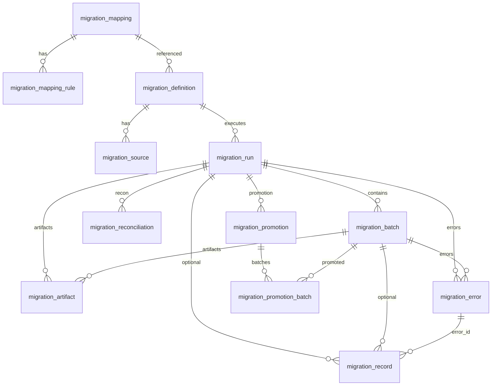

# ETP Migration — Database model

**Source of truth:** Flyway `V1` through `V5`, plus JPA entities under `com.etp.migration.entity`.
**Current Flyway version:** **V5**. Flyway location: `classpath:db/migration`. Hibernate `ddl-auto=validate`.
**Control-plane database (local default):** PostgreSQL database `etp_migration` on **localhost:55433** (`capabilities/etp-migration/docker-compose.yml`). Integration tests use a separate Testcontainers database `etp_migration_test` and must not write to this demo instance.

Related: [ARCHITECTURE.md](ARCHITECTURE.md).

**Implementation status:** Tables below are created by Flyway. Staging and business/demo tables are **not** Flyway-managed.

---

## 1. Database overview

The capability uses one PostgreSQL database for **control-plane** rows (definitions, runs, batches, errors, reconciliation, promotion). Large source files stay on disk (`etp.migration.storage.root`). Staging JSONB rows and business-target rows live in schemas/tables named in definition JSON on the **target** datasource. The local canonical demonstration kept the control plane on `localhost:55433` and staging plus schema `uam` on `localhost:55432`. That split is a workstation arrangement, not a production UAM deployment. See [ARCHITECTURE.md](ARCHITECTURE.md) §28.

V1 file header text mentions “runs up to 30M+ records”. That comment is **not** a capacity claim. See [BENCHMARK_TESTING.md](BENCHMARK_TESTING.md).

---

## 2. Schemas

| Schema | Created by Flyway? | Purpose |
|--------|-------------------|---------|
| `public` (typical search_path) | Yes — control-plane tables | `migration_*` tables |
| `migration_staging` (conventional) | **No** | Operator staging tables such as `address_load` and `entity_load`. Not control-plane tables. |
| `uam_migration_test` (local demo) | **No** | Simulated business table `address` — **not** a platform control-plane table |
| `promo_app` (integration tests) | **No** | Test business table only |

---

## 3–12. Control-plane tables

All timestamps are `TIMESTAMP WITH TIME ZONE` unless noted. JSON documents are `JSONB`.

### 3.1 `migration_mapping`

**Purpose:** Reusable mapping metadata.

| Column | Type | Null | Notes |
|--------|------|------|--------|
| id | UUID | PK | |
| name | VARCHAR(200) | NOT NULL | Unique with version |
| version | VARCHAR(50) | NOT NULL | |
| source_type | VARCHAR(100) | NOT NULL | Free-form |
| target_type | VARCHAR(100) | NOT NULL | Free-form |
| description | VARCHAR(1000) | NULL | |
| configuration | JSONB | NOT NULL default `{}` | |
| status | VARCHAR(30) | NOT NULL default DRAFT | DRAFT, ACTIVE, INACTIVE |
| created_at / created_by | timestamptz / VARCHAR(100) | created_at NOT NULL | |
| updated_at / updated_by | timestamptz / VARCHAR(100) | updated_at NOT NULL | |

**Constraints:** `uk_migration_mapping_name_version`, `ck_migration_mapping_status`.
**Index:** `idx_migration_mapping_status`.

---

### 3.2 `migration_mapping_rule`

**Purpose:** Ordered field rules.

| Column | Type | Null | Notes |
|--------|------|------|--------|
| id | BIGINT IDENTITY | PK | |
| mapping_id | UUID | NOT NULL | FK → `migration_mapping(id)` ON DELETE CASCADE |
| sequence_no | INTEGER | NOT NULL | `> 0`; unique per mapping |
| source_field | VARCHAR(500) | NULL | |
| target_field | VARCHAR(500) | NOT NULL | |
| transformation_type | VARCHAR(50) | NOT NULL | See check constraint |
| transformation_expression | TEXT | NULL | Stored; not executed as a script |
| default_value | TEXT | NULL | |
| configuration | JSONB | NOT NULL default `{}` | Transform-specific |
| mandatory | BOOLEAN | NOT NULL default FALSE | |
| enabled | BOOLEAN | NOT NULL default TRUE | |
| created_at / updated_at | timestamptz | NOT NULL | |

**Constraints:** `uk_mapping_rule_sequence`, `ck_mapping_rule_sequence`, `ck_mapping_rule_transformation_type`
Types: DIRECT, TRIM, UPPERCASE, LOWERCASE, DEFAULT, CONCAT, SPLIT, LOOKUP, REGEX, CONDITIONAL, DATE_FORMAT, CUSTOM.
**Index:** `idx_mapping_rule_mapping`.

---

### 3.3 `migration_definition`

**Purpose:** Migration recipe.

| Column | Type | Null | Notes |
|--------|------|------|--------|
| id | UUID | PK | |
| name / version | VARCHAR(200) / VARCHAR(50) | NOT NULL | Unique together |
| description | VARCHAR(1000) | NULL | |
| source_type / target_type | VARCHAR(50) | NOT NULL | Free-form strings |
| target_entity | VARCHAR(200) | NULL | |
| mapping_id | UUID | NULL | FK → `migration_mapping(id)` (added after mapping table) |
| batch_size | INTEGER | NOT NULL default 10000 | `> 0` |
| load_mode | VARCHAR(30) | NOT NULL default BULK | SINGLE, BATCH, BULK |
| status | VARCHAR(30) | NOT NULL default DRAFT | DRAFT, ACTIVE, INACTIVE |
| configuration | JSONB | NOT NULL default `{}` | target + promotion objects |
| created_at / created_by / updated_at / updated_by | | created_at/updated_at NOT NULL | |

**Constraints:** `uk_migration_definition_name_version`, `ck_migration_definition_batch_size`, `ck_migration_definition_load_mode`, `ck_migration_definition_status`, `fk_migration_definition_mapping`.
**Index:** `idx_migration_definition_status`.

---

### 3.4 `migration_source`

**Purpose:** Source attachment for a definition.

| Column | Type | Null | Notes |
|--------|------|------|--------|
| id | UUID | PK | |
| migration_definition_id | UUID | NOT NULL | FK CASCADE → definition |
| name | VARCHAR(200) | NOT NULL | |
| source_type | VARCHAR(50) | NOT NULL | Free-form |
| configuration | JSONB | NOT NULL default `{}` | provider, objectKey, fileFormat, … |
| enabled | BOOLEAN | NOT NULL default TRUE | |
| created_at / created_by / updated_at / updated_by | | | |

**Indexes:** `idx_migration_source_definition`, `idx_migration_source_enabled`.

---

### 3.5 `migration_run`

**Purpose:** One execution of a definition.

| Column | Type | Null | Notes |
|--------|------|------|--------|
| id | UUID | PK | |
| migration_definition_id | UUID | NOT NULL | FK (no CASCADE) |
| run_number | BIGINT | NOT NULL | Unique per definition |
| idempotency_key | VARCHAR(300) | NULL | Unique per definition when set |
| status | VARCHAR(30) | NOT NULL default CREATED | See check |
| started_at / completed_at | timestamptz | NULL | |
| requested_by | VARCHAR(100) | NULL | |
| source_snapshot | JSONB | NOT NULL | Inspect results, counts, checksum |
| configuration_snapshot | JSONB | NOT NULL | |
| total_records … rejected_records | BIGINT | NOT NULL default 0 | Aggregate counters |
| total_batches / completed_batches / failed_batches | INTEGER | NOT NULL default 0 | |
| error_message | VARCHAR(2000) | NULL | |
| created_at / updated_at | timestamptz | NOT NULL | |

**Status check:** CREATED, QUEUED, RUNNING, PAUSED, COMPLETED, COMPLETED_WITH_ERRORS, FAILED, CANCEL_REQUESTED, CANCELLED.

**Indexes:** definition, status, created_at DESC, (status, started_at).
**Unique:** `uk_migration_run_number`, `uk_migration_run_idempotency`.

---

### 3.6 `migration_batch`

**Purpose:** Restartable processing unit.

| Column | Type | Null | Notes |
|--------|------|------|--------|
| id | BIGINT IDENTITY | PK | |
| migration_run_id | UUID | NOT NULL | FK CASCADE |
| batch_number | INTEGER | NOT NULL | `> 0`; unique per run |
| status | VARCHAR(30) | NOT NULL default PENDING | See check |
| source_locator | JSONB | NOT NULL | startOffset, endOffset, objectKey, … |
| source_checksum | VARCHAR(128) | NULL | |
| record_count and *\_count columns | INTEGER | NOT NULL default 0 | |
| attempt_count | INTEGER | NOT NULL default 0 | |
| worker_id | VARCHAR(200) | NULL | |
| claimed_at / lease_until / next_attempt_at / started_at / completed_at | timestamptz | NULL | |
| error_message | VARCHAR(2000) | NULL | |
| created_at / updated_at | timestamptz | NOT NULL | |

**Status check:** PENDING, CLAIMED, PROCESSING, COMPLETED, COMPLETED_WITH_ERRORS, FAILED, RETRY_PENDING, CANCELLED.

**Indexes:** run, status, queue `(status, next_attempt_at, lease_until)`, worker_id.

---

### 3.7 `migration_artifact`

**Purpose:** Object metadata (not file bytes).

| Column | Type | Null | Notes |
|--------|------|------|--------|
| id | BIGINT IDENTITY | PK | |
| migration_run_id | UUID | NOT NULL | FK CASCADE |
| migration_batch_id | BIGINT | NULL | FK CASCADE |
| artifact_type | VARCHAR(50) | NOT NULL | RAW_SOURCE, STANDARDIZED, TRANSFORMED, MANIFEST, REJECTED, ERROR, RECONCILIATION |
| storage_provider | VARCHAR(50) | NOT NULL | MINIO, S3, AZURE_BLOB, GCS, FILE_SYSTEM — **runtime implements FILE_SYSTEM only** |
| object_key | VARCHAR(2000) | NOT NULL | |
| file_format | VARCHAR(30) | NOT NULL | CSV, JSON, JSONL, PARQUET, AVRO, TEXT, ZIP — **CSV filesystem used** |
| file_size_bytes / record_count | BIGINT | NULL | |
| checksum_algorithm / checksum | VARCHAR(30) / VARCHAR(256) | NULL | |
| created_at | timestamptz | NOT NULL | |

**Indexes:** run, batch, type.

---

### 3.8 `migration_error`

**Purpose:** Persisted processing errors.

| Column | Type | Null | Notes |
|--------|------|------|--------|
| id | BIGINT IDENTITY | PK | |
| migration_run_id | UUID | NOT NULL | FK CASCADE |
| migration_batch_id | BIGINT | NULL | FK CASCADE |
| stage | VARCHAR(50) | NOT NULL | EXTRACT, STANDARDIZE, TRANSFORM, ENRICH, VALIDATE, DEDUPLICATE, LOAD, RECONCILE |
| error_code / error_type | VARCHAR(100) | NULL | |
| source_record_key / source_record_hash | VARCHAR(500) / VARCHAR(128) | NULL | |
| target_entity_key / field_name | VARCHAR(500) | NULL | |
| error_message | VARCHAR(2000) | NOT NULL | |
| error_details | JSONB | NOT NULL default `{}` | |
| retryable | BOOLEAN | NOT NULL default FALSE | |
| created_at | timestamptz | NOT NULL | |

**Indexes:** run, batch, (run, stage), (run, source_record_key).

---

### 3.9 `migration_reconciliation`

**Purpose:** Run-level reconciliation results (one row per type).

| Column | Type | Null | Notes |
|--------|------|------|--------|
| id | UUID | PK | |
| migration_run_id | UUID | NOT NULL | FK CASCADE |
| reconciliation_type | VARCHAR(50) | NOT NULL | COUNT, CHECKSUM, TARGET, FULL |
| source_count … failure_count, difference_count | BIGINT | NOT NULL default 0 | |
| status | VARCHAR(30) | NOT NULL default PENDING | PENDING, RUNNING, PASSED, PASSED_WITH_WARNINGS, FAILED |
| details | JSONB | NOT NULL default `{}` | Includes verificationScope, error codes |
| started_at / completed_at | timestamptz | NULL | |
| created_at | timestamptz | NOT NULL | |

**Unique:** `uk_reconciliation_run_type`.
**Index:** `idx_reconciliation_run`.

---

### 3.10 `migration_record`

**Purpose:** Optional per-record tracking. **Workers do not insert successful rows here.** V1 comments warn against loading tens of millions of success rows.

| Column | Type | Null | Notes |
|--------|------|------|--------|
| id | BIGINT IDENTITY | PK | |
| migration_run_id / migration_batch_id | UUID / BIGINT | NOT NULL | FKs CASCADE |
| source_record_key / source_record_hash / target_entity_key | VARCHAR | NULL | |
| status | VARCHAR(30) | NOT NULL | PROCESSED, SUCCESS, DUPLICATE, VALIDATION_FAILED, ENRICHMENT_FAILED, LOAD_FAILED, REJECTED |
| error_id | BIGINT | NULL | FK SET NULL → migration_error |
| processed_at | timestamptz | NULL | |
| created_at | timestamptz | NOT NULL | |

---

### 3.11 `migration_promotion` (V2)

**Purpose:** Promotion control plane for a run. Separate from run status.

| Column | Type | Null | Notes |
|--------|------|------|--------|
| id | UUID | PK | |
| migration_run_id | UUID | NOT NULL | FK CASCADE |
| status | VARCHAR(30) | NOT NULL default NOT_STARTED | NOT_STARTED, READY, PROMOTING, PROMOTED, PARTIALLY_PROMOTED, PROMOTION_FAILED |
| requested_by | VARCHAR(100) | NULL | |
| requested_at / started_at / completed_at | timestamptz | NULL | |
| total_batches … skipped_batches | INTEGER | NOT NULL default 0 | |
| total_records … skipped_records | BIGINT | NOT NULL default 0 | |
| error_code / error_message | VARCHAR(100) / VARCHAR(2000) | NULL | |
| created_at / updated_at | timestamptz | NOT NULL | |

**Indexes:** run, status.

---

### 3.12 `migration_promotion_batch` (V2)

**Purpose:** Per-execution-batch promotion eligibility and outcome.

| Column | Type | Null | Notes |
|--------|------|------|--------|
| id | BIGINT IDENTITY | PK | |
| promotion_id | UUID | NOT NULL | FK CASCADE |
| migration_run_id | UUID | NOT NULL | FK CASCADE |
| migration_batch_id | BIGINT | NOT NULL | FK CASCADE |
| status | VARCHAR(30) | NOT NULL default NOT_ELIGIBLE | NOT_ELIGIBLE, ELIGIBLE, PROMOTING, PROMOTED, FAILED |
| eligible_record_count … skipped_record_count | BIGINT | NOT NULL default 0 | |
| started_at / completed_at | timestamptz | NULL | |
| error_code / error_message | VARCHAR | NULL | |
| created_at / updated_at | timestamptz | NOT NULL | |

**Unique:** `(promotion_id, migration_batch_id)`.
**Indexes:** promotion, run, batch.

---

## 13. Control-plane relationship summary



---

## 14. Promotion data model

See §3.11–3.12. Promotion does **not** alter `migration_run.status`. Application rows are **not** stored in these tables; only counters and statuses.

---

## 15. Reconciliation data model

See §3.9. `details` JSON holds verification attributes (`verificationScope`, `businessTargetVerified`, `comparisonPerformed`, identity flags, `errorCode`, etc.). Unique per type means repeating reconcile **overwrites** the same four rows.

---

## 16. JSON / configuration columns

| Table | Column | Typical keys |
|-------|--------|----------------|
| migration_definition | configuration | `target.schema`, `target.stagingTable`, `target.mergeStrategy`, `promotion.*` |
| migration_source | configuration | `provider`, `objectKey`, `fileFormat`, `hasHeader`, `delimiter`, `encoding` |
| migration_mapping_rule | configuration | CONCAT/SPLIT/REGEX/CONDITIONAL/DATE_FORMAT options |
| migration_run | source_snapshot | inspect: recordCount, checksum, columns |
| migration_batch | source_locator | startOffset, endOffset, recordCount, objectKey |
| migration_reconciliation | details | engine output |

---

## 17. Audit fields

Control entities generally have `created_at` / `updated_at`; definitions, sources, mappings also `created_by` / `updated_by` (activation sets `updated_by` to `system`). Promotion uses `requested_by` / `requested_at`. There is no separate audit-event table in this module.

---

## 18. Non-control-plane tables (not Flyway)

### Staging (operator / tests)

Example used by tests and demo docs:

```sql
CREATE SCHEMA IF NOT EXISTS migration_staging;
CREATE TABLE IF NOT EXISTS migration_staging.address_load (
  migration_run_id UUID NOT NULL,
  migration_batch_id BIGINT NOT NULL,
  source_record_number BIGINT NOT NULL,
  target_payload JSONB NOT NULL,
  idempotency_key VARCHAR(500),
  loaded_at TIMESTAMPTZ NOT NULL,
  UNIQUE (migration_run_id, migration_batch_id, source_record_number)
);
```

Flat migrations keep that unique key: `UNIQUE (migration_run_id, migration_batch_id, source_record_number)`. The stored flat idempotency value is `runId:batchId:sourceRecordNumber`.

An entity staging table uses a different uniqueness rule. One source row can produce several entities, and the same entity can be loaded from another batch. Batch id is not part of the logical entity identity. The entity idempotency value is `entity-v1:` plus the hex SHA-256 of run id, entity name, and source identity. Flyway does not create this staging table. Use:

```sql
CREATE TABLE IF NOT EXISTS migration_staging.entity_load (
  migration_run_id UUID NOT NULL,
  migration_batch_id BIGINT NOT NULL,
  source_record_number BIGINT NOT NULL,
  target_payload JSONB NOT NULL,
  idempotency_key VARCHAR(500) NOT NULL,
  loaded_at TIMESTAMPTZ NOT NULL,
  UNIQUE (migration_run_id, idempotency_key)
);
```

This table is still operator DDL. It is not a Flyway migration. The control-plane schema does not store the uniqueness rule, and a JSONB column cannot enforce it.

### Local business targets (not Flyway, not production UAM)

`uam_migration_test.address` is an older **flat** illustration table. It is not an ETP control-plane table and is not created by V1–V5.

The completed local canonical demonstration used schema **`uam`** on the target database (`localhost:55432` / `etp_migration`): `location`, `geographic_address`, `geographic_location`, `location_geometry`, and `geographic_sub_address`. Staging for that run is `migration_staging.uam_entity_stage` on the same target instance. The control plane stays on `localhost:55433`. Hosting `uam` on the existing local PostgreSQL instance was a workstation arrangement because a separate UAM container was not available. It is not a production UAM deployment. The column list used locally is `local/uam-target.sql`. That script does not replace a production UAM schema.

Integration tests also use `promo_app.address` similarly for the flat contract.

---

### `migration_identity_allocation` (V4)

**Purpose:** Remember the formatted target id already given to one source identity in one migration run. A retry reads this row and does not reserve another number.

| Column | Type | Null | Notes |
|--------|------|------|--------|
| id | BIGINT IDENTITY | PK | |
| migration_run_id | UUID | NOT NULL | Run that owns the assignment |
| entity_name | VARCHAR(200) | NOT NULL | Logical entity |
| source_identity | VARCHAR(500) | NOT NULL | Source key value |
| target_identity | VARCHAR(500) | NOT NULL | Formatted id |
| sequence_no | BIGINT | NOT NULL | Reserved number for `PREFIX_SEQUENCE` |
| created_at | timestamptz | NOT NULL | |

**Constraints:** `uk_identity_allocation_source` on `(migration_run_id, entity_name, source_identity)`, `uk_identity_allocation_sequence` on `(migration_run_id, entity_name, sequence_no)`.

### `target_identity_allocator` (V5)

**Purpose:** Atomic numeric range reservation. This is runtime state. Configuration does not store a start number.

| Column | Type | Null | Notes |
|--------|------|------|--------|
| namespace | VARCHAR(200) | PK | The configured prefix, such as `LOC-` or `GEO-LOC-` |
| current_value | BIGINT | NOT NULL | Last reserved number. The next range begins at `current_value + 1` |
| floor_established | BOOLEAN | NOT NULL | True after existing target ids for that prefix were considered once |
| updated_at | timestamptz | NOT NULL | |

Two prefixes do not share a row. A reservation locks the row, adds the requested count to `current_value`, and returns the first new number. Concurrent reservations block on that lock, so the ranges do not overlap.

---

## 19. Flyway files

| File | Role |
|------|------|
| `src/main/resources/db/migration/V1__initial_migration_schema.sql` | Control plane through reconciliation + optional `migration_record` |
| `src/main/resources/db/migration/V2__create_migration_promotion.sql` | `migration_promotion`, `migration_promotion_batch` |
| `src/main/resources/db/migration/V3__add_mapping_rule_entity_name.sql` | Nullable `migration_mapping_rule.entity_name` |
| `src/main/resources/db/migration/V4__create_migration_identity_allocation.sql` | `(run, entity, source identity)` → formatted target id, so a retry reuses it |
| `src/main/resources/db/migration/V5__create_target_identity_allocator.sql` | Atomic numeric range reservation, keyed by id prefix |

`migration_identity_allocation` remembers which formatted id was given to a source identity in one run. `target_identity_allocator.current_value` is the last reserved number for that prefix. Configuration supplies `prefix` and `sequenceLength` only. It does not supply a start number. Entity staging uniqueness remains operator DDL. `migration_record` remains the optional unused lineage table from V1.

---

## 20. Test vs demo databases

| Database | Port / location | Used by |
|----------|-----------------|---------|
| `etp_migration` | Host **55433** (etp-migration Compose) | Local control plane |
| `etp_migration` | Host **55432** | Local demonstration target: `migration_staging` and schema `uam`. Not a production UAM deployment |
| `etp_migration_test` | Testcontainers `postgres:17`, ephemeral mapped port | `@SpringBootTest` / `@DataJpaTest` |

Flyway V1–V5 run against whichever DataSource Spring is using. Tests do **not** isolate by truncating the demo database.
