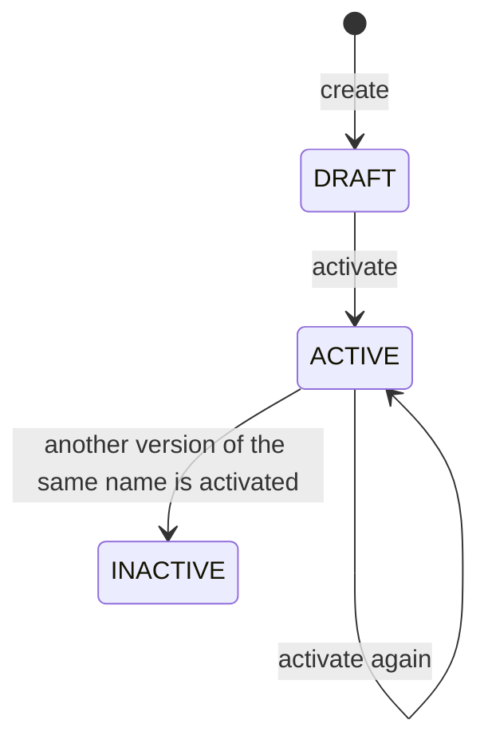
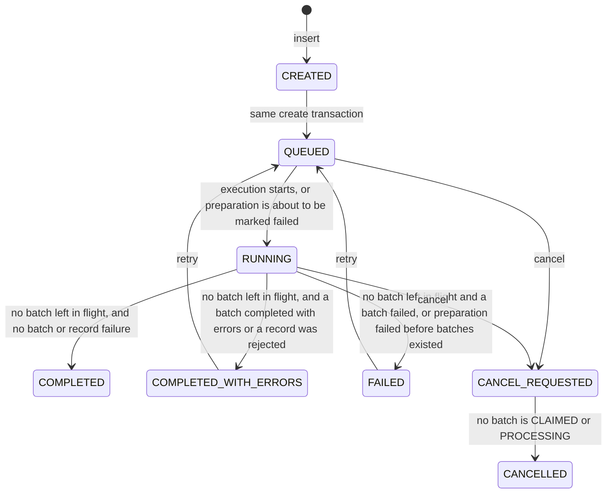
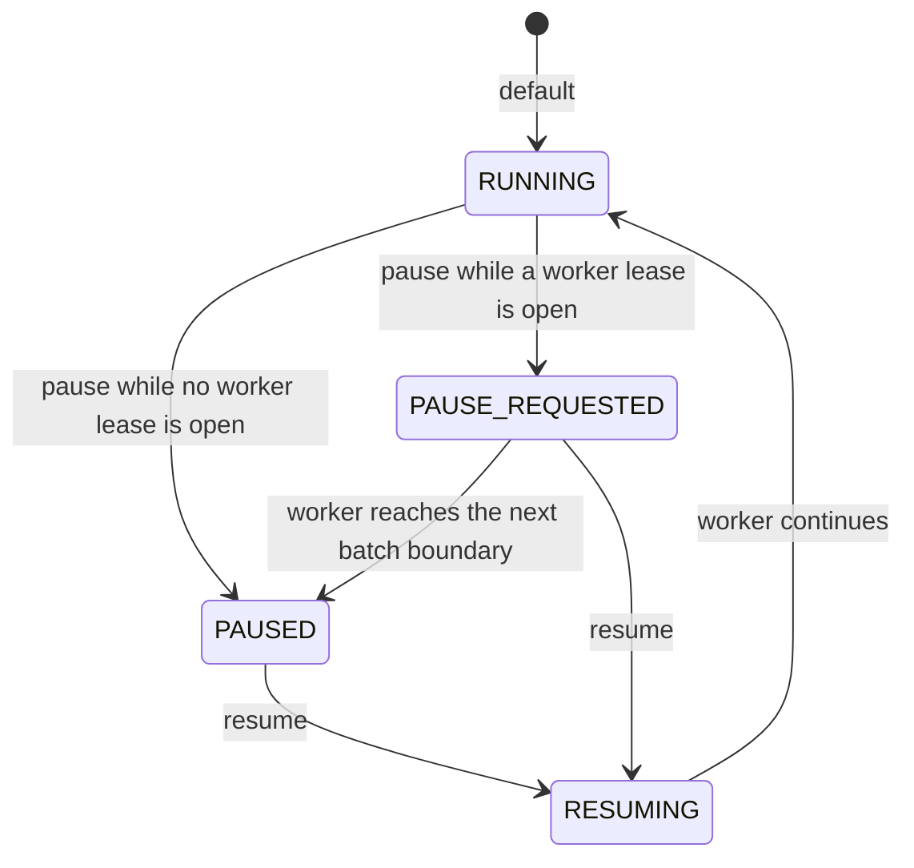
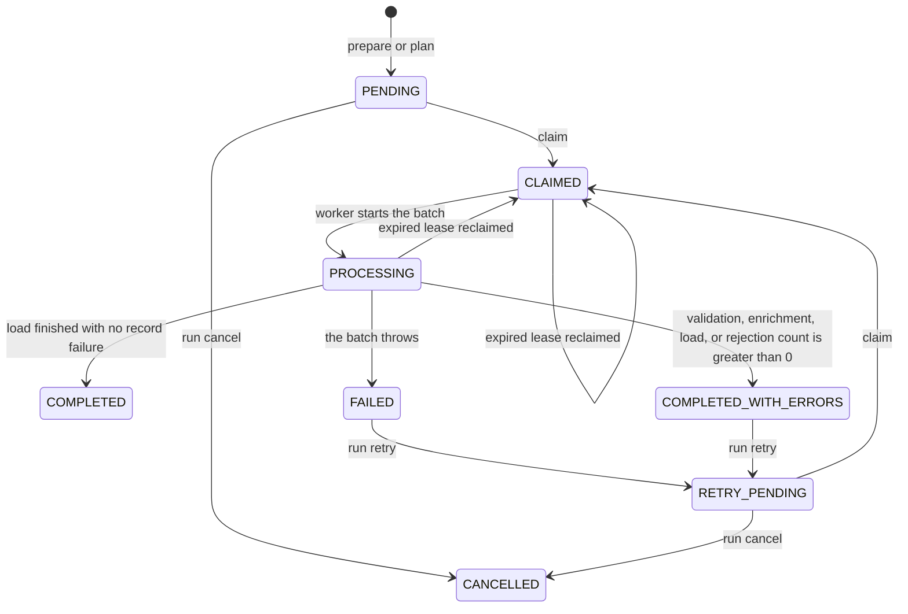
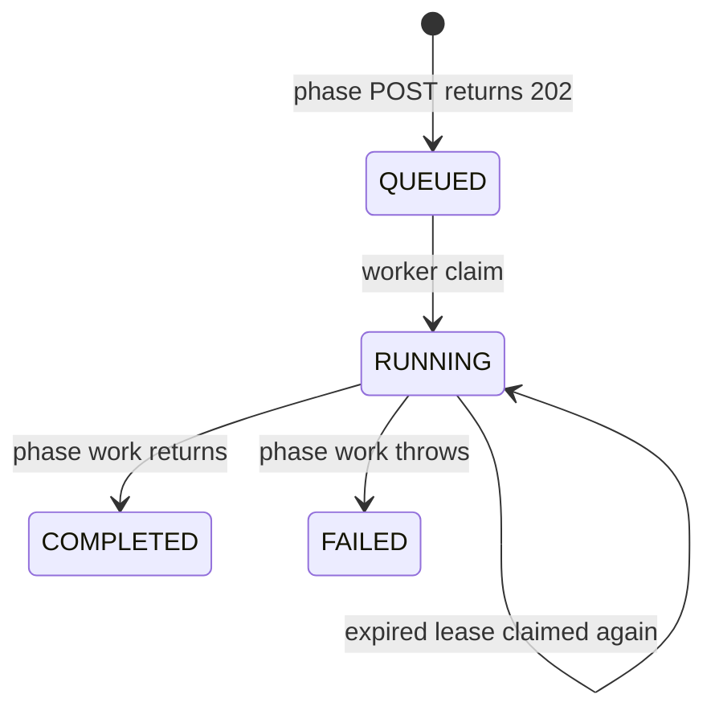
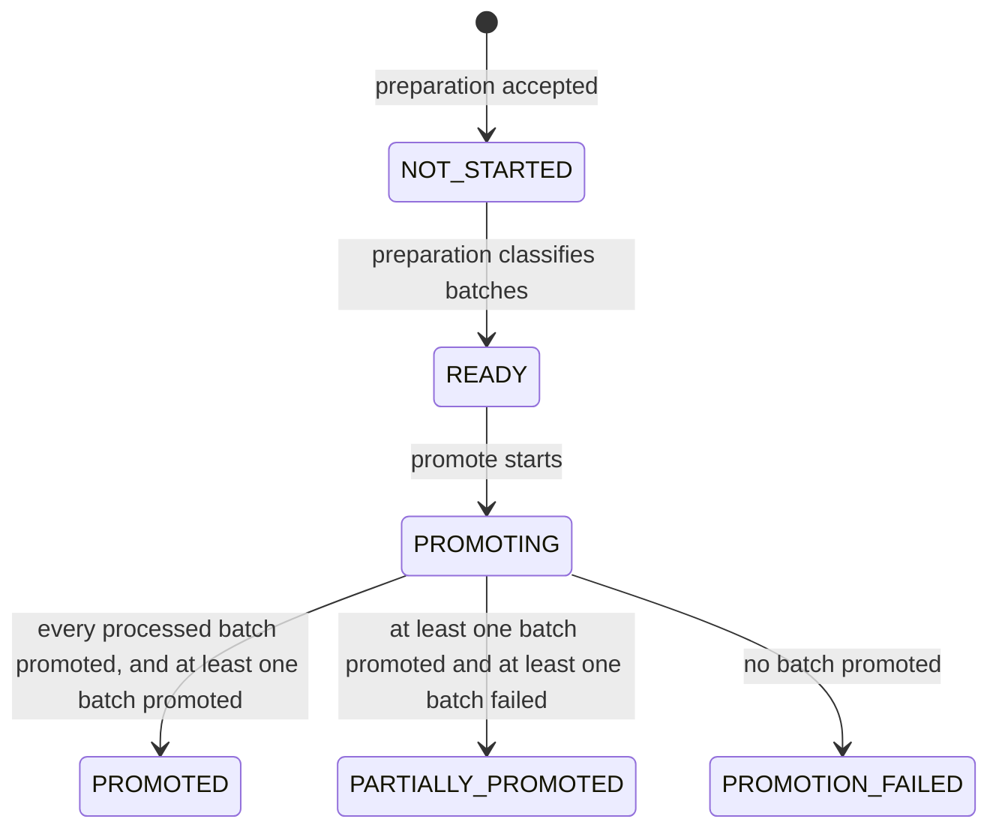
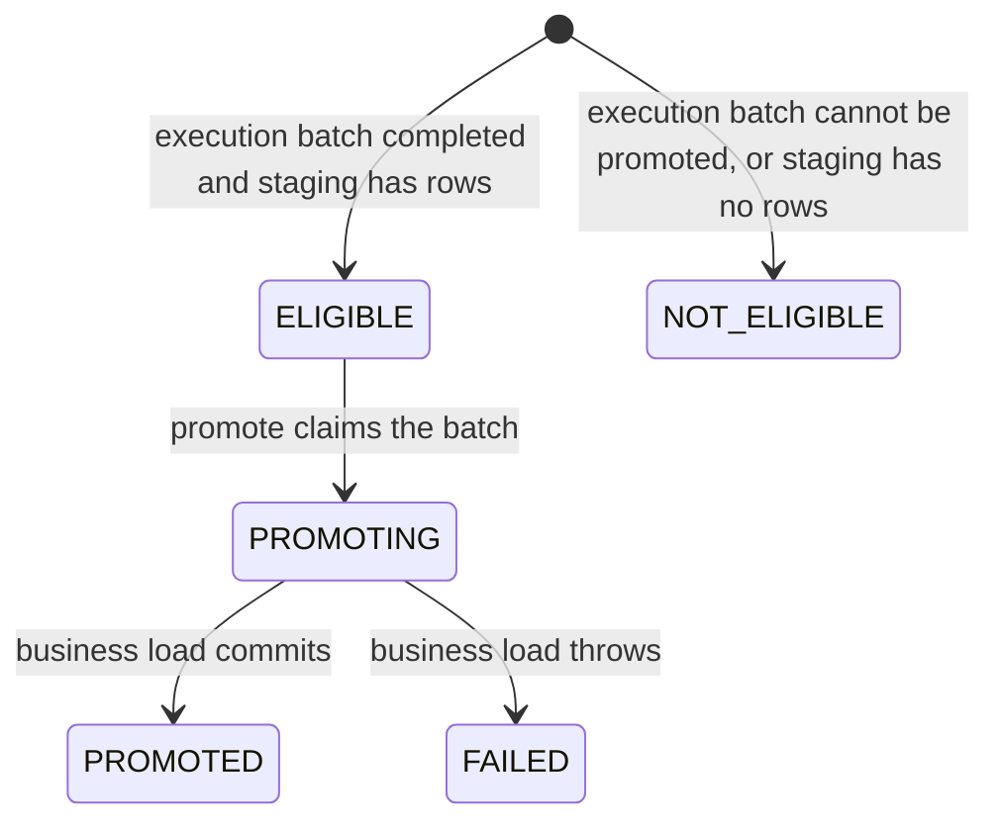

# ETP Migration — Status lifecycles

Audience: operators and engineers reading a run, batch, reconciliation, or promotion status.

This file records the status each control-plane entity can hold and the transitions the current service code performs. Allowed database values are also listed in [DATABASE_MODEL.md](DATABASE_MODEL.md). HTTP commands are in [API_GUIDE.md](API_GUIDE.md). [ARCHITECTURE.md](ARCHITECTURE.md) §13 is the short summary.

A finished execution run is not a promoted run. Reconciliation and promotion are separate requests, and neither one changes `migration_run.status`.

---

## 1. Migration definition

Table: `migration_definition`. Enum: `MigrationConfigStatus`.

| Status | Meaning |
|--------|---------|
| `DRAFT` | Stored by `POST /api/v1/migrations` and by the composite configuration create. A run cannot be created from it. |
| `ACTIVE` | Required by `POST /api/v1/migrations/{id}/runs` and `POST /api/v1/migrations/{id}/execute`. Activation of an already `ACTIVE` definition returns it unchanged. |
| `INACTIVE` | Set on every other `ACTIVE` version of the same name when one version is activated. There is no deactivate endpoint. An `INACTIVE` definition cannot be activated, and a run cannot be created from it. |

There is no update endpoint. `batchSize` is fixed on the definition row. A run copies that value into its batches at prepare time.

`ACTIVE` certifies the definition for execution. It is not an environment flag.

---

## 2. Migration mapping

Table: `migration_mapping`. Enum: `MigrationConfigStatus` (`DRAFT`, `ACTIVE`, `INACTIVE`).

Create stores `DRAFT`. No service method changes that status. Execution loads enabled mapping rules by mapping id and does not require the mapping to be `ACTIVE`.

---

## 3. Migration run

Table: `migration_run`. Enum: `MigrationRunStatus`.

Create writes `CREATED` and then `QUEUED` before the HTTP response. Callers see `QUEUED`. The transition table also allows `CREATED` → `CANCEL_REQUESTED`, but that path is not exposed.

| Status | How it is reached | What happens next |
|--------|-------------------|-------------------|
| `QUEUED` | Create, or retry of `FAILED` / `COMPLETED_WITH_ERRORS`. | Prepare is allowed. A stepwise run stays `QUEUED` through prepare. `POST /execute` sets `background_execution` and a worker claim sets `RUNNING` before preparation. |
| `RUNNING` | Background claim, the first claimed batch, or the preparation-failure recorder passing through `RUNNING` on its way to `FAILED`. | Batches may be claimed. The run stays `RUNNING` while any batch is `PENDING`, `RETRY_PENDING`, `CLAIMED`, or `PROCESSING`. |
| `COMPLETED` | No batch is still in flight, no batch is `FAILED` or `COMPLETED_WITH_ERRORS`, and `rejected_records` is 0. Zero batches finishes as `COMPLETED`. | Terminal for execution. Promotion can be prepared only from this status or `COMPLETED_WITH_ERRORS`. |
| `COMPLETED_WITH_ERRORS` | No batch is still in flight, no batch is `FAILED`, and some batch is `COMPLETED_WITH_ERRORS` or `rejected_records` is greater than 0. | Terminal unless retry is accepted. |
| `FAILED` | A batch is `FAILED` and nothing is in flight, or preparation fails before the source snapshot is stored and no batch is in flight. | Terminal unless retry is accepted. |
| `CANCEL_REQUESTED` | Cancel from `QUEUED` or `RUNNING` while a batch is `CLAIMED` or `PROCESSING`. | The open batch is allowed to finish. New claims require `QUEUED` or `RUNNING`, so no further batch is claimed. Recovery does not select this status. |
| `CANCELLED` | Cancel when nothing is `CLAIMED` or `PROCESSING`, or the completion evaluator after the last in-flight batch leaves those statuses. | Terminal. Retry is rejected. |
| `PAUSED` | Present in the enum and the database check. No service writes it, and the transition table has no edge out of it. | Operator pause uses `control_state`, below. It does not set this status. |

Retry requires `FAILED` or `COMPLETED_WITH_ERRORS`, at least one `FAILED` or `COMPLETED_WITH_ERRORS` batch, and no promotion in `PROMOTING` or `PROMOTED`. It moves the run to `QUEUED` and those batches to `RETRY_PENDING`. `COMPLETED` batches stay `COMPLETED`.

Cancel does not delete staging rows already committed by a finished batch. The batch that is `CLAIMED` or `PROCESSING` commits or rolls back its own load, then the run becomes `CANCELLED`.

`POST /execute` with an idempotency key that already belongs to a terminal run returns that run and does not start it again.

---

## 4. Execution control state

Column: `control_state` on `migration_run` and `migration_promotion`. Enum: `ExecutionControlState`. This is separate from the lifecycle status.

| State | Effect |
|-------|--------|
| `RUNNING` | Normal. A repeated resume returns the current state. |
| `PAUSE_REQUESTED` | The driver finishes the batch already inside `processNextBatch` or promotion batch processing. Recovery does not claim the run. A promotion phase job is also left for the worker that holds it. |
| `PAUSED` | The driver has stopped at a batch boundary. Startup recovery skips the run. Resume is required. `POST /process-next-batch` does not read this column. |
| `RESUMING` | Resume accepted. For a run, the coordinator submits the same run id. For a promotion, it submits the phase job when that job's lease is not open. The worker then stores `RUNNING`. |

Pause and resume of a terminal run are rejected. Pause and resume of a promotion in `PROMOTED`, `PARTIALLY_PROMOTED`, or `PROMOTION_FAILED` are rejected. Run control does not change the promotion row, and promotion control does not change the run row.

---

## 5. Migration batch

Table: `migration_batch`. Enum: `MigrationBatchStatus`.

| Status | Meaning |
|--------|---------|
| `PENDING` | Created by prepare or by explicit batch planning. Not yet claimed. |
| `RETRY_PENDING` | A `FAILED` or `COMPLETED_WITH_ERRORS` batch after run retry. Counters on that batch are cleared. Claim treats it like `PENDING`. |
| `CLAIMED` | A worker owns the row and holds a lease. `attempt_count` increases on each claim, including a reclaim. |
| `PROCESSING` | The worker has started the batch. Staging `COPY` commits or rolls back inside this attempt, before the status moves on. |
| `COMPLETED` | Terminal for that attempt. Retry does not select it. |
| `COMPLETED_WITH_ERRORS` | Terminal for that attempt until retry. The run counts it as both a completed batch and a failed batch. |
| `FAILED` | Terminal for that attempt until retry. |
| `CANCELLED` | Set only from `PENDING` or `RETRY_PENDING` by run cancel. Terminal. |

An expired lease lets another claim take a `CLAIMED` or `PROCESSING` batch back to `CLAIMED`, and only while the run is `QUEUED` or `RUNNING`. After cancel, that reclaim does not run. The transition class also allows `CLAIMED` → `PENDING`, `CLAIMED` → `CANCELLED`, and `PROCESSING` → `CANCELLED`. The cancel and queue services do not write those three edges.

---

## 6. Phase job

Table: `migration_phase_job`. Enum: `PhaseJobStatus`. One job is `RECONCILIATION`, `PROMOTION_PREPARATION`, or `PROMOTION`.

`COMPLETED` and `FAILED` are terminal for that job row. A later POST stores a new job. A repeated POST while a job for that phase and scope is `QUEUED` or `RUNNING` returns the existing job.

A reconciliation result of `FAILED` is stored on `migration_reconciliation` and the phase job still becomes `COMPLETED`. The job becomes `FAILED` only when the phase throws. `outcome` on the job is the reconciliation status or the promotion status. It is not a second copy of `phase_job.status`.

A promotion pause throws before completion. The job stays `RUNNING`, the worker lease is released, and recovery will not claim that promotion job while the promotion `control_state` is `PAUSE_REQUESTED` or `PAUSED`.

---

## 7. Reconciliation

Table: `migration_reconciliation`. Enum: `ReconciliationStatus`. One row per run and type: `COUNT`, `CHECKSUM`, `TARGET`, `FULL`.

The check constraint allows `PENDING`, `RUNNING`, `PASSED`, `PASSED_WITH_WARNINGS`, and `FAILED`. The persist path writes only the last three. `GET /reconciliation` reports `PENDING` when no `FULL` row exists yet. The service does not store `RUNNING` on this table. In-progress work is the phase job status.

| Stored status | When |
|---------------|------|
| `PASSED` | The checks for that type agree. |
| `PASSED_WITH_WARNINGS` | The type finished with a warning. A checksum comparison that was not performed uses this status. That warning does not fail the run. |
| `FAILED` | The type found a mismatch or a blocking target-verification failure. |

A later reconcile for the same run and type updates the existing row. Reconciliation does not change the run, the batches, or the promotion.

---

## 8. Promotion

Table: `migration_promotion`. Enum: `PromotionStatus`.

Prepare requires the run to be `COMPLETED` or `COMPLETED_WITH_ERRORS`, no batch in `CLAIMED`, `PROCESSING`, or `RETRY_PENDING`, a PostgreSQL target, promotion enabled, and at least one reconciliation row. The reconciliation status is not checked.

| Status | Meaning |
|--------|---------|
| `NOT_STARTED` | Row reserved when preparation is accepted. The worker then classifies batches. |
| `READY` | Batches have been classified. Promote can start. A repeated prepare returns this row. |
| `PROMOTING` | Promote has started. A second promote resumes `ELIGIBLE` and `PROMOTING` batches. Pause leaves this status in place and changes `control_state`. |
| `PROMOTED` | At least one promotion batch is `PROMOTED` and none is `FAILED`. Another prepare returns this row. Run retry is blocked. |
| `PARTIALLY_PROMOTED` | At least one promotion batch is `PROMOTED` and at least one is `FAILED`. A later prepare may insert a new promotion for batches that are not already `PROMOTED`. |
| `PROMOTION_FAILED` | The completion count found no `PROMOTED` batch. That includes a promotion whose batches were all `NOT_ELIGIBLE`. A later prepare may insert a new promotion. |

Flyway V10 allows one `NOT_STARTED`, `READY`, or `PROMOTING` promotion per run. Promote does not change `migration_run.status`.

---

## 9. Promotion batch

Table: `migration_promotion_batch`. Enum: `PromotionBatchStatus`.

Prepare chooses the first status:

| Condition | Status written |
|-----------|----------------|
| Execution batch is `COMPLETED` or `COMPLETED_WITH_ERRORS`, and the staging count for that batch is greater than 0 | `ELIGIBLE` |
| Execution batch is anything else, or the staging count is 0 | `NOT_ELIGIBLE` |
| That execution batch already has a `PROMOTED` promotion-batch row on an earlier promotion | No new row. The response shows `PROMOTED` and the records are skipped. |

`NOT_ELIGIBLE` stays `NOT_ELIGIBLE`. Promote selects `ELIGIBLE` rows, and a resume also selects rows left in `PROMOTING`. A failed business load sets `FAILED` and does not roll back promotion batches already stored as `PROMOTED`. There is no direct retry of a `FAILED` promotion batch. A new promotion, after `PARTIALLY_PROMOTED` or `PROMOTION_FAILED`, classifies the execution batches again and skips execution batches that already have a `PROMOTED` promotion batch.

---

## 10. Values that are not a lifecycle

### `migration_record.status`

Enum: `MigrationRecordStatus` (`PROCESSED`, `SUCCESS`, `DUPLICATE`, `VALIDATION_FAILED`, `ENRICHMENT_FAILED`, `LOAD_FAILED`, `REJECTED`).

The table and check constraint exist. The current batch worker does not insert `migration_record` rows. Record results are counters on the batch and the run, plus `migration_error` rows. The in-memory processor returns `SUCCESS`, `VALIDATION_FAILED`, or `REJECTED` for one source record. Those values do not move through a stored state machine.

### `migration_error.stage`

Enum: `MigrationStage` (`EXTRACT`, `STANDARDIZE`, `TRANSFORM`, `ENRICH`, `VALIDATE`, `DEDUPLICATE`, `LOAD`, `RECONCILE`, `PROMOTE`).

This labels where an error was recorded. It is not a status and it has no transitions.

### Parent identity

`ParentIdentityStatus` is `RESOLVED` or `UNRESOLVED` for one lookup during entity execution. It is not stored as an entity status.
